# FormWind

**Türkçe** | [English](README.en.md)

**Mevcut WinForms uygulamanızı yeniden yazmadan modernleştirin:** standart kontrollerle ve Krypton Toolkit ile çalışan, Tailwind tarzı bir stil katmanı. Kontroller değişmez; bir hazır görünüm (Fluent, Ant Design, Material) seçip `AutoStyle`'ı açmak formu class yazmadan giydirir, gerektiğinde kontrol başına class eklenir.

Forma bir `TailwindProvider` bırakın; her kontrolün property penceresinde `Classes` alanı belirir:

```
btnSave  →  Classes: "bg-blue-600 text-white px-4 py-2 rounded-md font-bold hover:bg-blue-700"
```

- Hedefler: .NET Framework 4.7.2+ ve .NET 8+ (`net472`, `net8.0-windows`); testler .NET 9 ve 10'da da çalışır
- Çekirdek paketin .NET dışında bağımlılığı yok (`net472` için yalnızca `System.Text.Json`)
- Durum varyantları: `hover:`, `focus:`, `active:`, `disabled:`, `checked:`, `dark:` ve birleşimleri (`dark:hover:`)
- Flex ve grid yerleşimi (`flex`, `gap-4`, `justify-between`, `flex-1`, `w-1/2`, `grid-cols-3`, `col-span-2`)
- Bileşen class'ları (`btn-primary`, `card`) ve JSON tema dosyası
- Hazır görünümler (Tailwind, Fluent, Ant Design, Material) ve class yazmadan stillendiren `AutoStyle`
- Yuvarlak köşeleri antialias çizen `TwButton`, `TwPanel`, `TwTextBox`
- Koyu temada native kaydırma çubukları ve ipuçları da koyulaşır
- WCAG kontrast denetimi (`TwContrast`) ve Windows Yüksek Karşıtlık desteği
- Krypton Toolkit entegrasyonu (`FormWind.Krypton`): Krypton kontrollerinde class'lar ve temayı izleyen Krypton paleti
- Gerçek uygulamalarda kaynak koduna dokunmadan deneme aracı (`tools/run-harness.ps1`)

| Açık tema | Koyu tema |
| --- | --- |
|  | 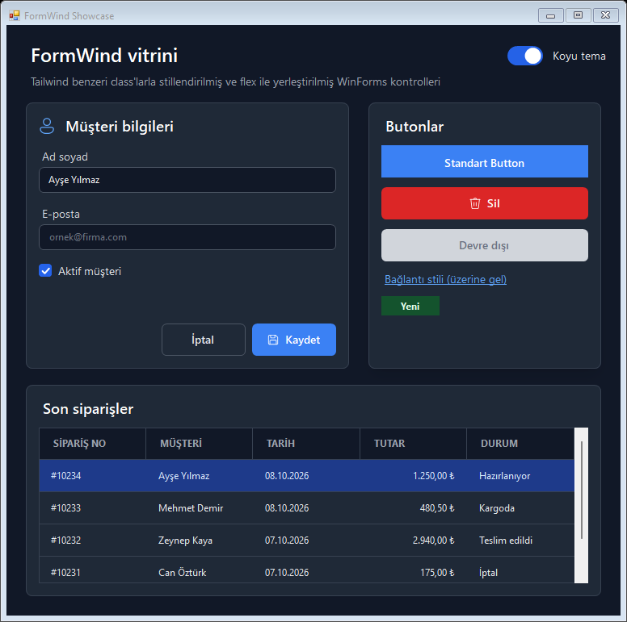 |

## FormWind ne zaman uygun?

| Durum | Öneri |
| --- | --- |
| Mevcut bir WinForms uygulamasını yeniden yazmadan modernleştirmek | FormWind: standart kontroller olduğu gibi kalır; `AutoStyle` ve bir hazır görünümle class yazmadan başlanır, gerektiğinde kontrol başına class eklenir. |
| Krypton Toolkit kullanan bir uygulama | FormWind + `FormWind.Krypton`: Krypton'un ribbon, docking ve gezgin bileşenleri yerinde kalır, palet temayı izler. |
| Koyu tema, tutarlı renkler, erişilebilirlik (kontrast, High Contrast, UI Automation) | FormWind. |
| Ribbon, docking, scheduler, rapor, gelişmiş grid gibi ağır bileşenler | Bunları Krypton'dan ya da kullandığınız kontrol paketinden alın; FormWind onların yanında standart kontrolleri stiller. |
| Tamamen yeni, çapraz platform bir uygulama | WinForms yerine Avalonia, WPF ya da web tabanlı bir arayüz daha uygun olabilir. |

## Hızlı başlangıç

1. Paketi ekleyin (FormWind önizlemedeyken `dotnet add package FormWind --prerelease`) ya da `src/FormWind` projesine proje referansı verin.
2. `Program.Main` içinde, formlar açılmadan önce temayı yükleyin (dosya yoksa varsayılan tema kullanılır):

   ```csharp
   TwTheme.Current = TwTheme.LoadIfExists(Path.Combine(AppDomain.CurrentDomain.BaseDirectory, "tw.config.json"));
   ```

   Paket, proje klasöründeki `tw.config.json` dosyasını çıktı ve yayın klasörüne kendisi kopyalar (tek dosyalık yayında exe'nin yanında kalır; `<FormWindCopyTheme>false</FormWindCopyTheme>` kapatır). .NET Framework uygulamalarında derleme yönlendirmelerini (`AutoGenerateBindingRedirects`) paket kendisi açar, eski biçimli projelerde de. Uygulama `app.config`'ini başka bir yerden alıyorsa (KeePass: `..\Ext\KeePass.exe.config`) derleme bunu `FW100` uyarısıyla bildirir; `<AppConfig>` ile o dosyayı gösterin, yoksa yönlendirmeler uygulamanın ayarları olmayan yeni bir dosyaya yazılır. Paketi yerelde aynı sürümle yeniden paketlerseniz NuGet önbellekteki eski kopyayı kullanır; her denemede sürümü artırın.

3. Toolbox'tan `TailwindProvider`'ı forma sürükleyin. Görünmüyorsa Toolbox → sağ tık → **Choose Items** → `FormWind.dll`.
4. Kontrolleri seçip `Classes on tailwindProvider1` alanını doldurun. Designer şunu üretir:

   ```csharp
   this.tailwindProvider1.SetClasses(this.btnSave, "btn-primary");
   ```

5. Koyu tema: `tailwindProvider1.DarkMode = true;`

### Mevcut bir uygulama: tek satır

Formları tek tek değiştirmeden bütün uygulamayı stillemek için `Program.Main`'de, ilk form oluşturulmadan önce:

```csharp
Application.EnableVisualStyles();
Application.SetCompatibleTextRenderingDefault(false);
TwAutoTheme.Install();                 // tw.config.json'ı yükler, açılan her forma AutoStyle'lı bir sağlayıcı verir
TwAutoTheme.DarkMode = true;           // bütün formlar; ya da TwAutoTheme.FollowWindowsTheme = true
```

- Form, `Load` olayından sonra ve görünmeden önce (`WM_SHOWWINDOW`) stillenir; stilsiz görünmez. Sağlayıcı formla birlikte dispose edilir.
- Kendi sağlayıcısı olan formlar (formda `TailwindProvider` tipinde bir alan, örn. Designer'da eklenen) ona bırakılır. Yalnızca üst düzey formlar sağlayıcı alır; MDI çocukları ve kontrol olarak gömülen formlar ebeveynlerinin sağlayıcısıyla stillenir.
- Başka UI iş parçacıklarında açılan formlar bir arka plan denetimiyle bulunur; o iş parçacığının ilk formu stillenmeden önce bir an görünebilir, sonrakiler görünmeden stillenir.
- `TwAutoTheme.Filter = f => f is not LogForm;` formları dışarıda bırakır. `TwAutoTheme.FormAttached` olayında tek tek kontrollere kendi class'larını verin (`e.Provider.SetClasses(…)`). `TwAutoTheme.GetProvider(form)` formun sağlayıcısını, `Uninstall()` özgün görünümü geri verir.
- Önce dönüştürücünün `--audit` taramasını çalıştırın (bkz. Araçlar): kodda atanan renkler, kendi çizen kontroller gibi elle bakılacak yerleri listeler.
- KeePass 2.61.1'de: elle yazılan 44 satırlık yardımcı sınıf ve pencere yöneticisine eklenen çağrı yerine 1 satır. Koyu tema menüsü dahil entegrasyon 17 satır; elle düzeltme olarak grup ağacındaki iki `ResetBackColor()` kaldı.

### WPF ile birlikte

FormWind WPF uygulamalarındaki WinForms kontrolleriyle de çalışır (net472 ve .NET 8+ ile denendi, `WpfInteropTests`):

- **WPF içinde WinForms (`WindowsFormsHost`):** sağlayıcının `ContainerControl`'ü bir `UserControl` olabilir (form gerekmez); AutoStyle, `FollowParentBackColor`, koyu tema ve kontrast denetimi çalışır. WPF penceresi DPI'ı farklı bir monitöre geçince gömülü kontroller yeni ölçekle yeniden stillenir; Tab ile WinForms kontrolleri arasında gezinmede klavye odağı (focus-visible) ve odak işaretleri doğru gösterilir.
- **WinForms içinde WPF (`ElementHost`):** FormWind `ElementHost`'a bileşen vermez ve içindeki WPF içeriğine dokunmaz; formun zeminini kopyalamışsa sayfanın zeminini izler. Kontrast denetimi `ElementHost`'u metin taşıyan bir kontrol saymaz (içindeki WPF yazısını göremez). WPF içeriğinin renkleri WPF tarafının işidir.
- **WPF'ten açılan WinForms formları:** `TwAutoTheme.Install()` modal (`ShowDialog`) ve modeless (`Show`) formları görünmeden stiller; kanca mesaj döngüsünden bağımsızdır. Renk geçişleri, hover takibi ve sistem ayarı değişimleri (yüksek karşıtlık, metin boyutu, tema) WPF'in Dispatcher'ında da çalışır. Modeless WinForms formunda klavye (Tab, kısayollar) için WinForms'un kendi gereği olan `WindowsFormsHost.EnableWindowsFormsInterop()`'u çağırın.
- **Kurulum:** WPF uygulaması WinForms'un görsel stillerini açmaz; WinForms kontrolleri oluşturulmadan önce `System.Windows.Forms.Application.EnableVisualStyles()` çağırın. Yoksa ListView grupları ve temalı başlıklar çizilmez, FormWind'in koyu liste başlığı (`DarkMode_ItemsView`) da çalışmaz.
- **Koyu tema köprüsü:** WPF tarafı kendi renklerini değiştirir; WinForms tarafı için tek anahtar `TwAutoTheme.DarkMode`'dur. Gömülü kontrollerin sağlayıcıları onu izler:

  ```csharp
  void SetDark(bool dark)
  {
      Background = dark ? darkBrush : lightBrush;   // WPF tarafı
      TwAutoTheme.DarkMode = dark;                  // WPF'ten açılan WinForms formları
  }
  // WindowsFormsHost içindeki UserControl'ün sağlayıcısı:
  provider.DarkMode = TwAutoTheme.DarkMode;
  TwAutoTheme.DarkModeChanged += (_, _) => provider.DarkMode = TwAutoTheme.DarkMode;
  ```

  Windows'un açık/koyu ayarını izlemek için `TwAutoTheme.FollowWindowsTheme = true`.
- WPF uygulamalarında WinForms kontrolleri GDI+ ile çizer (`UseCompatibleTextRendering`, `SetCompatibleTextRenderingDefault` çağrılmadığından); FormWind'in yeniden çizdiği devre dışı yazılar da GDI+ ile ölçülür. Önceden %125'te devre dışı onay kutusunun yazısı iki satıra bölünüyordu.

### Proje şablonu

`FormWind.Templates` paketi hazır ekranlarla bir uygulama oluşturur: giriş (doğrulamalı alanlar), liste–detay (aranabilir `TwDataList` ve ayrıntı kartı) ve ayarlar; açık/koyu tema anahtarı formlar arasında paylaşılır. Şablon metinleri İngilizcedir.

```bash
dotnet new install FormWind.Templates
```

```bash
dotnet new formwind-app -n MyApp --Framework net8.0-windows --Preset fluent --Krypton true
```

`--Framework`: `net8.0-windows` (varsayılan), `net9.0-windows`, `net10.0-windows`, `net472`; `--Preset`: `tailwind` (varsayılan), `fluent`, `antd`, `material` (bkz. [Hazır görünümler](#hazır-görünümler-ve-autostyle)); `--Palette`: `v3` (varsayılan), `v4`; `--Krypton true`: `FormWind.Krypton` paketini ekler, `KryptonApplier`'ı kaydeder ve Krypton paletini ana formun temasına bağlar (bkz. [Krypton Toolkit](#krypton-toolkit)); `--FormWindVersion`: paket sürümü (varsayılan: şablon paketiyle aynı sürüm). Önizleme sürümü için kurulumda sürümü açıkça verin: `dotnet new install FormWind.Templates::0.1.4-preview.1`. Formlar Designer'sız, kodla kurulur ve `AutoScaleMode.Dpi` kullanır; `net472` projesi PerMonitorV2 için manifest ve App.config ile gelir (bkz. [.NET Framework'te kurulum](#net-frameworkte-kurulum)). CI şablonu her çalışmada üç biçimde (varsayılan; `net472` ve `v4`; `--Krypton true` ve `material`) üretip derler.

## Hazır görünümler ve AutoStyle

Class yazmadan başlamak için bir hazır görünüm seçip `AutoStyle`'ı açın:

```jsonc
// tw.config.json
{ "preset": "fluent" }   // tailwind (varsayılan), fluent, antd, material
```

```csharp
tailwindProvider1.AutoStyle = true;   // Designer'da: Properties → FormWind → AutoStyle
```

| Tailwind | Fluent | Ant Design | Material |
| --- | --- | --- | --- |
| 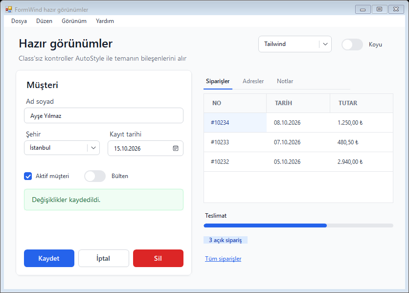 | 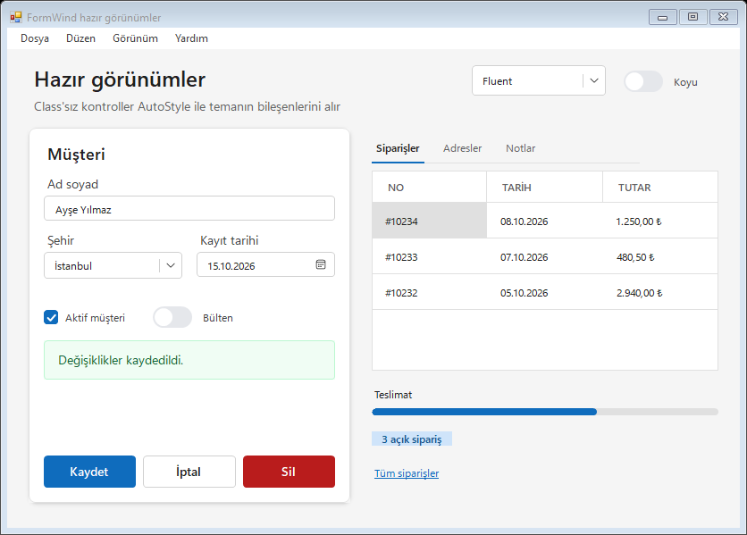 | 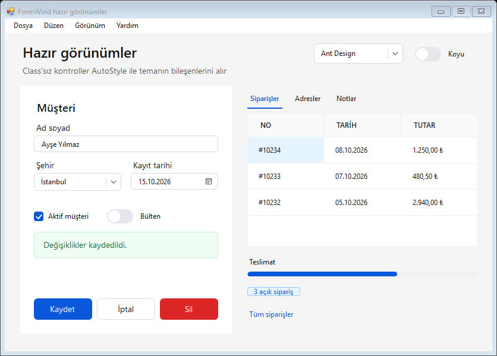 | 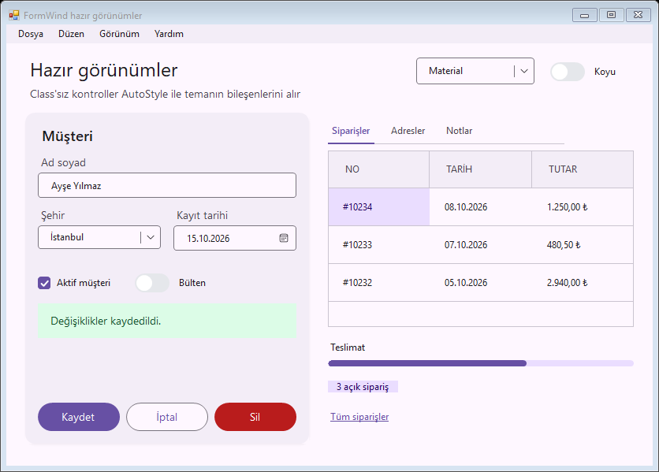 |

**Hazır görünümler** (`TwPreset`, kodda `new TwTheme(TwPreset.Fluent)`) renkleri, fontları ve bileşenlerin şeklini (köşe, boşluk, kalınlık) belirler. Görünümler adı geçen tasarım sistemlerinden **esinlenir**; o sistemlerin kendisi değildir ve logo ya da varlık içermez. Orijinali WCAG AA kontrastını sağlamayan yerlerde renk koyulaştırılır: Ant Design'ın `#1677ff` mavisi beyaz yazıyla 4,1:1 olduğundan dolu butonlar `primary-600` (`#0958d9`) kullanır. Fluent, Windows 11'de Segoe UI Variable ile, Material ise kuruluysa Roboto ile çizilir; ikisi de yoksa Segoe UI kullanılır. Her görünüm açık ve koyu temada kontrast denetiminden ve görsel regresyon testlerinden geçer.

Bütün görünümler **aynı bileşen adlarını** tanımlar; görünüm değiştirmek class'lara ya da Designer.cs'e dokunmadan uygulamanın tamamını yeniden giydirir:

| Grup | Bileşenler |
| --- | --- |
| Butonlar | `btn`, `btn-primary`, `btn-secondary` (dolgulu nötr), `btn-ghost` (kenarlıklı varsayılan), `btn-danger`, `link` |
| Form | `input`, `select` (input ve açılır liste), `field`, `setting` (`TwSettingRow`), `toggle`, `range` (slider, ilerleme) |
| Yüzey ve yazı | `page` (form zemini, yazı rengi ve font), `card`, `sidebar`, `nav-item`, `title`, `muted`, `badge`, `chip`, `chip-primary`, `chip-success`, `chip-warning`, `chip-danger`, `alert-info`, `alert-success`, `alert-warning`, `alert-danger` |
| Veri ve gezinme | `table`, `list`, `tabs`, `tab-control`, `tab-page`, `menu`, `properties` |

**Anlamsal renkler.** Bileşenler `primary`, `surface` (nötr zemin ve yazı), `danger`, `success` ve `warning` renklerini kullanır (`bg-primary-600`, `text-surface-500` …). Varsayılan temada bunlar sırasıyla `blue`, `gray`, `red`, `green` ve `amber`'ın kopyasıdır ve palet sürümünü izler. Tema dosyasında bir rampa tanımlamak (`"colors": { "primary": { "50": "…", …, "950": "…" } }`) bütün bileşenleri birlikte yeniden renklendirir. Kendi class'larınızda da anlamsal adları kullanırsanız onlar da görünümle değişir.

**Görünümü özelleştirme.** Tema dosyası görünümün üzerine uygulanır; yalnızca farklı olanı yazın (örneğin `"preset": "antd"` ile birlikte kendi `primary` rampanız ya da `btn` bileşeniniz). Bir görünümü baştan sona değiştirmek için [`src/FormWind/Presets/`](src/FormWind/Presets) klasöründeki dosyasını `tw.config.json` olarak kopyalayın; dosyalar aynı biçimdedir.

**AutoStyle.** `TailwindProvider.AutoStyle` açıkken `ContainerControl` formundaki kontroller tipine eşlenen bileşeni alır; sonradan eklenen kontroller de. Designer'da `ContainerControl` formun kendisine ayarlanır (ErrorProvider gibi); kodla kurulan formlarda `provider.ContainerControl = this;` yazın.

| Kontrol | Bileşen |
| --- | --- |
| `Form` | `page` |
| `Button`, `TwButton` | `btn-ghost` |
| `TextBox`, `RichTextBox`, `MaskedTextBox`, `TwTextBox`, `TwNumberBox`, `NumericUpDown`, `DomainUpDown` | `input` |
| `ComboBox`, `TwSelect`, `TwDatePicker`, `DateTimePicker` | `select` |
| `CheckBox`, `RadioButton`, `TwCheckBox`, `TwRadioButton`, `TwSwitch` | `toggle` |
| `TwSlider`, `TwProgress`, `ProgressBar` | `range` |
| `TwField` | `field` |
| `DataGridView` | `table` |
| `ListBox`, `ListView`, `TreeView`, `TwDataList`, `TwListBox`, `TwTreeView` | `list` |
| `TwTabStrip` (ve `TwTabControl`'ün şeridi) | `tabs` |
| `TwChip` | `chip` |
| `TwSettingRow` | `setting` |
| `MenuStrip`, `ToolStrip`, `StatusStrip` | `menu` |
| `LinkLabel` | `link-label` |
| `TabControl`, `TabPage` | `tab-control`, `tab-page` |
| `PropertyGrid` | `properties` |

- Etiketler ve paneller listede yoktur: formun yazı ve zemin rengini alırlar.
- **Kopyalanan zeminler.** Mevcut uygulamaların tema motorları formun zeminini çoğu zaman her kontrole açıkça yazar. FormWind formu yeniden boyayınca bu kontroller eski zeminde kalır ve yalnızca yazı rengi alan etiketler okunmaz olur (koyu zemin üzerinde koyu yazı). `AutoStyle`, bir konteyneri ilk gezişinde zemini ebeveyninkiyle aynı olan kontrolleri ebeveyni izlemeye bırakır (`FollowParentBackColor`, varsayılan açık; Designer'da yapılmaz). Sıfırlanınca ebeveynden farklı bir varsayılana dönen kontroller (örn. TextBox) rengini korur; sonradan eklenen kontroller ebeveynin özgün zeminiyle karşılaştırılır. Class'ları kendiniz atıyorsanız aynı işi stillemeden önce `TailwindProvider.InheritCopiedBackColors(form)` yapar.
- Kontrolün kendi class'ları otomatik bileşenin **üzerine** eklenir: `flex-1`, `mt-2` ya da `bg-red-50` görünümü korur. Kendi class'larında bir bileşen adı varsa (`btn-primary`, `card` …) otomatik bileşen kullanılmaz.
- Otomatik class'lar Designer.cs'e yazılmaz; akıllı etikette `AutoStyle: input` olarak görünür ve class oluşturucu onların üzerine yazar.
- Eşleme tema dosyasında değiştirilir: `"autoStyle": { "Button": "btn-primary", "Label": "muted", "KryptonButton": "btn-ghost", "ListView": "" }`. Anahtar tipin kısa adıdır, temel tipler de aranır (`TextBoxBase` tüm metin kutularını kapsar); boş değer o tipi stillemez. Kodda `theme.SetAutoStyle("Button", "btn-primary")`.
- `LinkLabel` `link-label` bileşenini alır: bağlantı dışındaki yazı `text-*`, bağlantılar (`LinkColor`, `ActiveLinkColor`, `VisitedLinkColor`) `accent-*`; devre dışı bağlantı yazı rengiyle zeminin ortasıdır. Kontrast denetimi bağlantı rengini `link` bölümü olarak ölçer.
- İç kontrolleri olan bileşik kontrollerin (`TwTextBox`'ın metin kutusu, `NumericUpDown`, `PropertyGrid`) içine girilmez. `PropertyGrid` kendi renk özellikleriyle stillenir: `bg-*`/`text-*` görünüm, yardım ve komut alanları, `divide-*` aralarındaki çizgiler, `header:` kategori satırları, `selected:` seçili özellik; koyu temada iç kaydırma çubuğu da koyulaşır, koyu kategori satırlarında genişletme işaretleri yazı renginde +/− çizilir.
- Standart `TabControl` renkleri yok saydığından renk veren class'larda sekme şeridini FormWind, Windows'un çiziminin üzerine yeniden çizer (`DrawMode` değişmez; değişimi sayfalardaki bütün kontrollerin handle'larını yeniden oluştururdu): `bg-*`/`text-*` sekmeler, `selected:` seçili sekme, `selected:border-*` seçili sekmenin dış kenarında 2 px çizgi; şeridin boş kısmı ebeveynin, sayfa çerçevesi seçili sayfanın zeminini alır. Uygulamanın kendisi çizdiği (`OwnerDrawFixed`) sekmelere dokunulmaz.
- Standart `ProgressBar` temalı çizildiğinde renk almaz; `accent-*` (çubuk) ya da `fill-*`/`bg-*` (iz) verilince görsel stili kapatılır ve renkler native kontrole gönderilir (düz, klasik çubuk; `Blocks` stili bu sürede `Continuous` olur). Class'lar kaldırılınca tema ve stil geri gelir.

Vitrinde görünümler arasında geçiş yapan bir form vardır: `FormWind.Showcase.exe --presets` (ilk görünüm için `--preset fluent`).

## Class sözlüğü

| Kategori | Kalıp | Örnek | WinForms karşılığı |
| --- | --- | --- | --- |
| Arka plan | `bg-{renk}-{ton}`, `bg-[#hex]` | `bg-blue-600`, `bg-white` | `BackColor` |
| Yazı rengi | `text-{renk}-{ton}` | `text-gray-900` | `ForeColor` |
| Yazı boyutu | `text-xs … text-4xl` | `text-sm` = 14 px | `Font` (px × 0,75 = pt) |
| Yazı stili | `font-thin` … `font-black`, `font-sans`, `font-mono`, `italic`, `underline` | `font-semibold` | `Font` (bkz. [Font kalınlıkları](#font-kalınlıkları)) |
| İç boşluk | `p`, `px`, `py`, `pt`, `pr`, `pb`, `pl` + `-{n}` / `-px` / `-[12px]` | `px-4` = 16 px | `Padding` |
| Dış boşluk | `m`, `mx`, `my`, `mt`, `mr`, `mb`, `ml` + `-{n}` | `mt-2` = 8 px | `Margin` (layout panellerinde) |
| Boyut | `w-{n}`, `h-{n}` | `h-10` = 40 px | `Width`, `Height` |
| Kenarlık | `border`, `border-{0,2,4,8}`, `border-{renk}-{ton}` | `border border-gray-300` | Çizim |
| Köşe | `rounded`, `rounded-{none,sm,md,lg,xl,2xl,3xl,full}`, `rounded-[10px]` | `rounded-md` = 6 px | `Region` veya owner-draw |
| Hizalama | `text-left`, `text-center`, `text-right` | | `TextAlign` |
| Diğer | `cursor-pointer`, `cursor-text`, `hidden`, `visible`, `truncate` | | `Cursor`, `Visible`, `AutoEllipsis` |

- Boşluk birimi 4 px'tir (`spacingUnit` ile değiştirilebilir). Sayılar her kültürde nokta ile yazılır: `p-0.5`.
- Palet: Tailwind v3'ün 22 rengi × 11 tonu (50–950), ayrıca `white`, `black`, `transparent`. Tailwind v4 paleti de seçilebilir (bkz. [Tema dosyası](#tema-dosyası-twconfigjson)).
- Aynı varyant içinde sonra gelen class kazanır: `p-2 px-4` → dikey 8 px, yatay 16 px.
- Tanınmayan class'lar `TailwindProvider.UnknownClasses` olayına (dinleyici yoksa Debug çıktısına) bildirilir. `Theme.SuggestClass("hovr:bg-blu-600")` en yakın tanınan class'ı döndürür (`hover:bg-blue-600`); Debug çıktısı, class düzenleyicisi ve akıllı etiket bu önerileri gösterir.
- [`website/llms.txt`](website/llms.txt), kodlama ajanları için class'ları, bileşenleri ve kuralları özetler (sitenin kökünde yayımlanır).
- Bozuk class'lar uygulamayı düşürmez: `int`'e sığmayan keyfi değerler (`w-[99999999999px]`) ve sıfır boyutlu font (`text-[0px]`) tanınmayan class sayılır. Kendini tekrar tekrar içeren ya da döngü kuran tema bileşenleri bir kez açılır (tekrarlar ayıklanır, sonra gelen class kazanır); döngüyü kapatan ad tanınmayan class olarak raporlanır. Uygulayıcıda çıkan hatalar `StyleError` ile bildirilir ve dışarı taşmaz (`BadInputTests`).
- CSS'te padding kutuyu büyütür; WinForms'ta boyutu sabit (`AutoSize` kapalı) bir buton ya da etikette ise içeriği daraltır. Bu kontrollerde padding, yazı tek satıra sığacak kadar kısılır (örn. 25 px yüksekliğindeki bir butona `btn` verildiğinde `py-2` küçülür). `AutoSize` açık ama kenetlenmiş (`Dock`) kontrollerde kenetlenen eksenin boyutunu ebeveyn belirlediğinden o eksende de kısılır (örn. `Dock = Right` bir AutoSize butonun yüksekliği; Bulk Crap Uninstaller'ın sihirbazında yazı alttan kırpılıyordu). Kontrol büyüyünce, fontu ya da metni değişince yeniden hesaplanır ve yer varsa tam değere döner. Butonun görseli (`Image`, `ImageList`) yazının yanında ya da üstündeyse onun yeri de ayrılır; görsel form yüklenirken atansa da form görünür olunca yeniden ölçülür (KeePass'in görselli "Tools" butonunda yazı "To" olarak kesiliyordu).
- Padding sığdırma fontu küçültemez: sabit boyutlu bir kontrole fontunu büyüten bir class (örn. `btn`'deki `text-sm font-semibold`) verilirse padding sıfıra inse de yazı sığmayabilir; böyle kontrollerde font class'ı vermeyin ya da kontrolü büyütün.
- `hidden` kaldırıldığında FormWind'in gizlediği kontrol yeniden görünür olur.
- **MDI:** `IsMdiContainer` bir formun `bg-*` rengi çocuk pencerelerin arkasındaki alana (`MdiClient`) da verilir; yoksa bu alan sistemin gri rengiyle kalır, koyu temada açık bir boşluk olurdu. Uygulamanın `MdiClient`'a atadığı renk korunur. Büyütülmüş çocuğun menüye eklenen küçült/geri yükle/kapat düğmeleri şeridin yazı rengiyle çizilir. Windows MDI çocuklarının başlık çubuğunu koyu çizmez (klasik çerçeve) ve `MdiClient`'ın çökük kenarı koyu temada açık bir çizgi olarak görünür; ikisi de FormWind'in dışında.
- **Şeride gömülü kutular:** `ToolStripTextBox` ve `ToolStripComboBox` şeridin renderer'ıyla çizilmez; koyu şeritte beyaz kalırlardı. Şeridin yazı rengini ve şeritten türetilen bir zemin (açık şeritte beyaz, koyu şeritte zeminin biraz açığı) alırlar; açılır kutunun çerçevesi ve ok düğmesi de bu renklerle çizilir. Şeridin renderer'ını paylaşan alt menülerdeki kutular ve sonradan eklenenler dahildir. Uygulamanın bu kutulara atadığı renkler korunur.
- **Devre dışı native metin kutuları:** `TextBox` ve `MaskedTextBox` devre dışıyken de class'ların zeminini alır; Windows zemini izler, yazıyı her zaman sistem grisiyle (#6D6D6D) çizer (renk devre dışı bırakılmadan önce, sonra ve gidip gelince ölçüldü). `RichTextBox` ise devre dışıyken zemini yok sayıp sistem zeminini çizer (`EM_SETBKGNDCOLOR` de etkisiz), yazı rengine uyar; koyu temada açık zeminde açık yazı çıkardığından devre dışıyken yalnızca `disabled:` varyantlarının renklerini alır, yoksa Windows'un görünümü (açık zeminde gri yazı) kalır. FormWind'in kendi çizdiği kontroller (`TwTextBox` dahil) bundan etkilenmez.
- **Devre dışı butonlar:** Windows devre dışı düz butonun yazısını `ForeColor` yerine zeminin koyulaştırılmış tonuyla çizer; koyu zeminde yazı görünmez olurdu. FormWind'in stillediği butonlarda yazı, devre dışıyken `disabled:text-*` rengiyle, o yoksa yazı renginin zemine doğru yarı yarıya karıştırılmış tonuyla yeniden çizilir (`TwButton` da aynı kuralı izler). Resimli native butonlarda Windows'un çizimi kalır. Varsayılan `btn-primary`, `btn-ghost` ve `btn-danger` bileşenleri açık ve koyu temada `disabled:` renkleri tanımlar; `disabled:` varyantı `dark:`'tan önceliklidir, bu yüzden kendi bileşenlerinizde koyu tema için `dark:disabled:` de verin.
- Class rengi ebeveynden kalıtılan renkle aynı olsa da kontrole açıkça atanır; ebeveynin rengi sonradan değişince class rengi değişmez.
- Class'lar kaldırıldığında (`SetClasses(control, "")`) renk, font, padding, margin, imleç, görünürlük, köşe ve ToolStrip renderer'ı class'lardan önceki değerlerine döner. Boyutlar (`w-*`, `h-*`) geri alınmaz; yerleşim kontrolü sonradan yeniden boyutlandırmış olabilir.

### Uygulama kodunun atadığı renkler

Class'lar uygulandıktan sonra uygulama kodu bir kontrolün `BackColor` ya da `ForeColor` değerini değiştirirse (örn. bir durum göstergesini yeşile boyamak), FormWind o renk kanalını uygulamaya bırakır: `hover:`, `dark:` ve diğer varyantlar o rengi ezmez. Diğer kanal FormWind'de kalır.

```csharp
tw.SetClasses(lblStatus, "bg-white text-gray-700 dark:bg-gray-800 dark:text-gray-200");
lblStatus.BackColor = Color.LightGreen;   // koyu temaya geçince de yeşil kalır; yazı rengi class'lardan gelir
tw.SetClasses(lblStatus, "bg-red-600 text-white");   // yeni class'lar: arka plan yeniden FormWind'in
```

- Ebeveynden kalıtılan renk değişimleri (örn. form koyu temaya geçti) uygulamanın ataması sayılmaz.
- Kanalı geri almak için farklı class'lar atanmalıdır; `Refresh(control)` yetmez.
- Uygulama yalnızca zemini değiştirip yazı rengini class'lara bırakırsa koyu temada okunmayan bir çift (açık yazı, açık zemin) çıkabilir. [Kontrast denetimi](#kontrast-denetimi) bunu raporlar ve nedenini `Cause = TwContrastCause.KeptBackground` olarak verir.

**Kendi çizen kod.** `CellPainting` işleyicisi ya da owner-draw bir ListView gibi renkleri uygulamanın çizdiği yerlerde class renkleri sağlayıcıdan istenir; sonuç sağlayıcının o anki modunu (koyu tema, yüksek karşıtlık) izler:

```csharp
var selected = tw.GetColors("list", "selected");            // bileşenler ve part'lar açılır
var hover = tw.GetColors("list", "item", TwState.Hover);
var own = tw.GetCurrentColors(lvUploads, "selected");          // kontrolün class'ları ve o anki durumu
e.Graphics.FillRectangle(new SolidBrush(selected.Back ?? SystemColors.Highlight), e.Bounds);
```

## Yerleşim (flex ve grid)

`flex` ya da `grid` class'ı verilen bir **`TwPanel`** çocuklarını kendisi yerleştirir; çocukların `Location`'ı, `Dock` ve `Anchor` değerleri yok sayılır. Standart `Panel` ve `Form`'un yerleşim motoru değiştirilemediğinden flex/grid yalnızca `TwPanel` (ya da `ITwLayoutHost` uygulayan bir konteyner) üzerinde çalışır.

```csharp
// Kart: dikey dizilim, öğeler genişliği doldurur
this.tailwindProvider1.SetClasses(this.pnlCard, "card flex flex-col gap-1");
// Buton satırı: sağa yaslı, 8 px aralıklı
this.tailwindProvider1.SetClasses(this.pnlActions, "flex justify-end gap-2");
// Boşluk doldurucu: kalan alanı kaplar ve buton satırını alta iter
this.tailwindProvider1.SetClasses(this.pnlSpacer, "flex-1");
```

| Konteyner (TwPanel) | Öğe (çocuk kontrol) |
| --- | --- |
| `flex`, `grid`, `block` | `flex-1`, `flex-auto`, `flex-initial`, `flex-none` |
| `flex-row`, `flex-col`, `flex-wrap`, `flex-nowrap` | `grow`, `grow-0`, `shrink`, `shrink-0` |
| `gap-{n}`, `gap-x-{n}`, `gap-y-{n}` | `basis-{n}`, `basis-1/2`, `basis-full`, `basis-auto` |
| `justify-start/end/center/between/around/evenly` | `w-1/2`, `w-full`, `h-full` (oranlar konteynere göre) |
| `items-start/end/center/stretch` | `min-w-{n}`, `max-w-{n}`, `max-w-md` …, `min-h-{n}`, `max-h-{n}` |
| `grid-cols-{1–12}`, `grid-rows-{1–12}` | `self-start/end/center/stretch`, `col-span-{1–12}`, `col-span-full`, `row-span-{1–12}`, `row-span-full`, `m-*` |

CSS'ten farklar:
- Öğelerin "doğal" boyutu Designer'daki `Size`'dır (AutoSize kontrollerde tercih edilen boyut). Boyutu belirtilmemiş öğeler doğal boyutlarının altına küçülmez.
- Öğe aralığı yalnızca `m-*` class'larından gelir; WinForms'un varsayılan 3 px `Margin`'i kullanılmaz.
- Varsayılan `items-stretch`: satırdaki öğeler konteyner yüksekliğine, sütundaki öğeler genişliğine uzar.
- Grid öğeleri CSS'in otomatik yerleştirmesiyle (seyrek) sırayla konur; `row-span-*`'ın kapladığı hücreler atlanır. `grid-rows-N` kabın yüksekliğini N eşit satıra böler (`repeat(N, minmax(0, 1fr))`); `row-span-full` bu açık satırların tümünü kaplar (`grid-rows` yoksa tek satırdır). Diğer satırların yüksekliği içerikten gelir; birden çok satır kaplayan bir öğe sığmazsa eksik yükseklik kapladığı satırlara eşit dağıtılır. `col-start-*`, `row-start-*`, `grid-flow-*`, `margin: auto` ve `order-*` yok.
- Öğeler satırın çapraz boyutunu aşmaz (CSS'te taşabilir; WinForms'ta taşan kısım kesilip kaybolurdu). Daralan Label'larda `truncate` "…" gösterir.
- `TwPanel`'in içeriği kenarlığın içinde başlar (CSS kutu modeli); `AutoScroll` panelde genişlik görünen alandan alınır ve dikey kaydırma çubuğunun yeri önceden ayrılır.
- `AutoSize = true` olan flex `TwPanel` içeriğine göre boyutlanır (grid için henüz yok).
- Responsive varyantlar (`sm:`, `md:` …): bkz. [Animasyonlar ve responsive varyantlar](#animasyonlar-ve-responsive-varyantlar).

### Windows metin boyutu

Windows'un **Metin boyutu** ayarı (Ayarlar → Erişilebilirlik → Metin boyutu, %100–225) sistem fontlarını, dolayısıyla WinForms'un varsayılan fontunu büyütür. `text-*` boyutları bu oranla çarpılır (tarayıcıdaki `rem` gibi); önceden bir `text-sm` class'ı kullanıcının büyüttüğü yazıyı 14 px'e geri küçültüyordu. Boşluklar ve boyutlar çarpılmaz; sabit boyutlu buton ve etiketlerde iç boşluk yazı sığacak kadar kısılır, yazının boşluksuz da sığmadığı sabit kontroller uygulamanın yerleşimidir (`AutoSize` ya da `TwPanel` flex yerleşimi kullanın). Ayar çalışırken değişirse stiller yeniden uygulanır. Kapatmak için `TwFonts.RespectTextScale = false` (bütün sağlayıcılar için). Testler ayarı benzetimle sınar (`TextScaleTests`, %150 ve %225).

## Font kalınlıkları

`font-thin` (100), `font-extralight` (200), `font-light` (300), `font-normal` (400), `font-medium` (500), `font-semibold` (600), `font-bold` (700), `font-extrabold` (800), `font-black` (900).

WinForms yalnızca normal ve kalın stilleri bilir; ara kalınlıklar Windows'ta **ayrı font aileleri** olarak kuruludur. FormWind kalınlığı bu ailelere CSS'in eşleme kuralıyla çözer:

| Class | Segoe UI'da kullanılan |
| --- | --- |
| `font-thin`, `font-extralight`, `font-light` | Segoe UI Light |
| `font-normal`, `font-medium` | Segoe UI |
| `font-semibold` | Segoe UI Semibold |
| `font-bold` | Segoe UI + kalın stil |
| `font-extrabold`, `font-black` | Segoe UI Black |

Başka bir font için ağırlık aileleri tema dosyasında tanımlanır; kurulu olmayan aile atlanır ve en yakın kurulu kalınlık seçilir:

```jsonc
"fontWeights": { "Inter": { "300": "Inter Light", "600": "Inter SemiBold" } }
```

## İkonlar

Windows'la gelen ikon fontu kullanılır: Windows 11'de **Segoe Fluent Icons**, Windows 10'da **Segoe MDL2 Assets** (Windows 7/8'de ikon çizilmez).

- **`TwIcon`**: tek başına ikon. `IconName` property'si Designer'da açılır listeden seçilir. Renk `text-*`, boyut font boyutuyla verilir: `text-xl` = 20×20 px. AutoSize varsayılan olarak açıktır.
- **`TwButton.IconName`**: metnin yanında ikon. `IconPosition` (Left/Right) ve `IconSpacing` (varsayılan 8 px) ayarlanabilir.

```csharp
this.icoCustomer.IconName = "user";
this.tailwindProvider1.SetClasses(this.icoCustomer, "text-xl text-blue-600 dark:text-blue-400");
this.btnSave.IconName = "save";
```

Yerleşik adlar: `arrow-down`, `arrow-left`, `arrow-right`, `arrow-up`, `attach`, `bell`, `calculator`, `calendar`, `camera`, `cart`, `check`, `chevron-down`, `chevron-left`, `chevron-right`, `chevron-up`, `clock`, `copy`, `cut`, `download`, `edit`, `error`, `eye`, `eye-off`, `file`, `filter`, `flag`, `folder`, `folder-open`, `fullscreen`, `globe`, `grid`, `heart`, `heart-filled`, `help`, `history`, `home`, `image`, `info`, `key`, `link`, `list`, `location`, `lock`, `mail`, `map-pin`, `menu`, `minus`, `more`, `paste`, `phone`, `pin`, `plus`, `power`, `print`, `redo`, `refresh`, `save`, `search`, `send`, `settings`, `share`, `shield`, `sort`, `star`, `star-filled`, `sync`, `tag`, `trash`, `undo`, `unlock`, `upload`, `user`, `users`, `warning`, `x`, `zoom-in`, `zoom-out`.

Fontun herhangi bir glyph'i kod noktasıyla da kullanılabilir (`IconName = "#E8A5"`). Ek adlar ve farklı bir ikon fontu tema dosyasından verilir:

```jsonc
"iconFont": "Segoe Fluent Icons",
"icons": { "invoice": "E8A5" }
```

Glyph'ler font metriklerine güvenilmeden, gerçek mürekkep sınırlarına göre ortalanarak çizilir (ikon fontlarının satır yüksekliği glyph boyutuyla uyuşmaz).

### SVG ikonlar

Lucide, Heroicons, Tabler gibi tek renkli SVG setleri de kullanılabilir. `icons` değeri bir `.svg` yolu (tema dosyasına göre) ya da doğrudan `<svg>` metni olabilir; kodda `TwTheme.SetSvgIcon(ad, svg)`:

```jsonc
"icons": {
  "invoice": "E8A5",                         // ikon fontu glifi
  "package": "Assets/icons/package.svg",     // dosya
  "dot": "<svg viewBox='0 0 24 24'><circle cx='12' cy='12' r='4'/></svg>"
}
```

SVG ikon aynı adlı glifi ezer, böylece yerleşik ikonlar (`check`, `chevron-down` …) tüm kontrollerde (`TwButton`, `TwSelect`, takvim, grid) tek tek değiştirilebilir. Renk her zaman çizildiği yerin metin rengidir (`currentColor` gibi). Desteklenenler: `path` (tüm komutlar, yaylar dahil), `circle`, `ellipse`, `rect` (`rx`), `line`, `polyline`, `polygon`, `g`; `fill`, `stroke`, `stroke-width`, `stroke-linecap`, `stroke-linejoin`. Gradient, maske, metin ve CSS desteklenmez.

## Kenarlık, gölge ve focus halkası

| Class | Etki |
| --- | --- |
| `border-t`, `border-b-2`, `border-x`, `border-y` | Kenar bazlı kenarlık (köşesiz çizilir) |
| `shadow-sm`, `shadow`, `shadow-md`, `shadow-lg`, `shadow-xl`, `shadow-2xl`, `shadow-none` | Tailwind v3 gölge katmanları (bulanık) |
| `shadow-{renk}`, `shadow-blue-500/50` | Renkli gölge |
| `ring`, `ring-0/1/2/4/8`, `ring-{renk}`, `ring-offset-2`, `ring-offset-{renk}` | Halka; genelde `focus:ring-2 focus:ring-blue-500/30` |
| `bg-black/50`, `text-white/75` … | Saydamlık: tüm renk class'larında `/0–100` |
| `backdrop-blur-sm`, `backdrop-blur`, `backdrop-blur-md` … `backdrop-blur-3xl`, `backdrop-blur-none` | `TwPanel`'de buzlu cam: ebeveynin arkada çizdiği bulanıklaşır (4–64 px), üstünde yarı saydam bir `bg-*/NN` |

Gölge ve halka kontrolün **ebeveyninde** çizilir (kontroller kendi sınırlarının dışına çizemez); Form, Panel ve TwPanel ebeveynlerinde çalışır. Bu sayede `TextBox` gibi native kontrollerin de focus halkası olabilir.

## Gradient

`bg-gradient-to-{r,l,t,b,tr,tl,br,bl} from-{renk} via-{renk} to-{renk}` — `TwPanel`, `TwButton` ve standart `Panel`'de çizilir. Eksik uç diğer ucun saydam halidir.

## Etkileşim

- **`transition`** (`transition-all`, `duration-75` … `duration-1000`, `duration-[250ms]`): arka plan, metin ve kenarlık rengi değişimleri yumuşak geçişle (ease-out, varsayılan 150 ms) uygulanır. Gölge ve halka değişimleri de (`shadow-sm hover:shadow-lg transition`, `ring-0 focus:ring-2 transition`) aynı sürede, eskisi solarken yenisi belirerek geçer; bulanık gölgeler önbellekten gelir, geçiş sırasında yeniden hesaplanmaz.
  - Ne geçeceği: `transition-colors` yalnızca renkler (zemin, metin, kenarlık), `transition-shadow` yalnızca gölge ve halka, `transition-none` hiçbiri.
  - Eğri ve gecikme: `ease-out` (varsayılan), `ease-linear`, `ease-in`, `ease-in-out`; `delay-75` … `delay-1000`, `delay-[40ms]` geçişi o kadar bekletir. Örnek: `bg-white hover:bg-gray-100 transition duration-200 delay-75 ease-in-out`.
  - İlk uygulama geçişsizdir: class'lar atandığında kontrol hemen son rengini alır (geçiş uygulamanın kendi renginden başlayıp açılışta renk kaydırırdı). Tema, durum (hover, focus, disabled …) ve class değişimleri geçişlidir.
  - FormWind'in bütün animasyonları UI iş parçacığı başına tek bir kare saatiyle (yaklaşık 60 kare/sn) ilerler. Saat `WM_TIMER`'a bağlı değildir: kendini sürekli yeniden boyayan bir kontrol (açılan bir grafik, nabız atan iskelet satırlar) ya da her `OnPaint`'te kendini geçersiz kılan başka bir pencere (örn. ShareX'in bölge yakalaması) açıkken de geçişler sürer. Yalnızca meşgul bir UI iş parçacığı kareleri geciktirir; değer o zaman zamana göre olması gereken yere atlar. Kontrast denetimi geçiş sürerken de varılacak rengi ölçer.
- **`hover:` / `active:`**: yalnızca bu varyantları olan kontroller fare girip çıkınca yeniden stillenir; diğerlerinde fare hareketi stil uygulamasını tetiklemez. Class'lar imleç zaten kontrolün üzerindeyken atanırsa (örn. tıklayınca class'ı değişen bir buton) hover durumu hemen uygulanır.
- **`group` / `group-hover:`**: `group` class'lı konteynerin üzerine gelindiğinde içindeki kontrollerin `group-hover:` varyantları uygulanır. Hover'a tepki veren konteynerler, imleç doğrudan bir çocuk kontrolün üzerinden girse de hover sayılır.
- **Placeholder**: `TwTextBox.PlaceholderText`; renk `placeholder:text-gray-400`.
- **`focus-visible:`**: yalnızca odak klavyeyle (Tab, oklar) geldiğinde uygulanır; fareyle tıklanan kontrolde uygulanmaz (`focus-visible:ring-2 focus-visible:ring-blue-500/40`). Owner-draw kontrollerin (`TwButton`, `TwTabStrip`, `TwDataList`, `TwCalendar`, `TwSlider`) odak halkaları da aynı kuralla çizilir. Son girişin türü `TwFocusVisible.LastInputWasKeyboard` ile okunabilir.

## CheckBox, Radio, Switch

`TwCheckBox`, `TwRadioButton`, `TwSwitch` owner-draw çizilir. Seçili renk `accent-*`, seçili değilken dolgu `fill-*`, kutu kenarlığı `border-*`, köşe `rounded-*`, metin `text-*`. `TwSwitch` (44×24 px) düğmesi 150 ms içinde kayar.

Devre dışı standart `Label` da (resimsiz, `LinkLabel` olmayan) yazı rengi class'lardan geliyorsa aynı şekilde yeniden çizilir: Windows onu koyu temada görünmeyen kabartma griyle çizer. Devre dışı `GroupBox`'ın başlığı da (görsel stillerle) zeminden türetilen koyu renkle çizilir ve aynı şekilde, `GroupBoxRenderer`'ın yerleşimiyle yeniden çizilir (Bulk Crap Uninstaller'da yükleme sırasında görüldü).

Standart `CheckBox` ve `RadioButton` devre dışıyken `ForeColor`'ı yok sayar ve yazıyı zeminden türettiği koyu bir renkle çizer; koyu temada yazı görünmez olur. Class'lar yazı rengini veriyorsa FormWind devre dışı yazıyı işaretin yanında yeniden çizer: `disabled:text-*` varsa o renk, yoksa yazı rengiyle zeminin ortası. İşaret solda ya da sağda, `Appearance.Normal`, resimsiz ve `FlatStyle.System` olmayan kontrollerde yapılır.

## Menü ve araç çubukları

MenuStrip, ToolStrip, StatusStrip ve ContextMenuStrip için tema renderer'ı. Temel class'lar şeride, `menu:` açılan menülere, `item:` öğelere uygulanır:

```csharp
SetClasses(menuStrip1, "bg-white text-gray-700 border-b menu:bg-white menu:border-gray-200 item:hover:bg-gray-100 item:rounded-md divide-gray-200 dark:bg-gray-900 dark:text-gray-200");
```

- `item:hover:`, ayırıcı (`divide-*`) ve menü kenarlığı (`menu:border-*`) verilmezse varsayılanlar açık şerit içindir. Şeridin zemini koyuysa bu renkler şeridin kendi zemin ve yazı renginden türetilir; böylece koyu şeritte hover kutusunda yazı kaybolmaz.
- Öğelere elle atanmış açılır menüler (`menuItem.DropDown = contextMenuStrip1`) WinForms'ta sahibinin renderer'ını devralmaz. FormWind bu menülere şeridin renderer'ını verir (iç içe menüler dahil). Kendi renderer'ı atanmış ya da kendi class'ları olan menülere dokunulmaz. Şeride sonradan atanan bir menü, şerit bir sonraki uygulanışında (örn. tema değişimi) renk alır.
- Renkler değişmedikçe renderer yeniden atanmaz (atama şeridi yeniden yerleştirir). Class'lar kaldırılınca şeridin özgün renderer'ı geri yüklenir.

## Başlık çubuğu

Form'a class verildiğinde koyu tema açıkken başlık çubuğu otomatik koyulaşır (Windows 10 20H1+). Windows 11'de `caption:bg-*`, `caption:text-*`, `caption:border-*` ile renklendirilir.

`backdrop-mica`, `backdrop-acrylic`, `backdrop-tabbed` (Mica Alt) ve `backdrop-none` Windows 11 22H2+ sistem zeminini seçer. Zemin başlık çubuğunda ve pencere çerçevesinde görünür; WinForms istemci alanını opak çizdiği için form içinde görünmez. `caption:bg-*` verilirse başlık rengi zeminin önüne geçer.

## Koyu tema: kaydırma çubukları ve ipuçları

`DarkMode = true` iken FormWind'in çizmediği native parçalar da Windows'un koyu temasına geçer:

| Özellik (varsayılan açık) | Etki |
| --- | --- |
| `TailwindProvider.DarkScrollbars` | Panel, TextBox, ListBox, TreeView, ListView ve DataGridView kaydırma çubukları; ListView'da sütun ve grup başlıkları da (Explorer'ın koyu liste teması; başlık yazısı listenin yazı rengiyle çizilir. `OwnerDraw` listelerde ve ObjectListView'de uygulama bildirimi önce işler; kendi çizdiği başlık hücrelerine dokunulmaz, Windows'a bıraktıklarının yazısı listenin rengini alır) |
| `TailwindProvider.DarkToolTips` | Native ipucu pencereleri: `ToolTip` bileşenleri, ToolStrip öğe ipuçları, ListView/TreeView ipuçları |

- **Devre dışı native kontroller:** Windows devre dışı `ListView`'ü ve düzenlenebilir `ComboBox`'ın metin alanını `BackColor`'ı yok sayıp sistem renkleriyle çizer; koyu temada açık kalırlardı (KeePass'te veritabanı açık değilken girdi listesi, Bulk Crap Uninstaller'da yükleme sırasında). Class'lar zemin verdiğinde FormWind bunları devre dışıyken class renkleriyle çizer: ListView'ün zemini (`WM_ERASEBKGND`, çift tamponlu listede özel çizimin ilk aşaması) ve öğeleri (`NM_CUSTOMDRAW`; seçili öğe sistem vurgusu yerine zeminin bir tonuyla), düzenlenebilir ComboBox'ın metin alanı (`WM_CTLCOLORSTATIC`). Yazı, yazı rengiyle zeminin ortasıdır. `OwnerDraw` listeler uygulamaya kalır. `DropDownList` ComboBox'ın temalı kutusu da `BackColor`'ı yok sayar; koyu bir zemin verildiğinde kutuyu (etkin ve devre dışı) FormWind çizer. `TextBox`, `ListBox`, `TreeView` ve `NumericUpDown` zemini Windows'un kendisi izler. Kapsanmayan: devre dışı `RichTextBox` (yukarıya bakın).
- **Uygulamanın kendi teması:** Bazı uygulamalar listelere ve ağaçlara `SetWindowTheme(..., "explorer")` verir (KeePass: ana pencere ve seçenekler). Bu, FormWind'in koyu temasını ezer; grup başlıkları ve seçili düğüm koyu zeminde koyu kalırdı. Koyu temadaki `ListView` ve `TreeView`, uygulamanın verdiği temadan sonra (`WM_THEMECHANGED`) koyu temayı geri alır; açık temada uygulamanın teması kalır.
- **RTF ile yüklenen metin:** `RichTextBox`'a `Rtf`, `SelectedRtf` ya da `LoadFile` ile renk tablosu olmayan metin yüklenince metin "otomatik" renk alır ve Windows onu sistem yazı rengiyle (siyah) çizer; koyu temada okunmazdı (KeePass'in giriş ayrıntıları). Class'lar yazı rengi verdiğinde otomatik renkli parçalar `ForeColor`'ı alır; RTF'deki renkler, seçim, kaydırma konumu ve geri alma geçmişi değişmez.
- **Varsayılana döndürülen renk:** Uygulama class'ların rengini kendi rengiyle ezip sonra `ResetBackColor()` ya da `ResetForeColor()` ile varsayılana döndürürse renk hemen yeniden class'lardan gelir (KeePass'in şifre tekrarı kutusu: uyuşmazlıkta kırmızı, eşleşince sıfırlanır). Class'lar atanırken renk açıkça atanmışsa uygulamada kalır.
- **DateTimePicker:** Windows standart `DateTimePicker`'ın düzenleme alanını, yukarı/aşağı butonlarını ve açılır takvimini temadan çizer, `BackColor`'ı yok sayar; hiçbir tema adı (`DarkMode_Explorer`, `DarkMode_CFD` …) bunları koyulaştırmaz. Class'lar koyu bir zemin verdiğinde (örn. `dark:bg-gray-900 dark:text-gray-100`) FormWind Windows'un çizimini bir bitmap'e alıp açıklığını çevirir: nötr pikseller kontrolün renklerine eşlenir (temanın beyazı `BackColor`'a, siyah yazısı `ForeColor`'a), renkliler (seçili alan, onay kutusu) tonunu korur. Yerleşim, seçili alan ve klavyeyle düzenleme Windows'undur; yazı bu sürede gri tonlu kenar yumuşatmayla çizilir (ClearType'ın renkli kenarları çevrimde renkli kalırdı). Açılır takvim temasız gösterilir ve takvim renklerini class'lardan alır (`menu:`, `selected:`/`accent-*`; bkz. `TwDatePicker`). Açık zeminde Windows'un çizimine dokunulmaz. Görsel stiller kapalıyken istemci alanı dışındaki 3B kenarlık da aynı şekilde çevrilir. `AutoStyle` DateTimePicker'a `select` bileşenini verir. Tamamen class'larla stillenen tarih seçici için `TwDatePicker` kullanılabilir.
- `DarkToolTips` ipucunun sahibi olan formun provider'ına bakar: ipucu, formu (açılır menüde menünün açıldığı şeridin formu) koyu temadaki bir provider'ın stillediği bir formsa koyudur; aynı iş parçacığındaki diğer formların ipuçlarına dokunulmaz (ör. FormWind'i bir eklenti kullanıyorsa barındıran uygulamanınkiler). Sahibi WinForms kontrolü olmayan ipuçları, iş parçacığında koyu temada bir provider varsa koyudur. Tema değişince açık ipucu pencereleri de güncellenir.
- **Görsel stiller kapalıyken** (uygulama `Application.EnableVisualStyles` çağırmıyor, `VisualStyleState` kapalı, uzak masaüstünde ya da kısıtlı ortamda görsel efektler kapatılmış): Windows'un temaları uygulanamadığından `DarkMode_Explorer`/`DarkMode_ItemsView` (koyu kaydırma çubukları, liste teması, ipuçları) sessizce etkisiz kalır. Koyu `ListView`'ün başlığı klasik açık gri kalır ve FormWind yazı rengine dokunmaz (önceden açık yazı açık gri zeminde okunmuyordu, 1,04:1). Sekme şeridi, DropDownList kutusu, `ProgressBar` renkleri, PropertyGrid işaretleri, `DateTimePicker`, düz butonlar ve devre dışı yazıların yeniden çizimi temaya bağlı değildir ve temasızken de çalışır; test paketi görsel stiller kapalı bir süreçte çalışır. Yazı yumuşatması kapalıyken (uzak masaüstü) harness'in ekran kontrast ölçümü yazının tam rengini görür, yanlış alarm vermez.
- İkisi de Windows Gezgini'nin kullandığı belgelenmemiş `DarkMode_Explorer` temasını kullanır (Windows 10 1809+); desteklenmeyen sistemlerde etkisizdir, sorun olursa kapatılabilir.
- Class'larla stillenen ipucu için `TwToolTip` kullanılabilir.

## DataGridView

DataGridView'un bölümleri **parça önekleriyle** stillenir; durum önekleriyle birleştirilebilir (`dark:header:bg-gray-900`, `row:hover:bg-gray-50`). Hazır `table` bileşeni tek class'la açık ve koyu temalı bir tablo verir:

```csharp
this.tailwindProvider1.SetClasses(this.gridOrders, "table");
```

| Açık tema | Koyu tema |
| --- | --- |
| 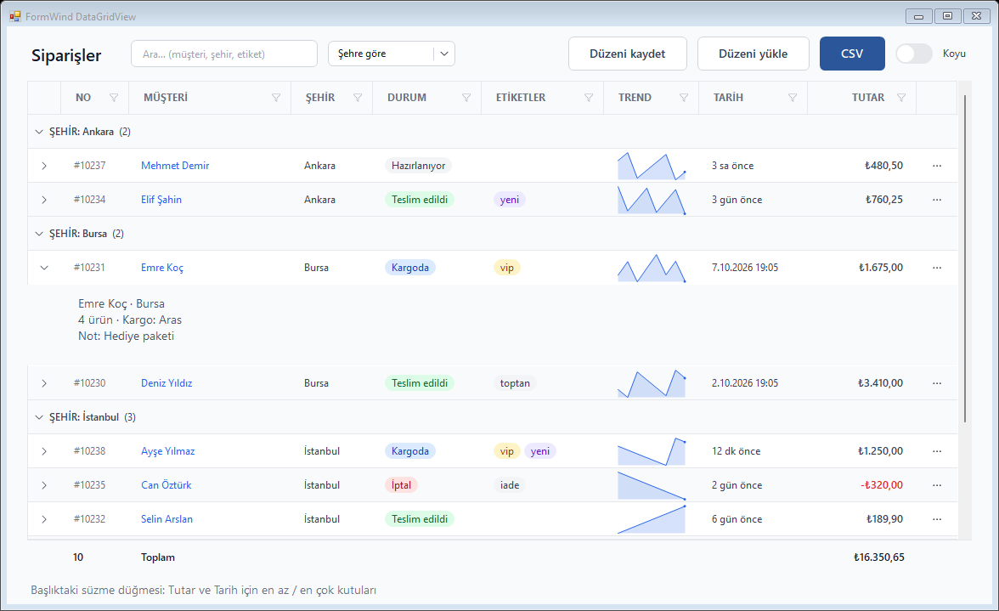 | 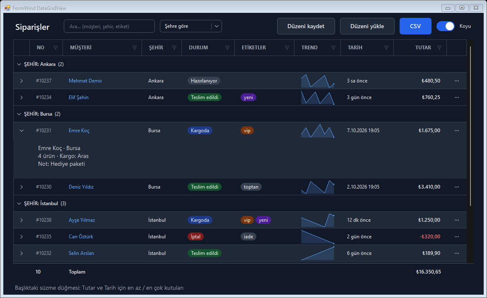 |

Vitrin örneğinin tablo formu (`FormWind.Showcase --grid`): arama, süzme, gruplama, alt toplam, satır detayları, yeni hücre tipleri ve düzen kaydetme.

| Önek | Hedef | Desteklenen class'lar |
| --- | --- | --- |
| (yok) | Kontrol alanı ve tüm hücreler | `bg-*`, `text-*`, font, `border`, `divide-x`, `divide-y`, `divide-{renk}` (ızgara çizgileri) |
| `cell:` | `DefaultCellStyle` | renk, font, `px-*`/`py-*`, `text-left/center/right`, `whitespace-nowrap` |
| `alt:` | `AlternatingRowsDefaultCellStyle` | renk, font |
| `selected:` | Seçim renkleri | `bg-*`, `text-*` |
| `header:` | Kolon başlıkları | renk, font, padding, hizalama, `h-*`, `border-0`, `whitespace-nowrap` |
| `row:` | Satırlar | `h-*` (satır yüksekliği), `row:hover:bg-*` / `row:hover:text-*` (satır hover'ı) |
| `row-header:` | Satır başlıkları | `hidden`, renk |
| `match:` | Arama eşleşmeleri ([Arama](#arama)) | `bg-*`, `text-*` |
| `group:` | Grup başlıkları ([Gruplama](#gruplama-ve-alt-toplam)) | `bg-*`, `text-*`, font |
| `footer:` | Alt toplam satırı (`TwGridFooter`) | `bg-*`, `text-*`, font |

**`table` varyantları** ondan sonra yazılır: `table-sm` (sık, 32 px satır), `table-lg` (48 px satır), `table-striped` (ardışık satırlar), `table-bordered` (dikey ve yatay çizgiler) — `"table table-sm table-striped"`. Fluent, Ant Design ve Material görünümleri kendi `table-sm` ve `table-lg` yüksekliklerini tanımlar.

- Başlık renkleri verildiğinde `EnableHeadersVisualStyles` kapatılır (Windows teması başlık renklerini yok sayar).
- Class'lar kaldırıldığında grid'in orijinal stillerine dönülür.
- Kaydırma çubukları koyu temada Windows'un koyu çubuklarına geçer (`TailwindProvider.DarkScrollbars`, varsayılan açık).
- Parça önekleri DataGridView dışındaki kontrollerde yok sayılır.
- `row:h-*`, `VirtualMode` ya da `DataSource` kullanan grid'lerde `RowHeightInfoNeeded` olayıyla verilir: satırlar paylaşımdan çıkarılmaz, kaydırma konumu ve seçili hücre korunur (17.000 satırda ~12 ms; satır satır atamada ~17 sn). Bağlı olmayan grid'lerde yalnızca yüksekliği farklı satırlar güncellenir.
- Grid'in zemini (`BackgroundColor`) saydamlığı desteklemez; saydam bir `bg-*` zeminde özgün renge düşer (hücrelere yine uygulanır).
- **Uygulamanın hücre renkleri:** Designer'daki zebra zemini (`AlternatingRowsDefaultCellStyle.BackColor`) özgün hücre zeminine göre seçilmiştir; class'lar hücre zeminini verip `alt:` zemini vermiyorsa zebra korunur ama class'ların zemininden türetilir (zemin yazıya doğru %6). Önceden koyu temada açık gri satırda açık yazı kalıyordu (AdvancedDataGridView örneği). Zemini verilip yazı rengi verilmemiş kolonlar (`Column.DefaultCellStyle.BackColor`, örn. bej bir toplam kolonu) class'lar yazı rengini verse de tasarlandıkları özgün yazı rengiyle çizilir; uygulamanın hücreye ya da satıra verdiği yazı rengine dokunulmaz. Kontrast denetimi bu çiftleri `alternating row` ve `column '…'` olarak ölçer.
- **Satır hataları:** `row-header:hidden` (ve `table`) satır başlıklarını gizler; WinForms satır hatasının (`DataGridViewRow.ErrorText`) ikonunu yalnızca orada gösterdiğinden hatalar görünmez oluyordu. Başlıklar class'larla gizliyken hatalı satırın başına tehlike renginde 3 px'lik bir şerit çizilir (RTL'de sağda) ve hata metni hücrelerin ipucu olur (`CellToolTipTextNeeded`; bağlı ya da `VirtualMode` grid'lerde). Hücre hataları (`Cell.ErrorText`) WinForms'un kendi ikonuyla kalır.
- Satır eklenince grid yalnızca boş tablo ya da yükleniyor görünümü değişiyorsa yeniden çizilir.
- **Kendi çizen grid'ler:** hücreleri kendisi çizen grid'ler (örn. Git Extensions'ın commit listesi) hücre stillerini yok sayar ve yapısal özelliklere bağımlı olabilir. `divide-x` / `divide-y` `CellBorderStyle`'ı, `row:h-*` satır yüksekliğini değiştirir; böyle bir grid `CellBorderStyle.None` ya da kendi satır yüksekliğini varsayıyorsa bu class'ları kullanmayın. Git Extensions'ın commit listesi `SingleHorizontal` kenarlıkla kaydırırken kilitlenir; FormWind olmadan da aynısı olur.
- **Kendi çizen grid'lerde koyu tema:** `TwGrid.EnableDarkInversion(grid)` böyle bir grid'i koyu temada açık class'larıyla stiller ve görüntüsünü tonu koruyarak çevirir (tarayıcıların zorunlu koyu modu gibi); sabit açık renkler de koyulaşır. Resimler ve renkli işaretler de çevrilir; kaydırma çubukları, düzenleme kontrolü ve satır detayları ayrı penceredir, onlara koyu renkler verilir.

### Kolon class'ları

Her kolonun Properties penceresinde **ColumnClasses on tailwindProvider1** özelliği vardır (kodda `SetColumnClasses`). Temel class'lar kolonun hücrelerine, `header:` başlığa uygulanır; `w-32`, `min-w-20`, `flex-1` (Fill ağırlığı) ve `hidden` kolonun kendisini etkiler. Font boyutu verilmezse grid'in fontu korunur.

```csharp
tw.SetColumnClasses(colTotal, "text-right font-semibold w-28 header:text-right");
tw.SetColumnClasses(colName, "flex-1 min-w-40");
```

### Hücre tipleri

| Kolon | Değer | Ayarlar |
| --- | --- | --- |
| `TwBadgeColumn` | Metin; değere göre renkli rozet | `Variants = "Alive: bg-green-100 text-green-800 dark:bg-green-900 dark:text-green-100; Dead: bg-red-100 text-red-800; *: bg-gray-100 text-gray-700"` |
| `TwAvatarColumn` | `Image` (yoksa `Placeholder` rengi) | `AvatarSize`, `Radius` |
| `TwIconColumn` | İkon adı (`check`, `#E710`) | Renk hücrenin metin rengi |
| `TwProgressColumn` | 0–`Maximum` sayı | `ShowText`, `BarColor`, `TrackColor`, `DarkTrackColor` |
| `TwCheckColumn` | `bool` / `CheckState` | Yuvarlak köşeli kutu, `AccentColor`, `BoxSize`; `ThreeState` belirsiz durumu çizgiyle gösterir |
| `TwButtonColumn` | Metin (ya da `Text` + `UseColumnTextForButtonValue`) | `Classes = "rounded-md bg-red-600 text-white hover:bg-red-700"`; tıklama `CellContentClick` ile |
| `TwSparklineColumn` | Sayılar (`IEnumerable` ya da `;`/boşlukla ayrılmış metin) | `Kind` (`Line`, `Area`, `Bar`), `LineColor`, `DarkLineColor`, `NegativeColor` |
| `TwDateColumn` | `DateTime` / `DateTimeOffset` | Kolon biçimi (varsayılan `g`); `Relative = true` son haftayı "5 dk önce" gösterir (`TwTexts.MinutesAgo` …); düzenlerken tarihin kendisi görünür |
| `TwNumberColumn` | Sayı | Sağa hizalı, `N2` biçimi (para için `C2`), `Culture = "tr-TR"`, `NegativeClasses` (varsayılan `text-red-600 dark:text-red-400`), `PositiveClasses` |
| `TwLinkColumn` | Metin | Tema mavisi (koyu temada `DarkLinkColor`), üzerine gelince altı çizili; tıklama `CellContentClick` ile |
| `TwTagsColumn` | Metinler (ya da `Separator` ile bölünen tek metin) | `Variants` ile birden çok rozet; sığmayanlar `+N` olarak sayılır |
| `TwActionsColumn` | — | Menülü "⋯" düğmesi: `Actions = "Düzenle; -; Sil"`, `ActionClicked`, `MenuOpening` (satıra göre öğeleri kapatma), `Icon` |
| `TwExpanderColumn` | — | Satır detayını açan ok ([Satır detayları](#satır-detayları)); tıklama ya da Boşluk |

Hücre tipleri koyu temayı grid'in sağlayıcısından öğrenir; `dark:` varyantları ayrıca ayar gerektirmez.

### Satır kuralları

```csharp
tw.SetRowClasses(gridOrders, row =>
    row.Cells["colStatus"].Value as string == "İptal" ? "text-gray-400 dark:text-gray-500" : null);
```

Kural her satır için class döndürür (`null` = değişiklik yok); `CellFormatting` sırasında uygulanır, veri değişince kendiliğinden güncellenir. `SetRowClasses(grid, null)` kuralı kaldırır.

### Sıralama, boş tablo ve yükleniyor durumu

Class verilmiş grid'lerde başlıktaki sıralama oku tema ikonuyla (`arrow-up` / `arrow-down`) ve `accent-*` rengiyle çizilir. `List<T>` ya da düz `BindingList<T>` ile bağlanan grid başlığa tıklanınca sıralamaz; `TwSortableBindingList<T>` ile `SortMode = Automatic` kolonlar sıralanır (metinler geçerli kültürle, Türkçe harf sırası dahil; eşit değerler yerini korur):

```csharp
gridOrders.DataSource = new TwSortableBindingList<Order>(orders);
TwGrid.SetEmptyText(gridOrders, "Kayıt bulunamadı");   // satır yokken ortada ikon + metin (TwGrid.SetEmptyIcon)
TwGrid.SetLoading(gridOrders, true);                   // satır yoksa iskelet satırlar, varsa soluk katman + "Yükleniyor…"
```

Hücre düzenlenirken açılan TextBox/ComboBox kenarlıksız ve hücre renkleriyle gösterilir; koyu temada kaydırma çubukları da koyulaşır.

### Süzme, kolon seçimi ve sayfalama

```csharp
TwGrid.EnableFilterMenu(gridOrders);     // başlıkta süzme düğmesi: kolonun değerleri onay kutularıyla
TwGrid.EnableColumnChooser(gridOrders);  // başlığa sağ tık: kolonları göster/gizle
```

- Süzme menüsü veri kaynağı `ITwFilterableList` olan grid'lerde (`TwSortableBindingList<T>`) ve `DataPropertyName`'i olan kolonlarda görünür. Süzülen kolonun düğmesi `accent-*` renginde çizilir. Kodla: `list.SetColumnFilter("City", new[] { "İzmir" })`, `ClearFilters()`.
- Sıralamalar üst üste uygulanır (önce ada, sonra tarihe göre sıralanan listede aynı tarihliler ada göre kalır); süzme sıralamayı korur, eklenen ve silinen satırlar tüm listeye yansır.
- Kolon menüsünde son görünen kolon gizlenemez.
- Sekiz ve daha çok değeri olan kolonlarda menünün üstünde arama kutusu vardır; "tümünü seç" o zaman görünen değerlere uygulanır.
- `ITwGridSource` (`TwSortableBindingList<T>`) kaynaklı grid'lerin sayı, tarih ve süre kolonlarında **En az** ve **En çok** kutuları vardır; geçerli kültürle okunur (`1.250,50`, `31.12.2025`), saatsiz bir tarih üst sınır olarak o günün tamamını kapsar. Kodla: `list.SetRangeFilter("Amount", 100, null)`. `ClearFilters()` değer ve aralık süzmelerini kaldırır.

### Arama

```csharp
TwGrid.AttachSearchBox(gridOrders, txtSearch);   // yazdıkça arar (200 ms bekleme); Escape kutuyu temizler
TwGrid.SetSearchText(gridOrders, "izmir");        // kodla; null aramayı bitirir
```

- Eşleşen metin düz metin hücrelerinde vurgulanır (`match:` renkleri; varsayılan sarı). Arama geçerli kültürle büyük/küçük harfi yok sayar (`İZMİR` `izmir`'i bulur).
- `TwSortableBindingList<T>` (`ITwGridSource`) ile yalnızca görünen bağlı bir kolonda eşleşen satırlar kalır; bağlı olmayan grid'lerde diğer satırlar gizlenir; diğer bağlı grid'lerde yalnızca vurgulanır.

### Gruplama ve alt toplam

```csharp
TwGrid.SetGroupBy(gridOrders, colCity);           // her şehir için satır sayılı bir başlık; tıklayınca grup kapanır
TwGrid.SetGroupText(gridOrders, g => $"{g.Key} — {g.RowCount} sipariş");   // isteğe bağlı

var footer = TwGrid.AddFooter(gridOrders);        // grid'in altında, aynı kapta alt toplam satırı
footer.SetText(colCustomer, "Toplam");
footer.SetAggregate(colAmount, TwAggregate.Sum, "C2");   // Sum, Average, Count, Min, Max
```

- `TwSortableBindingList<T>` satırları önce gruba göre dizer, grup içinde geçerli sıralamayı korur; kodla eklenen satırlar kendi grubunun sonuna girer. Diğer veri kaynaklarında aynı değerli ardışık satırlar bir grup olur. `TwGrid.GetGroups`, `SetGroupExpanded`, `ExpandAllGroups`, `CollapseAllGroups`. VirtualMode'da desteklenmez.
- Grup başlığı grubun ilk satırının üstüne eklenir (satır uzar, içeriği aşağı kayar); satırlar paylaşımda kalır, kaydırma akıcı kalır.
- `TwGridFooter` grid'in kolon genişliklerini, sırasını ve yatay kaydırmasını izler; satırlar ya da değerler değişince yeniden hesaplar. Süzülen ya da aranan listede yalnızca görünen satırlar sayılır. `footer.SetValue(column, values => ...)` özel bir hücre hesaplar. `AddFooter` doldurmaya (ya da üste/alta) yerleşen grid'in altına yerleşir; aksi halde grid kısalır. Designer'da da konup `Grid` ile bağlanabilir.

### Ağaç satırlar

Ayrı bir ağaç kontrolü olmadan, grid'de sütunlu hiyerarşik satırlar (hatlar → makineler → nedenler, her biri toplamlarıyla):

```csharp
var tree = TwGrid.SetTree(grid, colName, hatlar, hat => hat.Children);   // ya da TwGridTreeNode("Pres 3", 540, 6) düğümleri
tree.SetTotal(colMinutes, TwAggregate.Sum);                               // üst satırlar çocuklarının toplamını gösterir
TwGrid.AddFooter(grid).SetAggregate(colMinutes, TwAggregate.Sum);        // yalnızca çocuksuz satırları sayar
```

- Grid bağlı olmamalıdır (`DataSource` yok): her düğüm bir satırdır, kapalı dallar gizli satırlardır. Sütun değerleri `TwGridTreeNode.Values`'tan (sütun sırasıyla) ya da `DataItem`'ın `DataPropertyName` özelliklerinden gelir.
- Ağaç sütunu girintiyi, oku ve `IconName`'i gösterir. Oka tıklamak ya da hücreye çift tıklamak (salt okunur grid'de) açar ve kapatır; ağaç sütununda → açar ya da ilk çocuğa iner, ← kapatır ya da üst düğüme çıkar, `+`/`−` her sütunda çalışır, `*` dalın tamamını açar. `NodeExpanded`, `NodeCollapsed`, `ExpandAll`, `CollapseAll`, `node.IsExpanded`.
- Başlık tıklaması her üst düğümün çocuklarını kendi içinde sıralar; hiyerarşi ve açık dallar korunur (`tree.Sort(column, direction)`).
- `SetTotal` boş üst hücreleri çocuklarının `Sum`, `Average`, `Count`, `Min` ya da `Max` değeriyle doldurur (toplam çocukların toplamlarını toplar, diğerleri yapraklara bakar). Düğümler değişince `tree.Refresh()`.

### Satır detayları

```csharp
gridOrders.Columns.Insert(0, new TwExpanderColumn());
TwGrid.SetRowDetails(gridOrders, row => new OrderLinesView((Order)row.DataBoundItem), height: 160);
```

- Açılan satır kontrolü hücrelerinin altında gösterir; kontrol kaydırmayla birlikte hareket eder, satır kapanınca dispose edilir. Açık satırlar bağlı öğeleriyle hatırlanır; sıralama ve süzme onları korur. Kodla: `SetRowExpanded`, `ToggleRowDetails`, `IsRowExpanded`, `GetRowDetails`.

### Düzeni kaydetme ve dışa aktarma

```csharp
Settings.Default.OrdersLayout = TwGrid.SaveLayout(gridOrders);   // JSON: kolon sırası, genişlikler, görünürlük, sıralama, gruplama, arama, süzmeler
TwGrid.LoadLayout(gridOrders, Settings.Default.OrdersLayout);

TwGrid.ExportCsv(gridOrders, path);                 // BOM'lu UTF-8 (Excel); ayırıcı: kültürün liste ayırıcısı (Türkçede ;)
TwGrid.CopyToClipboard(gridOrders);                 // seçili hücreler (ya da tüm satırlar), başlıklı ve sekmeyle ayrılmış
string text = TwGrid.ToDelimitedText(gridOrders, ';', selectedOnly: false);
```

- Kolonlar `Name` ile eşlenir; grid'de olmayan kolonlar ve geçersiz değerler atlanır, formun eski sürümünde kaydedilmiş düzen de yüklenir.
- Dışa aktarma görünen kolonları görünüm sırasıyla ve görünen satırları, her kolonun biçimiyle yazar; ayırıcı, tırnak ya da satır sonu içeren alanlar tırnaklanır. Buton, resim, açma ve işlem kolonları atlanır.

**Büyük tablolar (VirtualMode):** `TwVirtualRows<T>` grid'i VirtualMode'a alır ve satırları görüldükçe sayfa sayfa yükler; son kullanılan sayfalar önbellekte tutulur, milyon satırda yalnızca görünen sayfalar bellektedir:

```csharp
var rows = new TwVirtualRows<Order>(gridOrders, (start, count) => db.Orders.OrderBy(o => o.Id).Skip(start).Take(count).ToList(), pageSize: 100);
rows.Reset(db.Orders.Count());              // veri ya da sıralama değişince yeniden
```

- Hücre değeri kolonun `DataPropertyName`'indeki (yoksa adındaki) özellikten okunur; `rows.CellValue = (order, column) => ...` ile değiştirilir. `rows.GetItem(rowIndex)` satırın verisini verir.
- `loadPage` UI iş parçacığında çağrılır; hızlı olmalı (veritabanında OFFSET/FETCH). VirtualMode'da grid kendisi sıralayamaz: sıralamayı sorguda yapıp `Reset` çağırın. Kullanıcının satır eklemesi kapatılır.

`TwPager` sayfalama düğmeleri çizer (‹ 1 … 9 10 11 … 20 ›); veriyi sayfaya göre siz bağlarsınız:

```csharp
pager.TotalItems = orders.Count;
pager.PageSize = 20;
pager.PageChanged += (s, e) => grid.DataSource = orders.Skip(pager.FirstItemIndex).Take(pager.PageSize).ToList();
tw.SetClasses(pager, "text-gray-700 selected:bg-blue-600 selected:text-white item:hover:bg-gray-100");
```

### Varyantların uygulanma sırası

Sonraki, öncekini ezer: temel → `dark:` → `checked:` → `focus:` → `focus-visible:` → `group-hover:` → `hover:` → `dark:hover:` → `active:` → `disabled:` → `invalid:` → `sm:` → `md:` → `lg:` → `xl:` → `2xl:` → `forced-colors:` (Tailwind'deki gibi genişlik varyantları en sonda).
Kontrol devre dışıyken `focus`, `hover` ve `active` uygulanmaz.

## Tema dosyası (`tw.config.json`)

```jsonc
{
  "version": 1,                                          // dosya biçiminin sürümü (isteğe bağlı)
  "preset": "fluent",                                     // hazır görünüm; dosyanın geri kalanı üzerine uygulanır
  "fontFamily": "Segoe UI",
  "spacingUnit": 4,
  "colors": {
    "brand": { "500": "#2b579a", "600": "#234a85" },   // bg-brand-500
    "canvas": "#f3f6fb"                                   // bg-canvas
  },
  "components": {
    "btn-primary": "btn bg-brand-500 text-white hover:bg-brand-600"
  }
}
```

`fontFamily` virgülle ayrılmış bir yığın olabilir (`"Inter, Segoe UI"`): kurulu ya da kayıtlı ilk aile kullanılır. Uygulamayla dağıtılan fontlar `"fonts": ["Assets/fonts/Inter-Regular.ttf", "Assets/fonts/Inter-SemiBold.ttf"]` ile kurulum gerektirmeden kaydedilir (yol tema dosyasına göredir, bulunamayan dosya atlanır); kodda `TwFonts.Register(path)`. Fontlar hem GDI+ (`PrivateFontCollection`) hem GDI (`AddFontResourceEx`, süreç içi) tarafına kaydedildiğinden `TextRenderer` ile çizilen standart kontrollerde de çalışır. Font dosyalarının lisansını (örn. SIL OFL) uygulamayla birlikte dağıtın.

**Tailwind v4 paleti.** `"palette": "v4"` (kodda `new TwTheme(TwPaletteVersion.V4)` ya da `theme.UsePalette(...)`) aynı 22 rengin v4 tonlarını kullanır. v4 renkleri OKLCH olarak tanımlıdır (`TwPaletteV4`); sRGB'ye sığmayanlar tarayıcıların yaptığı gibi CSS Color 4 gamut eşlemesiyle yaklaştırılır, böylece `blue-500` Tailwind sitesindeki gibi `#2b7fff` olur. Tema dosyasındaki renkler `oklch(62.3% 0.214 259.8)` biçiminde de yazılabilir; kodda `TwOklch.TryParse`. Varsayılan bileşenler iki paletle de kontrast denetiminden geçer.

Dosya varsayılan palet ve bileşenlerin (ya da `preset` ile seçilen görünümün) üzerine eklenir. Bileşenlerin listesi için bkz. [Hazır görünümler](#hazır-görünümler-ve-autostyle) ve `TwTheme.DefaultComponents`; `autoStyle` anahtarı AutoStyle eşlemesini değiştirir. Designer önizlemesi ve listeleri de projenin tema dosyasını kullanır (bkz. [Designer](#designer)). `version` dosya biçiminin sürümüdür (bkz. [API kararlılığı](#api-kararlılığı)).

## Kontroller

| Kontrol | Ne zaman |
| --- | --- |
| `TwPictureBox` | Pürüzsüz yuvarlak köşeli resim (`rounded-lg`, `rounded-full` avatar); `object-cover` / `object-contain` / `object-fill`. |
| `TwSelect` | Stillenebilir açılır liste (native ComboBox'ın yerine): kutu temel class'larla, menü `menu:` / `item:` ile. Genişlik varsayılan olarak seçili öğeye göredir (`SizeToSelection`). Harf yazmak o harflerle başlayan öğeyi seçer; `Searchable = true` menünün üstüne öğeleri süzen bir arama kutusu ekler (büyük/küçük harf, aksan ve ı/i farkı gözetilmez). |
| `TwIcon` | Tek başına ikon (bkz. [İkonlar](#i̇konlar)). |
| `TwCheckBox`, `TwRadioButton`, `TwSwitch` | Bkz. [CheckBox, Radio, Switch](#checkbox-radio-switch). |
| Standart kontroller | Renk, yazı ve boşluk her kontrolde çalışır. Köşe `Region` ile kırpılır (antialias yok), kenarlık `Paint` olayında çizilir. `TextBox`'ta (`TextBoxBase`) native kenarlık kapatılır; `border-*` ve `rounded-*` ebeveynde, kontrolün 3 px dışına zemin rengiyle doldurulmuş bir çerçeve olarak çizilir (çerçeve kontrolün sınırlarından taşar, yerleşimde pay bırakın). `DropDownList` modundaki `ComboBox`'ın kapalı kutusu (zemin, kenarlık, köşe, metin, ok) kenarlık ya da köşe class'larında ve koyu bir zeminde FormWind tarafından çizilir (kenarlık class'ı yoksa 1 px'lik, zeminden yazıya doğru bir kenarlıkla); açılır liste native kalır. Düzenlenebilir `ComboBox`'ta ve diğer native kontrollerde (`ListBox` …) köşe ve kenarlık uygulanmaz; `TwSelect`, `TwListBox` kullanın. |
| `TwButton` | Pürüzsüz köşeli buton. `Image` henüz çizilmez, `Paint` olayı tetiklenmez. |
| `TwPanel` | Pürüzsüz köşeli, kenarlıklı panel (kart). Yarı saydam zemin (`bg-white/70`) ebeveynin çizimini (geçişini ya da resmini) gösterir; `backdrop-blur-*` onu önce bulanıklaştırır: pencere içinde buzlu cam kart ya da kenar çubuğu, `backdrop-acrylic`'in form içi karşılığı. |
| `TwTextBox` | Kenarlıksız TextBox'ı yuvarlak bir panel içine alır; `input` stili için. |
| `TwNumberBox` | Sayı kutusu (`TwTextBox` + sağda ▲▼). `Minimum`, `Maximum`, `Increment`, `DecimalPlaces`; ok tuşları, fare tekeri ve kültüre göre ayrıştırma. |
| `TwDatePicker` | Tarih alanı + açılır `TwCalendar`. Tarih yazılabilir (`Culture`/`Format`'a göre çözülür), F4 / Alt+↓ takvimi açar. Takvim `menu:bg-* menu:border-*`, `selected:bg-* selected:text-*`, `item:hover:bg-*` ile stillenir. |
| `TwPopover` | Bir kontrole bağlı açılan panel (bileşen): `Content` kontrolünü `Placement` tarafında (`BottomStart`, `TopEnd`, `Right` …) gösterir, ekrana sığmazsa karşı tarafa geçer. Dışarı tıklama ve Esc kapatır; `Toggle(anchor)` açıkken kapatır, `RestoreFocus` odağı çapaya geri verir. `TwDatePicker`'ın takvimi bununla açılır. |
| `TwCalendar` | Tek başına ay takvimi: kültürün ilk günü ve gün adları, bugün halkası, `MinDate`/`MaxDate`, klavye (oklar, PageUp/PageDown, Home/End, Enter, Esc). |
| `TwTabStrip` | Sekme şeridi: `Underline`, `Pills`, `Segmented`. `selected:text-* selected:border-*` / `selected:bg-*`, `item:hover:*`, `fill-*` (segmented zemini), `gap-*`. Sığmayan sekmeler sondaki "daha fazla" (…) düğmesine taşınır (`OverflowMenu`, ↓ açar; menü `menu:` / `item:` alır); seçili sekme hep görünür kalır. `&` Label'daki gibi sekmenin Alt kısayolunu işaretler; `UseMnemonic = false` onu metin olarak çizer ("Parça & maliyet"). Yalnızca şerittir; sayfalı kullanım için `TwTabControl`. |
| `TwTabControl` | Sayfalı sekme kontrolü (TabControl yerine): `AddPage("Genel")` ya da `TwTabPage` ekleyin, seçili sayfa gösterilir. Şerit `Strip` üzerinden stillenir (`provider.SetClasses(tabs.Strip, "...")`); Ctrl+Tab / Ctrl+PageDown sayfalar arasında gezer. |
| `TwSlider` | Kaydırıcı (TrackBar yerine): `Minimum`, `Maximum`, `Value`, `SmallChange`, `LargeChange`. Ray `fill-*`, dolu kısım `accent-*`, tutamaç `item:bg-*`. Klavye, fare tekeri ve sürükleme. |
| `TwProgress` | İlerleme çubuğu (ProgressBar yerine): ray `fill-*`, dolgu `accent-*`, köşe `rounded-*`. `Indeterminate = true` süresi bilinmeyen iş için kayan bir parça çizer. |
| `TwDataList` | Sanal liste (bkz. aşağı). |
| `TwListBox` | ListBox yerine: `Items` (+ `DisplayMember`), `SelectedItem(s)`, `FindString`; TwDataList'in sanal çizimi, çoklu seçimi ve stilleriyle. `TwListItem` öğeleri hazır satır şablonuyla çizilir (bkz. [Liste satırları](#liste-satırları-twlistitem)). |
| `TwCheckedListBox` | CheckedListBox yerine: satır başında yuvarlak onay kutusu (`accent-*`), `CheckedIndices`/`CheckedItems`, `ItemCheck`; kutuya tık ya da Boşluk. |
| `TwTreeView` | TreeView yerine sanal ağaç: `Nodes`, ikonlu düğümler, `SelectedNode`, `ExpandAll`; ←/→ ile aç/kapa, tembel yükleme için `HasLazyChildren` + `BeforeExpand`. Ekran okuyucuya Outline olarak görünür. |
| `TwPager` | Sayfalama (bkz. [DataGridView](#datagridview)). |
| `TwField` | Etiket + düzenleyici + ipucu/hata metni; doğrulama kuralları (bkz. [Formlar](#formlar-doğrulama-maske-ve-diyaloglar)). |
| `TwToolTip` | Stillenebilir ipucu: `Classes`; `Provider` verilirse koyu temayı izler. |
| `TwChip` | Metinli, isteğe bağlı simgeli ya da durum noktalı (`IconName`, `DotColor`) ve isteğe bağlı ✕'li hap (`Removable` → `RemoveClick`; Delete/Backspace de). `Clickable` onu düğme, `Checkable` açılıp kapanan bir süzgeç çipi yapar (`Checked`, `checked:` ile stillenir). Salt gösterim çipleri sekme durağı değildir. Bileşenler `chip`, `chip-primary`, `chip-success`, `chip-warning`, `chip-danger`; ✕ ekran okuyucuya ayrı bir "Kaldır" düğmesidir. |
| `TwToolbar` | Duyarlı araç çubuğu (bir `TwPanel`): çocuklar `gap-*` aralıkla tek satırda durur; sığmayanlar "daha fazla" (…) düğmesine geçer ve menüden çalışır (düğme tıklanır, onay kutusu değişir, `TwTabStrip` ya da `TwSelect` alt menü olur, diğerleri `OverflowItemClick`'i tetikler). Öğe başına: `SetAlignment` (`Start`/`End`), `SetPriority` (yüksek olan daha geç taşınır), `SetOverflow` (`AsNeeded`, `Never`, `Always`, `Shrink`: başlık bir şey taşınmadan önce daralır, `MinimumSize.Width`'e kadar). Menü `menu:` / `item:` alır, düğme `OverflowButton`'dır. |
| `TwSettingRow` | Ayar satırı (System Settings tarzı): `LabelText`, `Description` (soluk, satır kaydırır), sağda düzenleyici (çocuk kontrol) ve `UnitText` (`EditorWidth`, varsayılan 160). `card p-0` panelde üst üste duran satırlar aralarına ayırıcı çizer (`divide-*`); dar satırda düzenleyici metnin altına iner. `label:` ve `hint:` parçaları, `setting` bileşeni. |

### TwDataList

Yalnızca görünen satırları çizen sanal liste; veri listede tutulmaz, satırlar dizinle istenir. Milyon satırda da çizim süresi görünen satır sayısına bağlıdır.

```csharp
list.ItemCount = orders.Count;
list.ItemHeight = 52;                       // 96 DPI pikseli
list.DrawItem += (s, e) =>
{
    var o = orders[e.Index];
    var c = e.ContentBounds;
    int left = e.DrawBadge(o.Status, c.Right, badgeBack, badgeFore);
    e.DrawText(o.Customer, new Rectangle(c.X, c.Y + 6, left - c.X - 12, 20), font: e.FontWithWeight(600));
    e.DrawText(o.Number, new Rectangle(c.X, c.Y + 26, left - c.X - 12, 20), e.MutedColor);
};
tw.SetClasses(list, "p-1 bg-white text-gray-900 item:hover:bg-gray-100 selected:bg-blue-50 selected:text-blue-900 "
                  + "row:border-gray-100 fill-gray-300 dark:bg-gray-800 dark:text-gray-100 dark:selected:bg-blue-950");
```

- `DrawItem` yoksa `ItemText` (ya da dizin) tek satır metin olarak çizilir.
- Fare tekeri yumuşak kaydırır (`SmoothScrolling`); kaydırma çubuğu owner-draw, sürüklenebilir ve `fill-*` ile renklenir.
- Klavye: ↑/↓, PageUp/PageDown, Home/End; Enter ve çift tık `ItemActivate`.
- `item:rounded-*` satır köşesi, `item:text-*` ikincil metin, `row:border-*` satır ayırıcısı, `ItemPadding` satır içi boşluk (`e.ContentBounds`).
- **Çoklu seçim:** `SelectionMode = MultiExtended`; Ctrl+tık ekler/çıkarır, Shift+tık ve Shift+ok aralık seçer, Ctrl+A tümünü seçer (milyon satırda da dizin tutmadan). `SelectedIndices`, `IsSelected`, `SetSelected`, `SelectionChanged`.
- **Gruplar:** `SetGroups(new[] { (0, "Bugün"), (12, "Dün") })`; kaydırırken üstteki grubun başlığı yapışık kalır. Başlık `header:bg-* header:text-*` ile ya da `DrawGroupHeader` olayıyla çizilir.
- **Farklı yükseklikte satırlar:** `ItemHeights = i => orders[i].HasNote ? 72 : 52` (96 DPI pikseli); satır başlangıçları bir kez hesaplanır, yükseklikler değişince `InvalidateItemHeights()`. Verilmezse bütün satırlar `ItemHeight` boyundadır ve milyon satırda ek maliyet yoktur; verildiğinde her satırın yüksekliği bir kez sorulur.
- **Parça parça yükleme:** `IsItemLoaded` yüklenmemiş satırları iskelet olarak çizer (hafifçe nabız atar) ve `ItemsNeeded(first, last)` görünür aralıkla tetiklenir; veri gelince `Invalidate()`.

### Liste satırları (`TwListItem`)

Listelerin tekrar tekrar çizdiği "başlık, soluk alt satır, durum noktası, sağda değer ve rozet" satırı hazır gelir (kenar çubuğu, kuyruk, uyarılar, kurallar, arama sonuçları): `TwListBox`'a `TwListItem` ekleyin, hazır şablonla çizilir; verilmeyen parçalar yer kaplamaz.

```csharp
list.Items.Add(new TwListItem("Pres 3 · mil yatağı", "Hat 2 · 30 günde 6 duruş")
{
    DotColor = Color.Red,                     // ya da IconName = "warning", ya da Score = 0.72 ("72" yazan küçük halka)
    Value = "540 dk", ValueCaption = "30 gün",
    Badge = "Kronik", BadgeClasses = "chip-danger",
});
```

- İkinci satırı olan satırlar (`Subtitle` ya da `ValueCaption`) kendiliğinden iki satır boyunda olur; tek satırlılar `ItemHeight`'te kalır.
- Rozet renklerini, dolgusunu, köşesini ve yazısını `BadgeClasses`'tan alır (varsayılan `chip`, `dark:` varyantlarıyla); skor halkasının yayı `ScoreColor` ya da `accent-*`.
- Ekran okuyucular parçaları birlikte okur (`"Pres 3 · mil yatağı, Hat 2 · 30 günde 6 duruş, 540 dk, 30 gün, Kronik"`). `DrawItem` işlenirse şablon kullanılmaz.

## Grafikler

FormWind'in kendi çizdiği, ek bağımlılığı olmayan hafif grafikler: `TwChart` (çizgi, alan, çubuk), `TwDonutChart`, `TwSparkline` ve KPI kartı `TwStat`. Diğer kontroller gibi koyu temayı, DPI'ı ve temayı izler; `AutoStyle` ile `chart` ve `stat` bileşenlerini alır.

| Açık | Koyu |
| --- | --- |
| 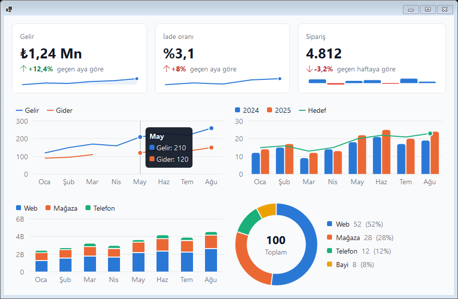 | 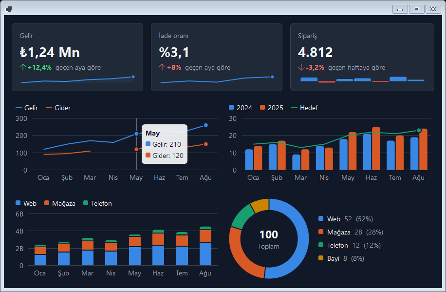 |

Bu pano örnekte hazır: `FormWind.Showcase --charts` (bir aya, çeyreğe ya da dilime tıklamak `ItemClick` ile durum satırını günceller).

```csharp
chart.Kind = TwChartKind.Bar;                    // Line, Area, Bar; Stacked = true çubukları üst üste koyar
chart.SetData(new[] { "Oca", "Şub", "Mar" },
    new TwChartSeries("Gelir", new[] { 120.0, 150, 170 }),
    new TwChartSeries("Hedef", new[] { 130.0, 140, 160 }) { Kind = TwChartKind.Line });   // çubukların üstünde çizgi
chart.ValueFormat = "C0";                        // ipucu; eksen kısa sayılarla yazılır (1,2B), AxisFormat verilmedikçe

donut.SetData(new[] { "Web", "Mağaza", "Telefon" }, new[] { 52.0, 28, 20 });

stat.Title = "Gelir"; stat.Value = "₺1,24 Mn"; stat.Delta = 0.124; stat.Caption = "geçen aya göre";
stat.Trend = new[] { 820.0, 940, 910, 1040, 1240 };
stat.PositiveIsGood = false;                     // maliyet ve hata oranında artış kırmızı gösterilir
stat.ShortValue = "278 sa";                      // "278 sa 52 dk" sığmazsa gösterilir; o da sığmazsa yazı küçülür

dagilim.Kind = TwChartKind.HorizontalBar;        // her kategori bir satır, tam etiketi solda
heatmap.EmptyCells = TwHeatmapEmptyCell.Hatched; // NaN hücreler: taralı gri; göstergede ve ipucunda "Üretim yok"
heatmap.EmptyCellText = "Üretim yok";
```

| Class | Etkisi |
| --- | --- |
| `bg-*`, `text-*`, font | Zemin, metin rengi (değerler, gösterge), font |
| `label:text-*` | Eksen etiketleri, gösterge değerleri, başlık ve açıklama (ikincil metin) |
| `divide-*` | Izgara çizgileri |
| `accent-*` | İlk serinin ve sparkline'ların rengi |
| `stat`: `border`, `rounded-*`, `p-*` | `TwStat`'ın kart görünümü |

- **Renkler** sabit, doğrulanmış bir kategorik paletten gelir (renk körlüğünde ayırt edilebilir, açık ve koyu tema için ayrı tonlar); seriler paleti sırayla alır, başka seriler eklenip çıkınca renklerini korur. Dokuzuncu seri yeniden kullanılan bir ton değil gri olur; `TwDonutChart` sekizden sonraki dilimleri `TwTexts.Other`'da birleştirir. `TwChartSeries.Color` ve `TwChartSlice.Color` rengi açıkça verir.
- **İşaretler:** çubuklar en çok 24 px genişlikte, ucu 4 px yuvarlak, tabanı köşeli; çubuklar, yığın segmentleri ve dilimler arasında 2 px boşluk; çizgiler 2 px; alanlar %10 opaklıkta; işaret yalnızca son noktada ve vurgulanan kategoride. Tek değer ekseni; çubuk ve alan grafikleri sıfırı içerir. `double.NaN` eksik değerdir (çizgide boşluk).
- **Gösterge:** iki ve daha çok seride görünür (`ShowLegend`); anahtar serinin işaretini taşır (çizgi için kısa çizgi, çubuk için kare). Metin hiçbir zaman seri rengini almaz.
- **Etkileşim:** fareyle ya da ok tuşlarıyla (Home/End) bir kategori vurgulanır ve her serinin değeri ipucunda görünür; Enter ya da tıklama `ItemClick`'i tetikler (`TwChartItemEventArgs.Index`, `Label`), `HoverIndexChanged` vurguyu izler. Halka grafik vurgulanan dilimi ortada gösterir.
- **Ekran okuyucular:** grafikler `Chart` rolündedir, her kategori ya da dilim bir öğedir (`"Mar: Gelir 170, Hedef 160"`, `"Web: 52 (52%)"`); grafiğin değeri aralıkların özetidir. `TwStat` "başlık: değer, değişim, açıklama" olarak okunur; değişim her zaman ok ve işaretle verilir, yalnızca renkle değil.
- `TwStat`'ın değişimi temanın `success` ve `danger` renklerini kullanır; hazır görünümler ve tema dosyaları onu da yeniden renklendirir.
- **Yatay çubuklar** (`TwChartKind.HorizontalBar`, grafiğe verilir): kategoriler satırdır, tam etiketleri soldadır (genişliğin en çok %40'ı, sonra "…"), değer ekseni alttadır ve değerler (`ShowValues`) çubuk uçlarında durur; her seri değerini gösteriyorsa eksen yazılmaz. Seriler yan yana ya da `Stacked`; referans çizgileri dikeydir; ↑/↓ satırlar arasında gezer.
- **`TwStat`'ta sığdırma:** karttan geniş değer önce `ShortValue`'ya geçer, sonra "…" ile kesilmek (`Ellipsis`) yerine başlık boyutuna kadar küçülür (`ValueFit = Shrink`, varsayılan); ekran okuyucu her zaman tam değeri okur.
- **Isı haritasında boş hücreler:** `EmptyCells`, `double.NaN` hücreleri en düşük tonla (`Low`, önceki davranış), düz griyle (`Solid`), taralı griyle (`Hatched`) çizer ya da hiç çizmez (`None`); `EmptyCellColor` griyi verir, `EmptyCellText` ("Üretim yok") ipucunda ve ekran okuyucuda "—" yerine geçer ve göstergeye bir anahtar ekler.
- **Küçük halkalar:** simge boyundaki (32 px) bir `TwRingChart` en az 3 px kalınlıkta halka çizer ve orta yazısını sığacak kadar küçültür; `TwListItem.Score` aynı skor halkasını liste satırında çizer.

## Formlar: doğrulama, maske ve diyaloglar

```csharp
var field = new TwField { LabelText = "T.C. kimlik no", Required = true, Validator = TwValidators.TcKimlikNo };
field.Controls.Add(new TwTextBox { Mask = TwMasks.TcKimlikNo });
tw.SetClasses(field, "field");                 // label:, hint:, error: parçaları
// Kaydet'te:
if (!tw.Validate(this)) return;                // hataları gösterir, ilk hatalı alana odaklanır
```

- **`TwField`**: etiket (zorunluysa " *"), tek bir düzenleyici ve altında ipucu ya da hata metni. Kurallar: `Required`, `Pattern` (düzenli ifade), `Validator` (özel), maskeli alanda tamlık. Etiket düzenleyicinin `AccessibleName`'i, hata metni `AccessibleDescription`'ı olur.
- **`tw.SetError(control, "mesaj")`**: elle hata (sunucudan gelen gibi). Hata varken kontrole `invalid:` varyantı uygulanır; `input` bileşeni kırmızı kenarlık ve halka içerir. Kullanıcı değeri değiştirince hata kendiliğinden temizlenir. `HasErrors`, `ClearErrors()`, `ErrorsChanged`.
- **Hazır kurallar** (`TwValidators`): `TcKimlikNo` (kontrol basamakları), `Iban` (mod 97), `Email`, `TurkishMobile`, `MinLength(n)`.
- **Maske** (`TwTextBox.Mask`): `0` rakam, `9` isteğe bağlı rakam, `L` harf; hazır maskeler `TwMasks.Phone`, `Iban`, `TcKimlikNo`, `Date`, `PostalCode`. Yalnızca uygun karakterler girilir, yapıştırma sabit karakterleri atlar. `UnmaskedText`, `MaskCompleted`.

```csharp
if (TwDialog.Show(this, "Sipariş silinsin mi?", "Silme onayı", TwDialogKind.Warning, TwDialogButtons.YesNo, danger: true) == DialogResult.Yes) …
TwToast.Show(this, "Sipariş kaydedildi", TwDialogKind.Success);
```

- **`TwDialog`** (MessageBox yerine): ikon, başlık, mesaj, sağa dayalı düğmeler; Enter varsayılan, Esc iptal/hayır. Sahip formun koyu temasını izler. Düğme metinleri [`TwTexts`](#yerelleştirme)'ten gelir, tek tek `TwDialog.Texts[DialogResult.Yes] = "Sil"` ile ezilebilir; `TwDialog.Create(...)` göstermeden özelleştirmeye izin verir.
- **Metin girişi:** `TwDialog.Prompt(this, "Kayıtlı arama adı", "Aramayı kaydet", placeholder: "örn. Hat 2 · gece vardiyası", validator: ad => adlar.Contains(ad) ? "Bu ad kullanılıyor." : null)` kırpılmış metni, iptalde `null` döndürür. `TwDialogOptions.ShowInput` (`InputText`, `InputLabel`, `InputPlaceholder`, `InputRequired`, `InputMaxLength`, `InputValidator`) her diyaloğa metin kutusu ekler; Tamam metni denetler, hata varsa diyalog açık kalır ve hata kutunun altında gösterilir.
- **`TwToast`**: sahip formun köşesinde (varsayılan sağ alt, `TwToast.Position`) üst üste dizilen, odak çalmayan, fare üzerindeyken bekleyen ve kendiliğinden kapanan bildirim (`DefaultDuration` 4 sn). Ekran okuyucuya Alert olarak bildirilir.

## Yerelleştirme

Kullanıcıya görünen metinler (diyalog düğmeleri, doğrulama mesajları, grid süzme menüsü ve "yükleniyor" metni, arama kutusu ipucu, ekran okuyucu adları) `TwTexts` içindedir. Varsayılan dil İngilizcedir; uygulamanın kullanıcı arayüzü dili (`CultureInfo.CurrentUICulture`) Türkçeyse Türkçe metinler seçilir.

```csharp
TwTexts.Current = TwTexts.Turkish;                                   // dili zorla
TwTexts.Current = new TwTexts { Ok = "OK", Cancel = "Abbrechen", Required = "Pflichtfeld." };   // başka bir dil
TwTexts.Current.Loading = "Veriler alınıyor…";                       // tek bir metin
```

- Kontrollerin kendi metin özellikleri (`TwField.RequiredMessage`, `PatternMessage`, `IncompleteMessage`, `TwSelect.SearchPlaceholder`) atanmışsa `TwTexts`'in önüne geçer; atanmamışsa Designer.cs'e yazılmaz.
- Biçimli metinlerde `{0}` yer tutucuları kullanılır (`MinLength`: karakter sayısı, `Page`: sayfa ve sayfa sayısı).
- Grid süzmesinde boş değerlerin anahtarı dilden bağımsızdır (`TwSortableBindingList<T>.EmptyValue`); menüde `TwTexts.Blank` görünür.
- Geliştiriciye görünen metinler (istisnalar, Designer komutları, çözümleyici uyarıları, Debug çıktısı) İngilizcedir.

## Erişilebilirlik

Owner-draw kontroller ekran okuyuculara ve UI otomasyon araçlarına (Narrator, NVDA, FlaUI, Appium/WinAppDriver) öğeleriyle görünür:

| Kontrol | Rol | Öğeler |
| --- | --- | --- |
| `TwDataList` | List | Her satır ListItem; ad `AccessibleItemText` (yoksa `ItemText`, o da yoksa "Öğe N"). Sanal: öğe nesneleri istendiğinde üretilir. |
| `TwTabStrip` | PageTabList | Her sekme PageTab (seçili durumu ve varsayılan eylemi ile) |
| `TwCalendar` | Table | "Önceki ay" / "Sonraki ay" düğmeleri ve günler (ad: "15 Ekim 2026 Perşembe"; aralık dışı günler Unavailable) |
| `TwSelect` | ComboBox | Değer seçili öğe; varsayılan eylem menüyü açar |
| `TwSlider` / `TwProgress` | Slider / ProgressBar | Değer |
| `TwTextBox`, `TwNumberBox`, `TwDatePicker` | (içteki TextBox) | Ad ve açıklama sarmalayıcının `AccessibleName` / `AccessibleDescription` değerinden, yoksa ipucu metninden |

Seçim ve odak değişiklikleri ekran okuyuculara bildirilir. Kontrole `AccessibleRole` verilmişse o kullanılır. FormWind'in Windows'un yerine çizdiği native parçalar (sekme şeridi, devre dışı yazı, koyu `DropDownList` kutusu, devre dışı liste) yalnızca görüntüyü değiştirir; ad, rol, durum ve değer Windows'un verdiği gibi kalır. Bu parçalar Windows'un odak çerçevesini de örttüğünden klavye ipuçları açıkken (Windows onları klavye kullanılana kadar gizler) odaklı sekmede ve kutuda odak çerçevesi FormWind tarafından çizilir. Devre dışı yazıyı çizen gizli etiket uygulamanın yazısını tutmaz. Görünen bir etiketi olmayan alanlara `AccessibleName` verin (bkz. `ControlsForm`). `TwTreeView` Outline/OutlineItem (açık/kapalı durumu ve düzeyiyle), `TwPager` ToolBar ("Sayfa 3 / 20"), `TwToast` Alert, `TwDialog` Dialog olarak görünür.

UI Automation testleri (`Category=UIAutomation`) listeyi, sekmeleri, açılır listeyi ve takvimi, ayrıca FormWind'in boyadığı native kontrolleri (`NativeUiAutomationTests`) ekran okuyucuların kullandığı istemciyle dışarıdan doğrular. Bu istemci süreç genelinde ayar değiştirdiğinden (sonraki testlerde metin farklı çizilir) varsayılan çalıştırmada atlanır; ayrı çalıştırın:

```powershell
$env:FORMWIND_UIA = "1"; dotnet test tests/FormWind.Tests -f net472 --filter Category=UIAutomation
```

### Yüksek Karşıtlık modu

Windows'ta Yüksek Karşıtlık (Ayarlar → Erişilebilirlik → Karşıtlık temaları) açıkken FormWind class renkleri yerine sistem renklerini kullanır:

- Kontrollerin zemini ve yazısı özgün (sistem) değerlerine döner; seçili ve hover parçaları (`selected:`, `item:hover:`, `row:hover:`) vurgu rengini (`Highlight`) alır.
- Class'lardaki kenarlık ve ayırıcılar yazı rengiyle çizilir; gölge, gradient ve renk geçişleri çizilmez. Kenarlığı olmayan `TwButton`'lar 1 px kenarlık alır. Zemin class'ı olan standart butonlar da (FormWind onları düz stile çevirir) sistem yazı renginde kenarlık alır; önceden zemin sistem rengine dönünce düz yazıya benziyorlardı.
- Boşluk, yazı boyutu, köşe ve yerleşim değişmez. Mod uygulama çalışırken değişirse stiller yeniden uygulanır.
- Bu moda özel renkler `forced-colors:` varyantıyla verilir (Tailwind'deki gibi): `forced-colors:border-2`.
- Kapatmak için `TailwindProvider.RespectHighContrast = false`. Modun etkin olup olmadığı `HighContrastActive` ile okunur; `DrawItem` gibi uygulamanın kendi çizdiği yerlerde (örn. rozet renkleri) buna bakılmalıdır.
- Grid hücre tipleri (`TwBadgeColumn`, `TwProgressColumn` …) kendi renklerini korur.
- FormWind'in Windows'un yerine çizdikleri bu modda Windows'a döner: standart `TabControl`'ün sekme şeridi, `ProgressBar` renkleri, koyu tema adları (kaydırma çubukları, ListView teması ve başlık yazısı, `PropertyGrid` kaydırma çubuğu, `DarkToolTips`), başlık çubuğunun koyu modu, `caption:` renkleri ve zemin efekti, `LinkLabel`'ın `accent-*` bağlantı renkleri (vurgu rengi bağlantı rengi olmaz) ve PropertyGrid'in +/− işaretleri. Devre dışı yazının yeniden çizildiği yerlerde (düz buton) yazı `GrayText`, `row-header:hidden` grid'lerdeki satır hatası şeridi `Highlight` olur; `disabled:text-*` class rengi kullanılmaz. Devre dışı ListView ve düzenlenebilir ComboBox, DateTimePicker ve koyu `DropDownList` çizimi class zemini olmadığından zaten devre dışı kalır. `HighContrastTests` bunları `TwHighContrast` benzetimiyle (sistem ayarına dokunmadan) açıp kapatarak denetler.

### Kontrast denetimi

`TwContrast` bir formun o anki renklerini WCAG 2 kontrast oranlarına göre denetler. Testlerde ya da geliştirme sırasında temanın açık ve koyu hâlini doğrulamak için kullanılır:

```csharp
tw.DarkMode = true;
foreach (var issue in TwContrast.Audit(this, tw))
    Debug.WriteLine(issue);   // TwButton 'btnSave' hover: 2,54:1 < 4,5:1 (#FFFFFF on #60A5FA)
```

| Denetlenen | Bölüm adı |
| --- | --- |
| Metin taşıyan kontroller (Label, buton, TextBox, ComboBox, liste, ağaç, GroupBox …) | `text` |
| Class'lardaki `hover:` varyantı (provider verilirse; fareyi gezdirmeye gerek yok) | `hover` |
| ToolStrip ve menüler: şerit, öğe hover'ı, açılır menü, menü öğesi hover'ı | `strip`, `item:hover`, `menu`, `menu item:hover` |
| DataGridView hücreleri, seçili hücreler, başlıklar, alternatif satırlar ve zemini verilmiş kolonlar | `cell`, `selected`, `header`, `alternating row`, `column '…'` |

- Eşik normal metinde 4,5:1, büyük metinde (18 pt ya da 14 pt kalın) 3:1 (WCAG AA). `minimum` parametresiyle değiştirilebilir.
- Saydam zeminler ebeveynin zeminiyle birleştirilerek hesaplanır. Gizli kontroller atlanır.
- Devre dışı kontroller WCAG'ın kapsamı dışında olduğundan varsayılan olarak atlanır. `includeDisabled: true` onları da denetler (bölüm adı `disabled text`); bu, devre dışı bir kontrolün içerik göstermek için kullanıldığı durumları yakalar (örn. imleç görünmesin diye devre dışı bırakılmış bir açıklama kutusu). Devre dışı native metin kutularında yazı sistem grisi, zemin `TextBox`'ta atanmış zemin, `RichTextBox`'ta Windows'un çizdiği sistem zeminidir; eşik diğer devre dışı kontrollerdeki gibi 3:1'dir. Harness denetimi bu seçenekle çalıştırır. Devre dışı butonlarda ve yazısını FormWind'in yeniden çizdiği onay kutularında ekrana çizilen yazı rengi 3:1 eşiğiyle denetlenir: amaç kontrast değil, görünmez yazıyı yakalamak.
- `transition` geçişi süren renklerde varılacak renk denetlenir; denetim tema değişiminin hemen ardından çağrılabilir.
- `issue.Cause` bilinen nedeni verir: `KeptBackground`, class'lar yalnızca yazı rengini verip zemin uygulamanın açıkça atadığı (ebeveyninkinden farklı) renkte kaldığında; çözüm bir `bg-*` class'ı ya da [kopyalanan zeminlerin](#hazır-görünümler-ve-autostyle) ebeveyni izlemesidir. `ToString()` nedeni de yazar.
- `TwContrast.Ratio(ön, zemin)` iki renk arasındaki oranı verir.
- `TwContrast.FindOwnerDrawn(root)` renklerini uygulamanın kendisi çizen kontrolleri listeler (`CellPainting` aboneli ya da `OnPaint`'i ezen grid'ler — FormWind'in kendi grid işleyicileri sayılmaz, `OwnerDraw`/`DrawMode` açık liste, ağaç, sekme ve açılır kutular). Denetim bunların ekrandaki renklerini bilemez; koyu temada elle bakılmalıdır. Çizim kodu renkleri `tw.GetColors(…)` ile alabilir.
- Varsayılan bileşenler (`btn-primary`, `btn-ghost`, `card`, `input`, `table`) açık ve koyu temada bu denetimden geçer (`ContrastTests`). `btn-primary` koyu temada da `blue-600`/`blue-700` kullanır; beyaz yazı `blue-500` üzerinde 3,7:1, `blue-400` üzerinde 2,5:1 ile eşiğin altında kalır.

## Hata yönetimi

Stil uygulanırken çıkan bir hata uygulamayı düşürmez: istisna yakalanır, kontrol o ana kadar uygulanan stille kalır ve hata `TailwindProvider.StyleError` olayıyla bildirilir (dinleyici yoksa Debug çıktısına yazılır). Özel bir `IStyleApplier`'ın ya da `SetRowClasses` kuralının fırlattığı istisnalar bu yolla raporlanır; gölge, kenarlık ve ComboBox çizimindeki hatalar da çizimi durdurmaz.

```csharp
tw.StyleError += (s, e) => logger.LogWarning(e.Exception, "{Target} stillenemedi: {Classes}", e.Target, e.Classes);
```

- Dinleyici istisnayı yeniden fırlatabilir (örn. testlerde hataları görünür tutmak için).
- Bellek yetersizliği gibi kritik istisnalar yakalanmaz.
- Hatalı kontrol bir sonraki durum değişikliğinde (hover, tema …) yeniden denenir.

## Sağdan sola (RTL)

Kontrolün kalıtılan `RightToLeft` değeri `Yes` ise:

- `rtl:` ve `ltr:` varyantları yöne göre uygulanır (Tailwind'deki gibi): `pl-4 rtl:pl-0 rtl:pr-4`. Yön sonradan değişirse stiller yeniden uygulanır.
- `TwPanel` flex ve grid yerleşimi yatayda aynalanır (CSS'teki `dir="rtl"` gibi): ilk öğe sağdadır, `justify-start` sağa yaslar. Kenar boşlukları da aynayla yer değiştirir (`ml-*` başlangıç tarafı gibi davranır).
- `TwButton` (ikon metnin öbür yanına geçer, metin hizası aynalanır), `TwCheckBox`, `TwRadioButton`, `TwSwitch` (gösterge sağda, açık konum solda) ve `TwSelect` (ok solda) aynalanır.
- Formda `RightToLeftLayout = true` ise Windows pencereleri kendisi aynalar; FormWind ayrıca aynalamaz.
- Windows'un yerine çizilenler Windows'un RTL yerleşimini izler: devre dışı etiket yazısı sağa yaslanır ve onay kutusu/radyo düğmesinde işaret öbür yana geçer; standart `TabControl`'ün sekme şeridinde sıra ve ikonun yeri (yazının solunda) Windows'taki gibi kalır, yazı RTL okuma sırasıyla çizilir. `RightToLeft` ve `RightToLeftLayout` ile Windows'un çizimine karşı ölçüldü (`DpiDrawingTests`).
- Henüz aynalanmayanlar: `TwNumberBox`, `TwDatePicker`, `TwSlider`, `TwProgress`, `TwTabStrip` (sekme sırası), `TwDataList`, `TwTreeView`, `TwCalendar`, `DropDownList` ComboBox çizimi. `ps-*`/`pe-*` gibi mantıksal boşluk class'ları yok; `rtl:` ile yazılır.

## .NET 9+ renk modu (`Application.SetColorMode`)

.NET 9 ve sonrasında `Application.SetColorMode(SystemColorMode.Dark)` sistem renklerini ve native kontrolleri koyulaştırır. FormWind bununla birlikte çalışır:

- Class renkleri sistem renklerinin önüne geçer; class'lar kaldırılınca kontrol koyu sistem rengine döner.
- `dark:` varyantları için `DarkMode` uygulamanın renk moduna bağlanmalıdır: `tw.DarkMode = Application.IsDarkModeEnabled;`
- FormWind'in Windows'un yerine çizdikleri (sekme şeridi, ListView başlık yazısı, ProgressBar renkleri, devre dışı yazı) WinForms'un koyu çizimiyle çakışmaz; bağlı modda (ikisi de koyu) denendi. Bağlanmamış modda (uygulama koyu, FormWind açık) WinForms'un koyulaştırdığı parçalar koyu kalır: ListView başlığı koyu zeminde açık temanın koyu yazısıyla, onay ve radyo işaretleri koyu çizilir.
- WinForms'un kendi koyu modunda da PropertyGrid'in açık kategori işareti (⌄) Explorer temasından koyu çizilir ve görünmez. FormWind kategori satırına koyu bir zemin verdiğinde (`header:bg-*`) işaretler yazı renginde +/− olarak çizilir (`CanShowVisualStyleGlyphs`); açık temada ve class'lar kalkınca özgün işaretlere dönülür.
- Bu davranış .NET 9 ve 10'da `ColorModeTests` ile doğrulanır (süreç geneline etki ettiğinden ayrı çalışır):

```powershell
$env:FORMWIND_COLORMODE = "1"; dotnet test tests/FormWind.Tests -f net10.0-windows --filter Category=ColorMode
```

## Krypton Toolkit

FormWind, Krypton Toolkit kullanan uygulamalarda iki yoldan çalışır; ikisi birlikte de kullanılabilir.

| Krypton + FormWind (Fluent) | Krypton + FormWind (Material, koyu) |
| --- | --- |
| 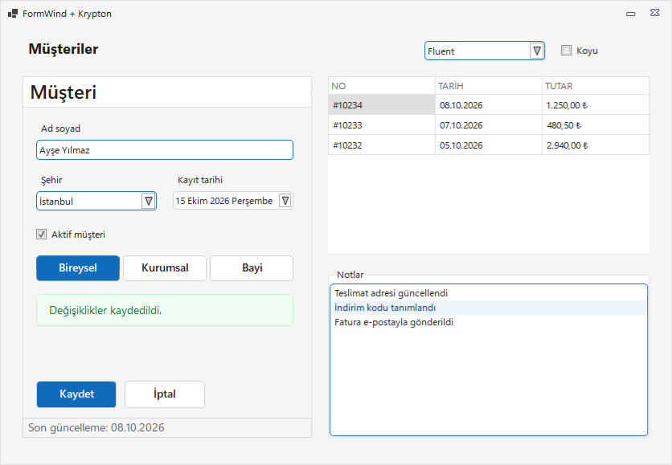 | 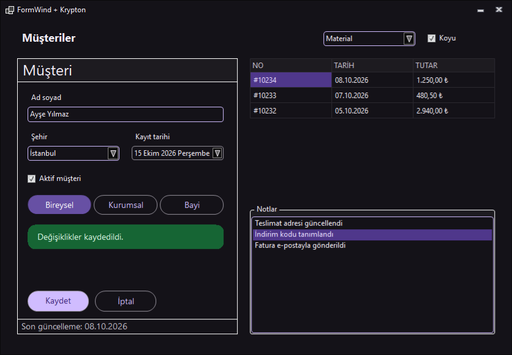 |

**1. Tema köprüsü: class yazmadan.** `TwKryptonTheme` FormWind temasından bir Krypton paleti üretir ve Krypton'un genel paleti yapar. Class'ı olmayan bütün Krypton kontrolleri seçili görünümü (`preset`) ve koyu temayı izler:

```csharp
using FormWind.Krypton;

KryptonApplier.Register();                                   // Program.Main içinde
var palette = TwKryptonTheme.Follow(tailwindProvider1);      // ana formda; kapanırken palette.Dispose()
```

Palet, temanın bileşenlerinden kurulur: `page` → form ve panel zemini, form başlık çubuğu; `card` → başlık grupları ve kontrol zeminleri; `btn-ghost` → butonlar (`btn-primary` → işaretli `KryptonCheckButton`); `input` → metin kutuları, açılır listeler, tarih ve sayı kutuları; `list` → liste öğeleri; `table` → `KryptonDataGridView`; temanın fontu. Sağlayıcının teması ya da `TwTheme.Current` değişince veya `DarkMode` açılıp kapanınca palet yeniden kurulur. Palet Krypton'un Microsoft 365 White (açık) ya da Black dark mode (koyu) paletinden başlar; FormWind'in eşlemediği parçalar (ribbon, gezgin sekmeleri, Krypton'un menü çizimi) o paletin renklerinde kalır. Sabit paleti kendiniz yönetmek isterseniz `TwKryptonTheme.CreatePalette(theme, dark)` bir `KryptonCustomPaletteBase` döndürür.

**2. Kontrol başına class'lar.** `KryptonApplier` class'ları Krypton'un durum paletlerine yazar: temel → `StateCommon`, `hover:` → `StateTracking`, `active:` → `StatePressed`, `focus:` → `OverrideFocus` (giriş kontrollerinde `StateActive`), `disabled:` → `StateDisabled`, `checked:` → `StateChecked*`.

| Kontrol | Parçalar |
| --- | --- |
| `KryptonButton`, `KryptonCheckButton` | `checked:` (işaretli durumlar) |
| `KryptonPanel`, `KryptonLabel`, `KryptonLinkLabel` | |
| `KryptonCheckBox`, `KryptonRadioButton` | yazı rengi ve fontu |
| `KryptonTextBox`, `KryptonMaskedTextBox`, `KryptonRichTextBox`, `KryptonNumericUpDown`, `KryptonDateTimePicker` | odak ve fare üzeri → `StateActive` |
| `KryptonComboBox` | `item:` (öğeler, `item:hover:`), `menu:` (açılır liste zemini) |
| `KryptonGroupBox` | `caption:` (başlık) |
| `KryptonHeaderGroup` | `header:` (birincil başlık) |
| `KryptonListBox`, `KryptonCheckedListBox` | `item:`, `item:hover:`, `selected:` |
| `KryptonForm` | `caption:` (başlık çubuğu) |
| `KryptonDataGridView` | aşağıya bakın |

- Sabit boyutlu butonlarda padding, yazı sığacak kadar kısılır (Krypton yazıyı `…` ile kırpmasın diye); `rounded-full` köşe yarıçapı kontrol yüksekliğinin yarısıyla (palette 16 px ile) sınırlanır.
- `KryptonDataGridView` yapısal olarak (satır yüksekliği, ızgara çizgileri, `row-header:hidden`, sıralama oku) FormWind'in DataGridView uygulayıcısıyla stillenir. Krypton hücreleri ve başlıkları kendi paletiyle çizdiği için renkler ayrıca palete yazılır: temel class'lar ve `cell:` → veri hücreleri, `header:` → kolon başlıkları, `row-header:` → satır başlıkları (yoksa `header:`), `selected:` → seçili hücreler, `bg-*` → boş alan, `divide-*` → hücre kenarlıkları. Kendi uygulayıcınızda aynı yolu izlemek için `TwAppliers.FindBuiltIn(control)` FormWind'in yerleşik uygulayıcısını verir.
- AutoStyle Krypton tiplerini varsayılan olarak eşlemez (köprü onları zaten stiller); isterseniz tema dosyasında ekleyin: `"autoStyle": { "KryptonButton": "btn-ghost" }`.

**Sürümler.** `FormWind.Krypton` Krypton Toolkit 100.25.11.328 ile derlenir (paketin bağımlılığı bu sürüm ve üstü) ve CI'da hem bu sürümle hem 105.26.7.201 ile test edilir. .NET Framework uygulamalarında daha yeni bir Krypton kullanılıyorsa derleme yönlendirmeleri (binding redirect) gerekir; SDK biçimli projeler bunları kendisi üretir.

**Örnek.** `samples/FormWind.Krypton.Showcase` (net8.0-windows): Krypton kontrolleriyle kurulu, görünüm seçicili bir form. `--preset material`, `--dark`; `--snapshot çıktı.png` görüntü alır. Şablonda: `dotnet new formwind-app --Krypton true`.

## Diğer kontrol kütüphaneleriyle kullanım

Kendi skin ya da tema motoru olan kontrol kütüphaneleri (ticari kontrol süitleri dahil) kontrollerini kendileri çizer. FormWind tanımadığı kontrollere standart WinForms uygulayıcısını uygular: boyut, boşluk ve yerleşim genellikle çalışır; renkler, durum varyantları (`hover:`, `focus:` …) ve köşeler ise kütüphanenin çizimiyle çakışabilir ya da yok sayılabilir. Bu kütüphanelerle FormWind üç şekilde kullanılabilir:

- **Karma kullanım:** Kütüphanenin güçlü olduğu bileşenler (gelişmiş grid'ler, ribbon, zamanlayıcı …) kendi motorunda kalır; FormWind standart kontrollerde, yeni ekranlarda ve form iskeletinde kullanılır. Kütüphanenin kontrolleri de bir `TwPanel` flex/grid yerleşiminin öğesi olabilir.
- **Uygulayıcı yazmak:** `IStyleApplier` uygulayan ve `TwAppliers.Register` ile kaydedilen bir sınıf, class'ları kütüphanenin kendi görünüm nesnelerine aktarır; temel stil ve her varyant kütüphanedeki karşılığına (normal, üzerinde, basılı, odaklı, devre dışı) eşlenir. [Krypton Toolkit](#krypton-toolkit) entegrasyonu bu yolun örneğidir. Çoğu skin motorunda renklerin birebir uygulanması için ilgili kontrolde skin'in kapatılması (düz stile geçilmesi) gerekir; yoksa renkler skin tarafından ezilir ya da yalnızca ton olarak kullanılır. `DataGridView`'den türeyen grid'lerde yapısal stil `TwAppliers.FindBuiltIn` ile FormWind'e bırakılabilir; kendi grid'i olan kütüphanelerde eşlemenin tümü uygulayıcıda yapılır. Uygulayıcı türleri deneyseldir (FW9001, bkz. [API kararlılığı](#api-kararlılığı)).
- **Yalnızca tema senkronu:** Kütüphanenin kontrollerine class verilmez; `DarkMode` değişince kütüphanenin açık/koyu skin'ine de geçilir ve istenirse `tw.config.json` renkleri kütüphanenin paletine aktarılır. Her kontrol kendi motoruyla çizilir, iki taraf aynı renkleri kullanır.

Lisanslı kütüphanelere yönelik uygulayıcılar bu repoda yer almaz; uygulamanın kendi projesinde tutulmaları önerilir. FormWind'in mevcut bir uygulamadaki standart kontrollere etkisi kaynak koduna dokunmadan [harness](#gerçek-uygulamalarla-deneme-harness) ile görülebilir.

## Eklentiler ve paylaşılan süreç

FormWind başka bir uygulamanın içinde de kullanılabilir: bir uygulamanın eklentisi (ör. KeePass eklentisi) kendi diyaloglarını FormWind ile stiller, barındıran uygulama FormWind kullanmaz. Bir süreçte FormWind kullanan birden çok bileşen de olabilir. Eklenti yazarları için:

- **Temayı provider'a verin:** `provider.Theme = TwTheme.FromJson(...)` (ya da `TwTheme.Load`). `TwTheme.Current` süreç genelidir; barındıran uygulamanın ve diğer eklentilerin de temasıdır, değiştirmeyin. `Theme` verilmeyen provider'lar ve provider'dan bağımsız çizen birkaç parça (`TwButton` ikonları, `TwTabStrip` yazısı, `TwIcon`, `TwToolTip`, `TwCalendar`, `TwDataList`, grid kolon tipleri) `TwTheme.Current`'ı kullanır; bunlarda varsayılan tema görünür.
- **`TwAutoTheme.Install` çağırmayın:** iş parçacığında açılan bütün formları, barındıran uygulamanınkiler dahil, stiller. Gerekirse `Filter` ile yalnızca kendi formlarınızı seçin. Kendi formunuzda `ContainerControl` + `AutoStyle` kullanın.
- **Açık/koyu:** barındıran uygulamanın durumunu izleyin, ör. KeePass'te `DarkMode = KeePass.UI.UIUtil.IsDarkTheme` (KeePass'in kendi koyu teması yoktur; sistem renkleri koyuysa, ör. Yüksek Karşıtlık siyah, true döner).
- **Barındıran uygulamaya sızmayanlar:** provider yalnızca kendi kontrollerine ve `ContainerControl`'üne dokunur; koyu ipuçları yalnızca provider'ın formlarında koyulaşır; odak halkası filtresi, Yüksek Karşıtlık ve metin boyutu abonelikleri provider başınadır ve `Dispose` yalnızca kendi kaydını kaldırır (diğer bileşenin provider'ı çalışmaya devam eder).
- **Süreç geneli olanlar:** `TwAppliers.Register` (kayıtlı uygulayıcı aynı FormWind kopyasını kullanan herkese uygulanır; kendi kontrol türünüz için kaydedin, standart türleri ezmeyin) ve `TwFonts.RespectTextScale`.
- **Bağımlılıklar (.NET Framework):** eklenti klasörüne `FormWind.dll` ile `System.Text.Json.dll` ve bağımlılıklarını (`System.Memory`, `System.Buffers`, `System.Runtime.CompilerServices.Unsafe`, `System.Text.Encodings.Web`, `System.Numerics.Vectors`, `System.Threading.Tasks.Extensions`, `Microsoft.Bcl.AsyncInterfaces`, `System.ValueTuple`) koyun. Barındıran uygulamanın `.exe.config`'inde bunlar için binding redirect olmadığından paketler birbirlerinin eski sürümlerini ister (System.Memory → Unsafe 4.0.4.1, dosya 6.0.0.0); FormWind bu istekleri `AppDomain.AssemblyResolve` ile kendi klasöründeki, aynı ortak anahtarlı ve en az istenen sürümdeki dosyaya yönlendirir (binding redirect'in yaptığı). Başka bir bileşen uygun sürümü zaten yüklediyse o kullanılır. Eklentinin kendi kodu bu derlemeleri doğrudan kullanıyorsa (ör. kendi `JsonSerializer` çağrısı) aynı durum onun için de geçerlidir; ilk kullanımdan önce bir FormWind türüne dokunmak (`TwTheme`) çözücüyü kurar.
- **İki FormWind sürümü yan yana:** derlemeler güçlü adlıdır (`PublicKeyToken=1cea47bdc82de2bf`); farklı `AssemblyVersion`'lı iki kopya (ör. 0.91 ve 0.92) `LoadFrom` ile yan yana yüklenir ve statikleri ayrıdır: tema, uygulayıcılar ve kancalar birbirini görmez. Aynı sürümün iki kopyası ise tek derleme olarak yüklenir ve statikleri paylaşır.

KeePass 2.61 ile denendi: iki eklenti (FormWind 0.91 ve 0.92) aynı süreçte kendi renkleriyle koyu diyalog açtı, KeePass'in ana penceresinin renkleri ve yazıları değişmedi, `TwTheme.Current` varsayılan kaldı.

## DPI

Önerilen kurulum: formlarda `AutoScaleMode = AutoScaleMode.Dpi` ve `AutoScaleDimensions = new SizeF(96F, 96F)` (kodla kurulan formlarda yapıcıyı `SuspendLayout`/`ResumeLayout` arasına alın) ve uygulamayı `PerMonitorV2` çalıştırın. `samples/FormWind.Showcase/ControlsForm.cs` bu şekilde kuruludur; %125'te (120 DPI) içerik ölçeklenip sığar. Ölçümler:

| Durum | Sonuç |
| --- | --- |
| DPI-unaware (4.7.2 varsayılanı) | Windows bitmap olarak büyütür; yerleşim doğru, metin bulanık. |
| PerMonitorV2 + `AutoScaleMode.Dpi` | Yerleşim, font ve FormWind boşlukları birlikte ölçeklenir. |
| PerMonitorV2 + `AutoScaleMode.Font` | Kodla kurulan formlar ve (.NET Framework'te) fontu `AutoScaleDimensions`'tan sonra atanan Designer formları ölçeklenmedi; boşluklar ve fontlar büyüdü, kontroller büyümedi. |

### .NET Framework'te kurulum

.NET 8+ projelerinde `<ApplicationHighDpiMode>PerMonitorV2</ApplicationHighDpiMode>` ya da `Program.Main`'de `Application.SetHighDpiMode(HighDpiMode.PerMonitorV2)` yeterlidir. .NET Framework 4.7.2 / 4.8'de üç seçenek var:

| Seçenek | Nasıl açılır | Sonuç |
| --- | --- | --- |
| DPI-unaware (varsayılan) | Ayar yok | Windows pencereyi bitmap olarak büyütür; yerleşim doğru, yazılar bulanık. `DeviceDpi` 96 kalır, FormWind ölçeklemez. |
| System-aware | Manifestte `<dpiAware>true</dpiAware>` | Birincil ekranın ölçeğinde net. Pencere ölçeği farklı bir ekrana taşınınca Windows onu bitmap olarak büyütür ya da küçültür. |
| PerMonitorV2 (önerilen) | Manifest **ve** App.config, ikisi birlikte | Her ekranda net; ekran değişince WinForms ve FormWind yeniden ölçekler. |

PerMonitorV2 için manifest süreci DPI-aware yapar ve Windows 10 uyumluluğunu bildirir (`supportedOS` yoksa süreç sessizce system-aware kalır):

```xml
<compatibility xmlns="urn:schemas-microsoft-com:compatibility.v1">
  <application>
    <supportedOS Id="{8e0f7a12-bfb3-4fe8-b9a5-48fd50a15a9a}" />
  </application>
</compatibility>
<application xmlns="urn:schemas-microsoft-com:asm.v3">
  <windowsSettings>
    <dpiAware xmlns="http://schemas.microsoft.com/SMI/2005/WindowsSettings">true/pm</dpiAware>
    <dpiAwareness xmlns="http://schemas.microsoft.com/SMI/2016/WindowsSettings">PerMonitorV2</dpiAwareness>
  </windowsSettings>
</application>
```

App.config ise WinForms'un kendi per-monitor desteğini açar:

```xml
<configuration>
  <System.Windows.Forms.ApplicationConfigurationSection>
    <add key="DpiAwareness" value="PerMonitorV2" />
  </System.Windows.Forms.ApplicationConfigurationSection>
</configuration>
```

- **İkisi birden gerekir.** Yalnızca manifestte PerMonitorV2 varsa süreç per-monitor çalışır ama WinForms ekran değişimini (`WM_DPICHANGED`) işlemez: ölçeği farklı ekrana taşınan formun yerleşimi ve fontları eski DPI'da kalır. Tek ekranda fark görünmez. Tek ekran yetiyorsa manifestte yalnızca `<dpiAware>true</dpiAware>` (system-aware) daha tutarlıdır.
- **`configSections` eklemeyin.** `System.Windows.Forms.ApplicationConfigurationSection` machine.config'de zaten tanımlıdır; App.config'te `<configSections>` ile yeniden tanımlanınca WinForms DPI ayarını sessizce yok sayar ve yapılandırma sistemi başlamaz. Hata açılışta değil, `ConfigurationManager`'ı (ayarlar, bağlantı dizeleri) ilk kullanan ekranda "Yapılandırma sistemi başlatılamadı" olarak çıkar.
- **`bindingRedirect`'leri silmeyin.** FormWind paketi .NET Framework'te `AutoGenerateBindingRedirects`'i açar ve derleme yönlendirmeleri çıktıdaki `.exe.config`'e yazar. Bu dosyayı elle düzenlerken derlemenin ürettiği yönlendirmeleri silerseniz `System.Text.Json` bağımlılıkları yüklenemez ve uygulama açılışta düşer.
- **Şablon:** `dotnet new formwind-app --Framework net472` manifesti ve App.config'i bu şekilde kurar.

**Kendi DPI ölçeklemesi olan uygulamalar.** DPI-unaware çalışırken boyutları kendi çarpanıyla (`Px(8)`, `Fs(13)` gibi) büyüten bir uygulama DPI-aware'a geçince aynı değer iki kez büyür: önce uygulamanın çarpanıyla, sonra WinForms'un AutoScale'i ya da FormWind ile (%125'te 1,25 yerine yaklaşık 1,56 kat). Geçişte:

- Sınıflardaki değerleri 96 DPI birimiyle yazın: `text-[13px]`, `p-[8px]`. `$"text-[{Fs(13)}px]"` gibi önceden ölçeklenmiş değerler FormWind'in ölçeklemesiyle iki katına çıkar.
- Formlarda `AutoScaleMode.Dpi` ve `AutoScaleDimensions = new SizeF(96F, 96F)` kullanın; yapıcıda (`ResumeLayout`'tan önce) atanan `Size`, `Location`, `Padding` gibi değerleri de 96 DPI birimiyle yazın, AutoScale bunları büyütür.
- Form açıldıktan sonra kodla atanan piksel değerleri için kendi çarpanınız yerine `control.LogicalToDeviceUnits(8)` kullanın; kendi `OnPaint` çiziminizde ölçek `DeviceDpi / 96f`'tir.
- Uygulamayı %125 ve %150'de açıp kontrol edin: boşluklar ve yazılar ekran ölçeğinden belirgin biçimde fazla büyüdüyse bir değer hâlâ iki kez ölçekleniyordur.

- .NET Framework'te PerMonitorV2'nin nasıl açılacağı için bkz. [.NET Framework'te kurulum](#net-frameworkte-kurulum).
- .NET Framework'te WinForms DPI ayarını ilk `Control` oluşturulurken uygular; GDI+ ise ekran DPI'ını başladığı anda bir kez okur. Bundan önce bir `Font` oluşturulursa (örn. tema yüklenirken) GDI+ 96 DPI'da kalır ve native kontrollerin (TextBox) fontları küçük çizilir. FormWind GDI+'ya dokunmadan önce WinForms'un DPI başlatmasını tetikler; kendi kodunuzda `Program.Main` içinde form oluşturmadan önce `Font` üretiyorsanız önce `new Control().Dispose()` çağırın.
- **Ekran değişimi (%150, %200):** form başka DPI'lı bir ekrana taşınınca FormWind class'ları WinForms ölçeklemeyi bitirdikten sonra bir kez yeniden uygular. `AutoScaleMode.Dpi` ile kurulan formlarda fontlar, boşluklar, owner-draw kontroller ve DataGridView (font ve kolon genişlikleri) doğru ölçeklenir; bu `ControlsForm` ve bir grid formu için %150 ve %200'de doğrulandı.
- **`AutoScaleMode.Font` ve .NET Framework:** Designer formun `Font`'unu `AutoScaleDimensions`'tan sonra yazar. .NET Framework WinForms, PerMonitorV2 açıkken bu font atamasında ölçeklemeyi atlar ve `AutoScaleDimensions`'ı ölçeklenmiş gibi günceller: kontroller 96 DPI boyutunda kalır, fontlar (ve FormWind boşlukları) ekran DPI'ıyla büyür; yazılar kırpılır, grid kolonları dar kalır. Bu FormWind'siz de olur (aynı form `Font` önce atanınca doğru ölçeklenir) ve .NET 8'de yoktur. Çalışma anında düzeltilemez: ezilen değerden formun hangi DPI'da tasarlandığı anlaşılamaz. **FW002** çözümleyicisi bu formları uyarır; çözüm `AutoScaleMode.Dpi` ve `AutoScaleDimensions = new SizeF(96F, 96F)`.
- Font modundaki formlarda .NET Framework ekran değişiminde fontları olay tetiklemeden değiştirir; `TwTextBox`'ın iç kutusu silinmiş font handle'ını tutup yazıyı sistem fontuyla küçük çiziyordu. `TwTextBox` artık formun `DpiChanged` olayında iç fontu yeniler (`Text_boxes_keep_a_valid_native_font_after_moving_to_200_percent`).
- **Windows'un yerine çizilen yazılar:** FormWind'in Windows'tan sonra çizdiği yazılar (devre dışı etiket, onay kutusu, radyo ve düz buton yazısı, sekme şeridi) WinForms'un yerleşimini birebir izler: devre dışı yazı, aynı font ve biçimdeki gizli, etkin bir etikete çizdirilip yerine kopyalanır (kontrolün `UseCompatibleTextRendering` değeriyle; GDI ya da GDI+). Onay kutusu ve radyo düğmesinde işaret boyutu pencerenin DPI'ındaki temadan alınır. Sekme yazısı Windows'un yerleşimiyle (ikon, `Padding.X` boşluk, yazı; birlikte ortalanır) iç boşluksuz çizilir; önceden %200'de Windows'un sığdırdığı yazıyı "Gen…" diye kısaltıyordu ve devre dışı etiket 2–3 px kayıyordu. %125, %150 ve %200'de (WM_DPICHANGED ile) ve 120 → 96 DPI'lı gerçek ekran değişiminde ölçüldü; `DpiDrawingTests` aynı yerleşimi 9, 13,5 ve 18 pt'de denetler.
- Test: `Controls_*_at_150/200_percent` görsel testleri vitrini ayrı bir PerMonitorV2 sürecinde açıp WM_DPICHANGED ile ölçekler (`FormWind.Showcase.exe --snapshot x.png --controls --dpi 192`; yalnızca PerMonitorV2 yapılandırmasıyla etkili). Referans adı sürecin sistem DPI'ını da içerir.

Piksel değerleri kontrolün `DeviceDpi / 96` oranıyla ölçeklenir; class'lardaki değerler 96 DPI birimidir (`p-2` %125'te 10 px). Uygulamanın kendisinin DPI'a göre ölçeklemediği kontrollerde (örn. AutoScale'i çalışmayan UserControl'ler) bu, özgün değerlerden farklı sonuç verir.

- **Formun AutoScale'i:** `InitializeComponent` içindeki `SetClasses` ölçeklenmiş değeri atar; formun AutoScale'i (sondaki `ResumeLayout`) aynı padding'i bir kez daha ölçeklerdi (%125'te 8 → 10 → 12 px). Kendi `AutoScaleMode`'u olan iç içe UserControl'lerde bu ölçekleme handle oluştuktan sonra da olur. FormWind bunu iki yolla önler:
  - Class'lar padding ya da margin tanımlıyorsa değer değiştiğinde (`PaddingChanged`/`MarginChanged`) FormWind'in değeri geri yazılır.
  - Class'lar kontrolün ilk handle'ı oluşunca (ölçeklemeden sonra, `Load`'dan önce) bir kez yeniden uygulanır; boyut ve font da düzelir.
- **Sonuç:** class'lar padding/margin'i yönettiği sürece uygulama kodunun bu özelliklere çalışma anındaki atamaları geri alınır (FW001 bu atamaları uyarır); uygulamanın değeri için class'tan padding/margin'i kaldırın. Class'lar kaldırılınca izleme durur. Renklerde tersi geçerlidir: uygulamanın ataması [korunur](#uygulama-kodunun-atadığı-renkler). Designer'da izleme yapılmaz. Ekran değişiminde WinForms'un ölçeklemesi bir an geri alınır, ardından DPI yenilemesi yeni ölçekle uygular.
- Doğrulama: Git Extensions'ın dönüştürülmüş formlarında %125'te özgün uygulamayla karşılaştırıldı; kalan farklar 1 px yuvarlama ve uygulamanın hiç ölçeklemediği kontrollerden geliyor.
- Ölçeklenen pikseller WinForms gibi yuvarlanır (.5 yukarı).

Uygulama DPI-aware (örn. `PerMonitorV2`) çalışıyor ama formların AutoScale'i yerleşimi büyütmüyorsa boşluklar büyür, kontroller büyümez ve metinler sığmaz. Bu durumda AutoScale'i düzeltin ya da `TailwindProvider.ScaleWithDpi = false` yapın. DPI-unaware uygulamalarda (çoğu 4.7.2 projesinin varsayılanı) Windows ölçeklemeyi kendisi yapar ve ek ayar gerekmez.

## Designer

- `TwTabControl`: "Sayfa ekle" / "Seçili sayfayı kaldır" komutları ve akıllı etiket (görünüm seçimi), tasarım zamanında sekmeye tıklayınca sayfa değişir; kontrolün içine yalnızca `TwTabPage` bırakılabilir, diğer kontroller sayfaya bırakılır. Araç kutusundan bırakılan kontrol iki sayfayla başlar.
- **Akıllı etiket:** formda bir `TailwindProvider` varken her kontrolün akıllı etiketinde (standart kontroller dahil) bir FormWind bölümü görünür: `Classes` alanı, `Component` listesi, kontrol tipine uygun bileşenler (buton → `btn-primary`/`btn-ghost`/`btn-danger`, metin kutusu → `input`, panel → `card`, grid → `table`; temada tanımlıysa) ve "Class'ları temizle". Bileşen seçmek yalnızca mevcut bileşenin yerine geçer, diğer class'lar korunur (`btn-ghost px-6` → `btn-primary px-6`). Değişiklikler `Classes` özelliği üzerinden yapıldığından Designer.cs'e yazılır ve geri alınabilir.
- **Class oluşturucu:** akıllı etiketin alt bölümlerinde gruplara ayrılmış açılır listeler vardır: renkler (arka plan, yazı, kenarlık), boşluk ve şekil (padding, kenarlık, köşe), yazı (boyut, kalınlık), hover ve koyu tema (`hover:bg-*`, `dark:bg-*`, `dark:text-*`). Her alan yalnızca kendi grubundaki class'ları okur ve değiştirir; `px-4` seçmek `px-2`, `pl-1` gibi ezdiği class'ları kaldırır, `py-2`'yi korur. Alanı boşaltmak o grubun class'larını siler. Tanınmayan class'lar akıllı etikette uyarı olarak listelenir. Renk listeleri temanın kendi renkleriyle (`brand-500` …) başlar; serbest metin de yazılabilir.
- **Önizleme ve Designer.cs:** Designer.cs'e FormWind'den yalnızca `SetClasses` satırları yazılır. Class'ların yönettiği özellikler (BackColor, ForeColor, Font, Padding, Margin, Cursor) ve önizlemenin yan etkileri (düz buton: `FlatStyle`, `FlatAppearance`, `UseVisualStyleBackColor`; boyalı çerçeveli metin kutusunun `BorderStyle`'ı; grid stilleri; bağlantı renkleri) yazılmaz: bir kontrol serileştirilirken önizleme geri alınır, ardından yeniden uygulanır. Kayıt sırasında `ComponentChanged` bildirilmez; form kaydedildikten sonra değişmiş görünmez. Class'ların yönetmediği, elle atanmış değerler yazılmaya devam eder. `DesignTimePreview` kapatılınca kontroller özgün değerlerine döner. Kaydet ve yeniden aç döngüsü kodu değiştirmez; %150'de `h-10` bir kez ölçeklenir (60 px) ve büyümez. Testler Visual Studio'nun CodeDOM serileştiricisiyle yapılır (`DesignerCodeTests`).
- `TwTabControl` tasarımcısı .NET Framework ve .NET 8 için derlenir; .NET 8'in süreç dışı Designer'ında tasarımcı sunucu sürecinde çalışır (komutlar `DesignSurface` testleriyle iki hedefte doğrulanır).
- **.NET 8+ (süreç dışı) Designer:** akıllı etiket, class oluşturucu, açılır listeler ve önizleme iki Designer'da da çalışır (hepsi `TypeConverter`'lı özellikler ve `DesignerActionList` üzerindedir). Yalnızca `Classes` alanının "…" penceresi (`ClassesEditor`; çok satırlı düzenleme) .NET Framework Designer'ı ile sınırlıdır. .NET 8'de `Classes` alanı temadaki bileşenleri öneren bir açılır listedir (`ClassesConverter`); liste mevcut bileşenin yerine geçen hali gösterir (`btn-primary px-6`), serbest metin de yazılabilir.
- **Tema dosyası:** paketle gelen `build/FormWind.targets`, proje klasöründeki `tw.config.json` dosyasını uygulamanın derlemesine gömer. Designer tasarlanan formun derlemesini bulur; derleme klasöründeki `tw.config.json` dosyasını (fontlar ve SVG ikonlarla birlikte), yoksa gömülü kopyayı okur. Böylece önizleme, bileşen ve renk listeleri projenin temasıyla gelir. Tema dosyası değişince projeyi derleyip formu yeniden açın. Proje henüz derlenmemişse varsayılan tema kullanılır. Dosya başka bir yerdeyse `<FormWindThemeFile>yol/tw.config.json</FormWindThemeFile>`, gömmeyi kapatmak için `<FormWindEmbedTheme>false</FormWindEmbedTheme>`. Çalışma zamanı dosyayı yine `TwTheme.LoadIfExists` ile yükler; gömülü kopyayı yalnızca Designer okur. Dosya ayrıca çıktı ve yayın klasörüne `tw.config.json` adıyla kopyalanır; proje onu zaten kopyalıyorsa ikinci kez eklenmez, `<FormWindCopyTheme>false</FormWindCopyTheme>` kopyalamayı kapatır. Aynı Visual Studio sürecinde farklı temalı birden çok proje açıksa sağlayıcıya bağlı olmayan çizimler (ikonlar, grid kolonları) son açılan formun temasını kullanır.

### FW001 çözümleyicisi

Paketle gelen Roslyn çözümleyicisi, class'ların yönettiği bir özelliğe kodda değer atanınca uyarır:

```csharp
tw.SetClasses(btnSave, "btn-primary");
btnSave.BackColor = Color.Red;   // FW001: 'btnSave' has classes; assigning 'BackColor' conflicts with them. …
```

Çalışma zamanında renk ataması kazanır: FormWind o renk kanalını uygulamaya bırakır (bkz. [Uygulama kodunun atadığı renkler](#uygulama-kodunun-atadığı-renkler)); durum rengi gibi bilinçli atamalarda uyarı bastırılabilir. Padding ve margin atamaları ise geri alınır, class kazanır (bkz. [DPI](#dpi)); bu durumda uyarı gerçek bir çakışmayı gösterir.

Yalnızca class metni sabit olan çağrılar ve class'ların gerçekten yönettiği özellikler denetlenir (`bg-*` → BackColor, `text-{renk}` → ForeColor, `text-{boyut}` → Font, `p-*` → Padding, `m-*` → Margin, `cursor-*` → Cursor; varsayılan bileşenler dahil). `font-sans` ya da `font-semibold` varken temel `Font` ataması uyarı vermez. Kapatmak için `.editorconfig`'te `dotnet_diagnostic.FW001.severity = none`.

### FW002 çözümleyicisi

.NET Framework projelerinde, `SetClasses` kullanan bir `InitializeComponent` `AutoScaleMode.Font` kuruyor ve formun `Font`'unu `AutoScaleDimensions`'tan sonra atıyorsa uyarır (bkz. [DPI](#dpi)): PerMonitorV2'de form ölçeklenmez. Hedef çerçeve `build_property.TargetFramework`'ten, o yoksa referans verilen WinForms'un sürümünden anlaşılır. Uygulama PerMonitorV2 çalışmıyorsa uyarı `.editorconfig`'te `dotnet_diagnostic.FW002.severity = none` ile kapatılabilir.

## Animasyonlar ve responsive varyantlar

- Sekme göstergesi (alt çizgi, hap, bölme) yeni sekmeye kayar; liste satırlarının hover zemini yumuşakça belirir; iskelet satırlar (liste ve grid) hafifçe nabız atar; `TwSwitch` düğmesi kayar, `TwToast` solarak belirip kaybolur, `TwDialog` ve `TwPopover` açılırken solarak belirir, belirsiz `TwProgress` şeridi ray boyunca kayar. Switch düğmesi, sekme göstergesi ve liste hover'ı kontrolün `duration-*`, `delay-*` ve `ease-*` class'larına uyar; `transition-none` onları anında yapar.
- **`animate-spin`** bir `TwIcon`'u döndürür (saniyede bir tur; yükleniyor göstergesi), **`animate-pulse`** bir `TwIcon`'u ya da `TwPanel`'in zeminini solup geri getirir (iskelet yer tutucu), `animate-none` durdurur. Tüm animasyonlu kontroller aynı saatle çizilir; nabız atan yer tutucular birlikte atar.

```csharp
tw.SetClasses(icoLoading, "text-gray-500 animate-spin motion-reduce:animate-none");
tw.SetClasses(pnlSkeleton, "h-4 w-40 rounded bg-gray-200 animate-pulse");
```

- `TwMotion.Enabled` Windows'un "animasyonları göster" ayarını izler (uygulama çalışırken değişirse de), kodla kapatılabilir; `TwMotion.FollowSystem()` yeniden Windows'a bırakır. Kapalıyken bunların hepsi ve `transition` geçişleri anında olur (belirsiz progress şeridi ortada durur, dönen simge durur). Tasarım zamanında ve görünmeyen kontrollerde animasyon yapılmaz.
- **`motion-safe:`** / **`motion-reduce:`** varyantları animasyon açıkken / kapalıyken uygulanır; ayar değişince yalnızca bunları kullanan kontroller yeniden uygulanır. `forced-colors:` yine en son uygulanır.
- **Kapanış:** `TwDialog` ve `TwPopover` kapanırken de solar. Pencere hemen kapanır (`DialogResult`, `IsOpen`, `Closed` gecikmez); son görüntüsü tıklamayı geçiren bir pencerede solarak kaybolur.
- **Değerler:** yeni `TwProgress.Value` dolguyu yerine kaydırır (300 ms; `duration-*`, `ease-*`, `transition-none`). `TwStat` yeni değeri öncekinden (ilk görünüşte sıfırdan) sayarak gösterir, metnin biçimi korunur (`₺12.400`, `%98,4`); yalnızca tek sayı içeren değer sayılır, `AnimateValue = false` kapatır; `TwStat.DefaultAnimateValue = false` kendi değerini vermeyen bütün göstergelerde kapatır. Grafikler verisiyle ilk göründüklerinde açılır: `TwChart`'ta çubuklar tabandan sırayla büyür (35 ms arayla), çizgi ve alanlar soldan sağa çizilir; `TwRingChart` halkaları sıfırdan dolar; `TwHeatmap` hücreleri sol üstten sağ alta solarak belirir; `TwTimeline` noktaları zaman sırasıyla yayla (Spring) çıkar ve birleştiren çizgi uzar; `TwSparkline` çizgisi soldan sağa çizilir, çubukları büyür. Gecikmeler toplam 400 ms'yi geçmez. Gösterildikten sonra veri değişirse baştan çizilmez: ekrandaki çubuk, nokta, doluluk ve renk 350 ms'de yenisine kayar (`SetData` gibi silip yeniden ekleyen çağrılar da). `AnimateOnShow = false` açılışı, `AnimateChanges = false` geçişi kapatır; `AnimateIn()` açılışı yeniden oynatır (örn. yeni veri yüklenince).
- **Açılıp kapanan panel:** `TwPanel.Expanded = false` (ya da `Collapse()`) panelin yüksekliğini sıfıra kaydırıp gizler, `Expand()` gösterip yüksekliğine (`AutoSize` ise tercih edilen yüksekliğe) geri kaydırır; 200 ms, `duration-*` / `ease-*` ile değişir. Çocuklar yerinde kalır, kayış sırasında kesilir. Yükseklik panelin kendisine ait olmalıdır: `Dock = Top`/`Bottom` ya da kenetlenmemiş (flex'te `grow` ile büyüyen panel kaymaz).

```csharp
btnFilters.Click += (_, _) => pnlFilters.Expanded = !pnlFilters.Expanded;
```

- Kendi kontrolünüzde aynı kurallarla animasyon için `TwTween`: değer değişince `Start(süre, eğri, gecikme)`, `OnPaint`'te `Progress` (0–1) okunur; sahibi her karede geçersiz kılınır, animasyon kapalıysa `Progress` hemen 1 olur. `Tick` (her kare) ve `Completed` olayları opaklık gibi özellikleri sürmek içindir. `TwMotion.Ease`, `Lerp` ve `Blend` aynı eğri ve ara değer hesaplarını verir.

```csharp
_tween = new TwTween(this);
void Expand() { _from = _height; _tween.Start(200, TwEasing.InOut); }
// OnPaint: float h = _from + (_target - _from) * _tween.Progress;
```

- Eğriler: `TwEasing.Out` (varsayılan), `In`, `InOut`, `Linear` ve `Spring` (hedefi ~%10 aşıp geri oturan sönümlü yay; `Progress` bir an 1'in üstüne çıkar, `Blend` renkleri sınırlar). Özel eğri için CSS'teki gibi `new TwCubicBezier(x1, y1, x2, y2)`: `_tween.Start(250, new TwCubicBezier(0.34, 1.56, 0.64, 1))`.
- Standart süreler `TwMotion.Durations`: `Xs` 120, `S` 180, `M` 250, `L` 450 ms. Animasyon kapalıyken hepsi 1 ms olur, bu sürelere bağlı bekleyişler de hemen biter.
- `duration-*` class'larının ulaşmadığı yerleşik süreler `TwMotion.Timings` ile tasarım sisteminin değerlerine uyarlanır: `ChartIntro` (600), `ChartChange` (350), `ChartStagger` (35), `StatCount` (800), `PopupOpen` (140), `PopupClose` (120), `AttentionPulse` (700), `DialogFade` (150), `ToastFade` (150) ms. Değişiklik sonra başlayan animasyonlara uygulanır, 0 o animasyonu kapatır, `Reset()` varsayılanlara döner.

```csharp
TwMotion.Timings.ChartStagger = 70;      // zaman çizelgesinde noktalar arası
TwMotion.Timings.AttentionPulse = 1200;  // nabız
```

- Animasyon ayarını uygulamanın kendi ayarlarında saklamak için `TwMotion.Preference` (`TwMotionPreference.System` Windows'u izler, `On` / `Off` `Enabled`'ı ayarlar): açılışta `TwMotion.Preference = Settings.Default.Motion;`, kullanıcı değiştirince `Settings.Default.Motion = TwMotion.Preference;`.
- `await TwMotion.AfterPaintAsync(control)` kontrol ve çocukları bekleyen boyamalarını bitirince, animasyon saatinin bir sonraki karesinde tamamlanır; örneğin sayfayı önce gösterip verisini ekrana çıktıktan sonra bağlamak için. `Application.Idle`'ın aksine kendini sürekli boyayan bir kontrol varken de gelir.

```csharp
ShowPage(page);
await TwMotion.AfterPaintAsync(page);
grid.DataSource = await LoadAsync();
```
- Kontrolün bir sayısını (genişlik, konum, opaklık) `OnPaint` yazmadan canlandırmak için `TwAnimator.Animate(kontrol, ad, başlangıç, bitiş, süre, set)`; aynı kontrol ve adla yeni çağrı çalışanın yerine geçer (kaldığı yerden sürmek için `set`'e son verilen değeri `başlangıç` olarak verin). Eğri, gecikme ve `completed` alan aşırı yüklemeleri vardır; `Cancel` ve `IsAnimating` da aynı adla çalışır. Animasyon kapalıysa değer hemen bitişe atanır.

```csharp
TwAnimator.Animate(pnlSide, "width", pnlSide.Width, 320, TwMotion.Durations.M, w => pnlSide.Width = (int)w, TwEasing.Spring);
```

- **Bildirimler:** `TwToast.Position` köşeyi seçer (`BottomRight` varsayılan, `TopRight`, `BottomLeft`, `TopLeft`, `BottomCenter`, `TopCenter`; üstte en yenisi en üsttedir). `TwToast.MaxVisible = 1` her yeni bildirimi eskisinin yerine koyar (eskisi yerinde solar; 0 = sınır yok). Yeni bildirim kendi kenarından 12 px kayarak gelir (`TwToast.EnterEasing`, örn. `TwEasing.Spring`); başarı bildiriminin onay işareti kendini çizer. `toast.Subtitle` mesajın altına soluk bir satır ekler ("DR-24817 · Hat 2") ve yığını yeniden dizer. `TwToast.Inset` sahip formun kenarlarında 16 px kenar payına ek olarak boş kalacak alanı verir (96 DPI px): `TwToast.Inset = new Padding(0, 56, 0, 0)` üstteki bildirimleri araç çubuğunun altında tutar; açık bildirimler hemen yer değiştirir.
- **Meşgul buton:** `TwButton.IsBusy = true` metnin önünde dönen bir gösterge çizer ve tıklamaları (Enter, Space, `PerformClick`, `AcceptButton`) yok sayar; `Click` ve `DialogResult` gelmez, ekran okuyucu Busy durumunu duyar.

`RunBusyAsync` işi meşgul durumda çalıştırır ve iş bitince (hata verse de) düğmeyi serbest bırakır; düğme zaten meşgulse işi çalıştırmaz ve `false` döner:

```csharp
btnSave.Click += async (_, _) => await btnSave.RunBusyAsync(() => SaveAsync());
```

- **Popover ve menüler:** `TwPopover` ve FormWind'in çizdiği menüler açılırken çapanın (alt menüde sahip öğenin, bağlam menüsünde imlecin) tarafından %95'ten büyüyüp solarak belirir (140 ms), kapanırken solar (120 ms). Pencere içeriği ölçeklenemediği için açılış boyunca gerçek pencere görünmezdir (tıklama ve tuşları alır), yerinde tıklamayı geçiren bir görüntüsü büyür.
- **Odak halkası:** klavyeyle gelen odakta beliren halka (`focus-visible:ring-*`, `focus:ring-*`) 6 px dışarıdan başlayıp 180 ms'de yerine daralır; fareyle verilen odakta yerinde belirir.
- **Grid yükleme:** `TwGrid.SetLoading(grid, true, TwLoadingStyle.Shimmer)` iskelet çubuklar üzerinden soldan sağa açık bir bant geçirir (varsayılan `Pulse` nabızdır; `SetLoadingStyle` sonradan değiştirir). Class'ı olan `DataGridView`'lerde çift tampon açılır (veri dolarken tablo satır satır boyanmaz); class'lar kaldırılınca özgün değerine döner.
- **Liste yükleme:** `TwDataList.IsLoading = true` (ve `TwListBox`) satırları gizleyip listeyi nabız atan iskelet satırlarla doldurur, tıklama, tuş ve tekerleği yok sayar. Veri sayfa sayfa geliyorsa `IsItemLoaded` ile yalnızca yüklenmemiş satırlar iskelet çizilir.
- **Geçişler:** `TwTransition.CrossFade(host, change)` önce `host`'un görüntüsünü üstüne koyar, `change`'i onun altında uygulayıp boyatır ve eski görüntüyü ondan sonra 250 ms'de soldurur (değişiklik uzun sürse de solmanın tamamı görünür). Görüntü, bekleyen boyamalar bittikten sonra ekrandan alınır: üst üste binen kontroller, özel başlık çubuğu ve kaydırılmış paneller ekrandaki gibi çıkar. Ölçekli ekranda DPI farkında olmayan uygulamada ekran fiziksel piksellerle okunup pencerenin boyutuna küçültülür. Parça başka bir uygulamanın penceresi altındaysa ya da ekran dışındaysa pencerenin kendi içeriği masaüstü pencere yöneticisinden (`PrintWindow`, birkaç kat yavaş) istenir; `DrawToBitmap` yalnızca son çaredir ve üst üste binen kontrolleri yanlış çizebilir. Parçanın üstünde ekranda görünen her şey (örn. aynı formun bildirimi) de resme girer ve onunla birlikte solar. Sayfa değişimi ve tema değişimi için:

```csharp
TwTransition.CrossFade(pnlPage, () => ShowPage(next));
TwTransition.CrossFade(this, () => provider.DarkMode = !provider.DarkMode);   // başlık çubuğu dahil tüm form
```

- **Kayan panel:** `TwTransition.SlideIn(panel, TwEdge.Right)` bir kenar panelini (Inspector, filtreler) kenarından kayarak gösterir, `SlideOut` kayarak gizler (250 ms). Genişlik her karede değiştirilmez: yerleşim bir kez yapılır, panelin resmi yerine kayar ve ebeveynin geri kalanı yeni yerleşimine solar; yanındaki tablo her karede yeniden yerleşip yırtılmaz. Panelin yeni hâli, üstündeki eski görüntü bir anlığına ekran yakalamasından çıkarılarak ekrandan okunur (Windows 10 2004 ve sonrası; öncesinde `PrintWindow`). Ekran kaydı ya da paylaşımı bu anda eski görüntüyü bir kare görmeyebilir.
- **Kayan pencere:** `TwWindowMotion.Attach(sheet, TwEdge.Right)` bir pencerenin her gösterilişinde kenarından 24 px kayarak belirmesini, her kapanışında son görüntüsünün aynı kenara kayarak solmasını sağlar; pencere yine hemen kapanır (`DialogResult` ve `ShowDialog`'un dönüşü gecikmez). Tek seferlik kullanım için `SlideIn(window, edge)` (gösterilmiş pencere) ve `FadeOut(window, edge)` (`FormClosing` içinde).

```csharp
TwTransition.SlideIn(pnlInspector, TwEdge.Right);
TwWindowMotion.Attach(filterSheet, TwEdge.Right);
filterSheet.ShowDialog(this);
```

- **Dikkat çekme:** `TwAttention.Pulse(control, count: 2)` kontrolün kenarından dışa yayılıp solan halkalar gönderir (her biri 700 ms), örneğin sayısı artan bir rozete; renk zemini varsa zemin, yoksa yazı rengidir. `TwChip.Pulse()` aynısıdır.

- `sm:`, `md:`, `lg:`, `xl:`, `2xl:` varyantları formun istemci genişliğine göre uygulanır (640 / 768 / 1024 / 1280 / 1536 px, 96 DPI; `TwBreakpoints` ile değiştirilebilir). Form yeniden boyutlanıp eşik değişince yalnızca bu varyantları kullanan kontroller yeniden uygulanır:

```csharp
tw.SetClasses(pnlForm, "flex flex-col gap-4 md:flex-row lg:gap-8");
tw.SetClasses(lblTitle, "text-lg lg:text-2xl");
```

## Kodlama ajanları (MCP)

[`website/llms.txt`](website/llms.txt), FormWind'i kodlama ajanları için özetler. `formwind-mcp` sunucusu ([`tools/FormWind.Mcp`](tools/FormWind.Mcp/README.md)) ajanın yaptığı işi denetlemesini sağlar: `validate_classes` (öneriyle birlikte bilinmeyen class'lar), `explain_classes` (her durumun çözümlendiği değerler), `list_components`, `list_vocabulary` ve `render` (kontrolün açık ve koyu temada, durum başına PNG'si). Yalnızca okur ve uygulama kodu çalıştırmaz.

```bash
dotnet tool install -g FormWind.Mcp --prerelease
```

```bash
claude mcp add formwind -- formwind-mcp
```

Sunucu, ajanın onu başlattığı klasördeki `tw.config.json` dosyasını kullanır; her araç ayrıca `preset` ve `themeFile` alır.

## Proje yapısı

```
src/FormWind/             Çekirdek: parser, tema, durum motoru, WinFormsApplier, Tw* kontrolleri, Designer editörü
src/FormWind.Krypton/     KryptonApplier, TwKryptonTheme
src/FormWind.Analyzers/   FW001 Roslyn çözümleyicisi (FormWind paketine eklenir)
tests/FormWind.Tests/     xUnit testleri (net472, net8.0, net9.0, net10.0-windows)
samples/FormWind.Showcase/ Vitrin uygulaması (net472)
samples/FormWind.Krypton.Showcase/ Krypton Toolkit ile örnek (net8.0-windows)
tools/FormWind.Convert/   Designer dosyalarını class'lara çeviren komut satırı aracı (net8.0-windows)
tools/FormWind.Harness/   Gerçek uygulamalarda deneme için startup hook ve harness (net8.0-windows)
tools/FormWind.Docs/      Önizlemeli class referansı sitesini üretir (net8.0-windows)
tools/FormWind.Mcp/       Kodlama ajanları için MCP sunucusu: class'ları doğrular, açıklar ve çizer (net8.0-windows)
website/                  Tanıtım ve belge sitesi, Türkçe ve İngilizce (statik HTML; website/build.ps1)
templates/                dotnet new şablonu (formwind-app)
tools/run-harness.ps1     Bir .NET WinForms uygulamasını harness'le çalıştırıp log özetini yazar
.github/workflows/ci.yml  Derleme, test, paket ve görsel çizimlerin yapıt olarak yüklenmesi
```

## Geliştirme

Katkı kuralları, test kategorileri, public API ve sürümleme politikası: [CONTRIBUTING.md](CONTRIBUTING.md). Kodun yapısı (class dizgisinden ekrana giden yol, modüller, tasarım kararları): [ARCHITECTURE.md](ARCHITECTURE.md). Değişiklikler: [CHANGELOG.md](CHANGELOG.md). Güvenlik açıkları: [SECURITY.md](SECURITY.md).

CI'daki adımların tamamı (derleme, dört hedefte test, kapsam denetimi, paketleme) tek komutla çalışır; `-Quick` yalnızca derleyip .NET 8'de test eder. SDK sürümü `global.json` ile sabitlenmiştir (.NET 10 SDK):

```powershell
.\build.ps1
```

Tek tek komutlar:

```bash
dotnet build FormWind.sln
```

```bash
dotnet test FormWind.sln
```

Performans ve GDI testleri (`Category=Performance`) varsayılan çalıştırmada atlanır (Skipped). Toplam ~6 dakika sürerler (uzun süreli kullanım testi ~5 dakika) ve süreç genelindeki GDI sayaçlarını ölçtükleri için diğer testlerle paralel çalışmazlar. Çalıştırmak ve ölçümleri görmek için `FORMWIND_PERF=1` ortam değişkenini ayarlayın (PowerShell):

**Uzun süreli kullanım (`SoakTests`).** FormWind'in pencere alt sınıflamaları ve kancaları olan kontrollerle dolu bir form tekrar tekrar açılır, tema değiştirilir, uygulama kendi temasını verir (`SetWindowTheme`), handle'lar yeniden oluşturulur (`RightToLeft`, `Multiline`) ve form kapatılır. Kontroller: koyu ListView ve TreeView, RTF yüklenen RichTextBox, DropDownList, DateTimePicker, devre dışı ListView ve ComboBox, ipuçları, PropertyGrid ve grid. Elle bağlanan sağlayıcı ve `TwAutoTheme` ayrı denenir. 300 turda (net9) GDI 62→62, USER 37→37, yönetilen bellek ~4,3 MB'ta sabit, tur süresi iki yarıda aynı; son tur dışındaki bütün formlar ve sağlayıcılar toplanır. Varsayılan çalıştırmada 8 turluk kısa sürümü çalışır. Bu deneme kapanan ipucu pencerelerinin handle'larının unutulmadığını gösterdi; artık pencere yok olunca kümeden çıkarlar.

**Büyük formlar (`LargeFormTests`, net9).** Sekmeler, paneller içinde iç içe kontroller (etiket, metin kutusu, düğme, onay kutusu, açılır liste) ve her 100 kontrolde bir grid ya da liste:

| Kontrol | İlk stilleme (AutoStyle / elle class) | Tema geçişi + çizim (AutoStyle / elle class) | FormWind belleği |
| ---: | --- | --- | --- |
| 1 011 | 165 ms / 362 ms | 38 ms / 38 ms | 2,0–3,3 KB/kontrol |
| 2 523 | 447 ms / 1 160 ms | 39 ms / 83 ms | 2,3–2,4 KB/kontrol |
| 5 039 | 824 ms / 1 550 ms | 85 ms / 118 ms | 2,1–2,5 KB/kontrol |

Süre kontrol sayısıyla doğrusal büyür (kontrol başına süre sabit kalır). AutoStyle açıkken sonradan eklenen kontrollerde 250'den 2000 kontrole süre WinForms'un kendisiyle aynı oranda büyür (tek tek ~9x, WinForms ~12x; WinForms her eklemede ebeveynin yerleşimini baştan çalıştırır). Toplu eklemelerde `SuspendLayout`/`ResumeLayout` kullanın. FormWind bir kontrole stil uygularken ebeveynin yerleşimini askıya alıp bir kez çalıştırır; önceden font, padding ve boyut atamalarının her biri ayrı yerleşim tetikliyordu (2000 kontrolde 5,8 sn → ~4,1 sn). Saniyede ~60 tema geçişinde renk geçişleri (`transition`) üst üste biner, her kontrol hedef renginde biter, handle sayısı artmaz; 200 animasyonlu kontrolde kare hızı ~10 kare/sn'ye düşer (çoğu kartların köşe ve kenarlık çizimi). Eşikler milisaniye değil, kontrol başına süre ve büyüme oranıdır (5000 kontroldeki kontrol başına süre 1000'dekinin 2 katını, sonradan eklemedeki büyüme WinForms'unkinin 1,5 katını geçmez).

```powershell
$env:FORMWIND_PERF = "1"; dotnet test FormWind.sln --filter Category=Performance --logger "console;verbosity=detailed"
```

Visual Studio Test Explorer'da çalıştırmak için değişkeni Visual Studio'yu açmadan önce sistemde tanımlayın.

### Public API

`src/FormWind/PublicAPI.Shipped.txt` ve `PublicAPI.Unshipped.txt` kütüphanenin public yüzeyini listeler. Listede olmayan bir public üye eklenirse ya da listedeki bir üye kaldırılırsa derleme uyarı verir (RS0016/RS0017); yeni üyeler `Unshipped` dosyasına eklenir, sürüm yayımlanınca `Shipped` dosyasına taşınır. Kod düzeltmesiyle toplu ekleme:

```bash
dotnet format analyzers src/FormWind/FormWind.csproj --diagnostics RS0016 --severity warn
```

`src/FormWind.Krypton`'ın kendi dosya çifti vardır. Yalnızca kütüphanenin kendi kullandığı yardımcılar (çizim, parser, iç uygulayıcılar, Designer türleri) `internal`'dır; genişletme noktaları (`IStyleApplier`, `TwApplyContext`, `TwStyle`, `ITwChrome`) public'tir, henüz değişebilecek olanlar deneysel olarak işaretlidir (bkz. [API kararlılığı](#api-kararlılığı)).

### Kod kapsamı

Kapsam, test SDK'sıyla gelen "Code Coverage" toplayıcısıyla ölçülür (net472 ve net8.0-windows; yalnızca `FormWind` ve `FormWind.Analyzers`):

```powershell
dotnet test tests/FormWind.Tests -f net8.0-windows --settings tests/coverage.runsettings --collect "Code Coverage" --results-directory TestResults/net8.0-windows
```

```powershell
.\tools\check-coverage.ps1 -Results TestResults -Minimum 0.80
```

CI her iki hedefin raporunu iş akışı özetine tablo olarak yazar ve `FormWind` satır kapsamı %80'in altına düşerse düşer (şu an ~%85–87). Coverlet, WinForms çerçeve derlemelerini çözemediği için kullanılmaz.

### Değişmez testleri

`InvariantTests` rastgele bir kontrole (16 tip: standart kontroller, ToolStrip, DataGridView, `Tw*` kontrolleri) rastgele bir işlem dizisi uygular: class atama, koyu tema, devre dışı bırakma, hover, ebeveyn rengini değiştirme, uygulamanın renk ataması, handle'ı yeniden oluşturma. Her adımdan sonra renklerin çözülen stile (ya da uygulamanın atadığı renge) eşit olduğu, sonda class'lar kaldırılınca özgün değerlerin döndüğü denetlenir.

Varsayılan çalıştırmada 300 senaryo çalışır. Senaryolar seed'lidir; hata mesajı seed'i ve işlem dizisini yazar:

```powershell
$env:FORMWIND_INVARIANT_RUNS = "3000"; dotnet test tests/FormWind.Tests --filter FullyQualifiedName~InvariantTests
```

```powershell
$env:FORMWIND_INVARIANT_SEED = "162"; dotnet test tests/FormWind.Tests --filter FullyQualifiedName~InvariantTests
```

Bu testlerin bulduğu her hata için `ApplierTests` içinde ayrıca açık bir regresyon testi tutulur; seed'ler üretim değişirse aynı senaryoyu vermeyebilir.

### Gerçek uygulamalarla deneme (harness)

`tools/run-harness.ps1` bir .NET (Core) WinForms uygulamasını **kaynak kodunu değiştirmeden** FormWind'le çalıştırır. `DOTNET_STARTUP_HOOKS` ile yüklenen `FormWind.Harness`, açılan her forma kontrol tipine göre class'lar uygular (butonlara `btn-ghost`, metin kutularına açık/koyu renkler, ToolStrip'lere şerit renkleri …) ve sonuçları kaydeder:

```powershell
.\tools\run-harness.ps1 -Exe C:\apps\MyApp.exe -SelfTest -ExitAfter 60
```

| Parametre / ortam değişkeni | Etki |
| --- | --- |
| `-Dark` / `FORMWIND_DARK=1` | Koyu temayla başlar. Çalışırken **Ctrl+Alt+Shift+D** temayı değiştirir. |
| `-SelfTest` / `FORMWIND_SELFTEST=1` | Her yeni formun açık ve koyu temada görüntüsünü alır ve kontrastını hem class renklerinden hem görüntüden denetler. |
| `-ExitAfter 60` / `FORMWIND_EXIT_AFTER` | Verilen saniye sonra süreci sonlandırır (gözetimsiz çalıştırma). Süre arka plan iş parçacığında tutulur; UI zamanlayıcıları dursa da süreç sonlanır. |
| `-Skip DataGridView,ToolStrip` / `FORMWIND_SKIP` | Bu tipleri stillemez; bir sorunu bir kontrol tipine indirmek için. |
| `FORMWIND_DISABLE=1` | Harness'i kapatır; aynı senaryoyu FormWind'siz karşılaştırmak için. |
| `-Dump` / `FORMWIND_DUMP=1` | Hiç stil uygulamaz; her formun kontrollerinin renk, font ve padding değerlerini `dump-<form>.txt` dosyasına yazar. Dönüştürme aracından önce ve sonra çalıştırılıp karşılaştırılır. |
| `FORMWIND_CLOSE=FormSettings` | Adı verilen formları işlendikten sonra kapatır; açılıştaki modal pencerelerin arkasındaki formlara gözetimsiz ulaşmak için. |
| `FORMWIND_WALK=Launch` | İlk formdaki bu yazıya sahip butonlara sırayla basar; açılan her formu işler, kapatır ve sonrakine geçer; bitince süreci sonlandırır (örn. bir demo uygulamasının bütün örnekleri). `FORMWIND_WALK_WAIT` form başına bekleme (ms, varsayılan 4000), `FORMWIND_WALK_SKIP=33,40` atlanacak butonların sırası. |
| `FORMWIND_MENU=m_menuEntryAdd,m_menuToolsOptions` | İlk formdaki bu adlara (`ToolStripItem.Name`) sahip menü öğelerine sırayla tıklar; açılan her formu işler ve kapatır (`FORMWIND_WALK_WAIT` kadar bekler). Pencere öne gelemediği için `SendKeys` ulaşmayan uygulamalarda menüden açılan diyaloglara ulaşmak içindir (KeePass: giriş, seçenekler, parola üreteci, veritabanı ayarları). `-Dump` ile de çalışır. |
| `FORMWIND_OPEN=SettingsForm,AboutForm` | Bu form tiplerini yüklü derlemelerde bulup parametresiz constructor'la sırayla açar, işler ve kapatır; menüden ya da tepsiden açılan formlara gözetimsiz ulaşmak için (test amaçlı yansıma). Kapanmayı reddeden formlar zorla dispose edilir. |
| `-Skip '*'` / `FORMWIND_SKIP=*` | Hiçbir kontrolü stillemez ama ölçer; aynı senaryonun FormWind'siz karşılaştırması için (donma, çizim sayısı, uygulama hataları). |
| `FORMWIND_SELFTEST_DELAY=30000` | Self-test'in ilk görüntüsünden önce bekler (ms, varsayılan 1500); açılışta uzun yükleme yapan, bu sırada kontrollerini devre dışı bırakan uygulamalar için (Bulk Crap Uninstaller). |
| `-Dpi 144` / `FORMWIND_DPI=144` | Her formu stillendikten sonra bu DPI'lı bir ekrana taşınmış gibi ölçekler (WM_DPICHANGED; yalnızca PerMonitorV2 uygulamalarda etkili, log'da `DPI MainForm 120 -> 144`). `screen` formu DPI'ı farklı gerçek bir ekrana taşır. Benzetimde yalnızca form yeni DPI'ı alır; Windows'un kendi ölçtüğü parçalar (ListView grup başlığı, onay işareti, PropertyGrid araç çubuğu ikonları) ekranın DPI'ında kalır, FormWind'siz (`-Skip '*'`) çalıştırmayla karşılaştırın. |

Log ve görüntüler `%TEMP%\FormWind-Harness\<süreç>-<zaman>\` altına yazılır:

| Satır | Anlamı |
| --- | --- |
| `FORM` | Form, stillenen kontrol sayısı ve süre; `unstyled` tanınmayan kontrol tipleri |
| `ADDED` | Sonradan eklenen ve stillenen kontroller |
| `CONTRAST` | Kontrast denetiminin bulduğu çiftler (açık ve koyu tema) |
| `SCREEN` | Self-test görüntüsünde 3:1'in altında kalan yazılar: kontrolün alanında en sık renk zemin, zemine en zıt piksel yazı sayılır. Class renklerinin göremediğini yakalar (Windows'un çizdiği devre dışı yazı, kendi paletiyle çizen kontroller); ölçüm yazı yumuşatması nedeniyle yaklaşıktır |
| `OWNERDRAW` | Renklerini uygulamanın kendisi çizen kontroller (`TwContrast.FindOwnerDrawn`): kontrast denetimi bunları ölçemez, class'ların hücre/öğe renkleri yok sayılabilir; koyu temada elle bakılmalı |
| `UI STALL` | UI iş parçacığının 250 ms'den uzun donması |
| `PAINT STORM` | 3 saniye üst üste saniyede 100'den fazla çizim: çizim sırasında yeniden geçersiz kılma döngüsü |
| `TIMER STARVATION` | UI iş parçacığı mesaj işliyor ama WinForms zamanlayıcıları 2 saniyedir çalışmıyor: Windows `WM_TIMER`'ı kuyrukta başka mesaj yokken üretir, her `OnPaint`'te `Invalidate` eden bir pencere (örn. ShareX'in bölge yakalaması) onu süresiz bekletir. Bu sürede harness yeni formları bulamaz ve `PAINT STORM` ölçülemez; zamanlayıcılar dönünce `TIMER STARVATION ended` yazılır |
| `UI BLOCKED` | UI iş parçacığı 2 saniyedir hiç mesaj işlemiyor; bitince süresi `UI STALL` olarak da yazılır |
| `EXCEPTION`, `UNKNOWN` | Stil uygulanırken çıkan hata; tanınmayan class |

- Startup hook yalnızca .NET (Core) uygulamalarında vardır; trim edilmiş ya da hook'u kapatılmış uygulamalarda yüklenmez. .NET Framework uygulamalarında projeye `FormWind.Harness`'teki `FormWindHarness.cs` (`LangVersion` `latest`) ve FormWind'in net472 derlemesi eklenir, `Main`'in başında `FormWindHarness.Install()` çağrılır. `Install` mesaj döngüsü yokken pencere oluşturmaz (uygulamanın sonraki `SetCompatibleTextRenderingDefault` çağrısı düşerdi); kurulum ilk form açılınca yapılır. FormWind'in bağımlılıkları için projede `AutoGenerateBindingRedirects` açılmalıdır.
- FormWind'i zaten kullanan bir uygulamada (formunda `TailwindProvider` tipinde bir alan varsa, örn. `formwind-app` şablonu, ya da form `TwAutoTheme` ile stilleniyorsa) harness o formu yeniden stillemez: uygulamanın sağlayıcısını kullanır, onun class'larını denetler ve tema geçişini onunla yapar. Önceden harness'in class'ları uygulamanın flex yerleşimini eziyor, sahte kontrast sorunları çıkıyordu.
- Pencerelerini ayrı UI iş parçacıklarında açan uygulamalarda (Open Live Writer her düzenleyiciyi ve açılış ekranını) harness her iş parçacığına ayrı kurulur: her iş parçacığı kendi formlarını tarar, donma ve zamanlayıcı açlığı iş parçacığı başına ölçülür, tema kısayolu hepsine geçer.
- Uygulamanın hata diyaloğu (`ThreadExceptionDialog`) açılınca `APP EXCEPTION` satırının altına hatanın ilk satırları yazılır.
- Harness yalnızca içerik taşıyan konteynerlere (form, panel, GroupBox, sekme, SplitContainer, UserControl, ToolStrip konteynerleri) iner. Bileşik kontrollerin iç parçaları (örn. `KryptonTextBox`'ın içindeki `TextBox`, `PropertyGrid`'in yardım paneli, `NumericUpDown`'ın düzenleme kutusu) kontrolün kendisine aittir ve stillenmez.
- Self-test görüntüleri üst düzey pencerelerde `PrintWindow` ile alınır: başlık çubuğu, `RichTextBox` ve MDI çocukları ekrandaki gibi çıkar, pencere başka bir pencerenin altında kalsa da çalışır. MDI çocuklarında (`PrintWindow` üstteki kardeş pencereleri de yakaladığından) ve `PrintWindow` başarısız olursa `DrawToBitmap` kullanılır; orada başlık çubuğu Windows'un çizdiği gibi görünmez ve `RichTextBox` yanlış çizilir. `RightToLeftLayout`'lu formların görüntüsü `PrintWindow`'dan aynalı gelir ve ekrandaki gibi çevrilir; yoksa yazılar ters okunur ve `SCREEN` denetimi kontrolleri yanlış bölgede ölçerdi.
- Formlar bir zamanlayıcıyla bulunur; uygulama WinForms ya da WPF mesaj döngüsüyle çalışsa da (örn. Greenshot) olur. Class'lar form gösterildikten sonra uygulandığından açılışta kısa bir an stilsiz görünebilir; o anda uygulamanın atadığı renkler özgün değer sayılır.
- Bir sorun bulunduğunda önce `FORMWIND_DISABLE=1` ile FormWind'siz tekrarlayın; sorun yine oluyorsa uygulamanındır. Sonra `-Skip` ile sorunu bir kontrol tipine indirin.
- Kendi tema motoru olan uygulamalar ebeveynin zeminini çoğu zaman her çocuğa açıkça yazar (örn. ShareX). Harness, form stillenmeden önce zemini ebeveyninkiyle aynı olan çocukların `BackColor`'ını sıfırlar; böylece yalnızca yazı rengi verilen etiketler ve checkbox'lar ebeveynin yeni zeminini izler (log'da `inherited`). Sıfırlanınca ebeveynden farklı bir varsayılana dönen kontroller (örn. TextBox) eski renklerini korur.
- Denenen uygulamalar: Git Extensions (.NET 10, startup hook), Greenshot (.NET Framework 4.8, WPF döngüsü), Greenshot 1.3 (.NET Framework 4.7.2, WinForms döngüsü, harness kod olarak), mRemoteNG (.NET 10, DockPanelSuite), Krypton Toolkit örnekleri (.NET 9: grid, giriş formu, ribbon, docking), ScottPlot WinForms demosu (.NET 10, 45 demo, `FORMWIND_WALK` ile), bir MDI kabuğu (.NET 8: birleşen menüler, pencere listesi, büyütülmüş çocuk, sonradan açılan çocuklar), KeePass 2.61.1 (.NET Framework 4.8, harness kod olarak), Open Live Writer (.NET Framework 4.7.2, harness kod olarak, birden çok UI iş parçacığı; C++ Ribbon olmadan yalnızca açılış ekranı ve sihirbaz), ShareX 19.0.2 (.NET 9, kendi koyu teması, `FORMWIND_OPEN` ile 8 form; sonraki sürümlerin arayüzü Avalonia'dır), AdvancedDataGridView örneği (.NET 8, süzme ve arama araç çubuklu DataGridView), bir iş formu (.NET 8: master-detail grid'ler, `BindingNavigator`, `ErrorProvider`, hücre/satır hataları), Bulk Crap Uninstaller 6.3 (.NET 8, ObjectListView; yönetici yetkisi isteyen manifest `__COMPAT_LAYER=RunAsInvoker` ile yetkisiz çalıştırıldı, yalnızca liste ve ilk açılış sihirbazı), bir DPI/RTL deneme formu (.NET 9; `-Dpi`, `SetColorMode`, `RightToLeft`/`RightToLeftLayout`). Bulunan sorunlar bu README'deki davranışlara ve testlere dönüştü. Kendi tema motoru olan uygulamalarda (mRemoteNG) uygulamanın atadığı renkler korunduğu için koyu tema kısmen görünür; bu beklenen davranıştır.

### Görsel regresyon testleri

`tests/FormWind.Tests/Visual` vitrin formlarını (`MainForm`, `ControlsForm`) ve takvimi açık/koyu temada çizip `tests/FormWind.Tests/Baselines` içindeki PNG'lerle karşılaştırır (yalnızca net472). Bir pikselin RGB farkı toplamı 48'i aşarsa farklı sayılır; oran %0,2'yi geçerse test düşer ve çıktı klasöründeki `VisualDiffs` altına `*.actual.png` ile kırmızı işaretli `*.diff.png` yazılır.

Font çizimi ortama bağlı olduğundan referanslar ortam başına ayrı klasörde durur: `Baselines/win26200-96dpi-cleartype/` (Windows sürümü, DPI, font yumuşatma). Bu ortamın klasörü yoksa testler atlanır. Bilerek yapılan görsel değişikliklerden sonra referansları yeniden üretin ve PNG farklarını gözden geçirerek commit'leyin:

```powershell
$env:FORMWIND_UPDATE_BASELINES = "1"; dotnet test tests/FormWind.Tests -f net472 --filter Category=Visual; $env:FORMWIND_UPDATE_BASELINES = ""
```

**CI.** `.github/workflows/ci.yml` her push ve PR'da derler, dört hedefte (net472, .NET 8, 9, 10) test eder, kapsamı denetler, paketler. `FORMWIND_VISUAL_EXPORT` ayarlı olduğundan görsel testler çizimlerini `visual-snapshots` yapıtına yazar; CI ortamının referansı henüz yoksa testler yalnızca dışa aktarır ve iş akışı bir uyarı yazar. CI `windows-2022` imajına sabitlidir; imaj değişirse referans klasörünün adı da değişir. Yapıttaki `win…` klasörünü `tests/FormWind.Tests/Baselines/` altına ekleyip commit'lemek, o ortam için karşılaştırmayı açar.

### Web sitesi ve belge sitesi

`website/` tanıtım sayfasını ve belgeleri (başlangıç, hazır görünümler, class'lar, yerleşim, kontroller, DataGridView, grafikler, Krypton, Designer, DPI, erişilebilirlik, araçlar, performans, API kararlılığı) içerir. Statik HTML'dir, derleme aracı gerekmez; `website/build.ps1` sayfaları ortak şablona yerleştirip `docs/` altındaki ekran görüntüleriyle birlikte `artifacts/website`'a yazar. `-Reference` ile aşağıdaki class referansını da `reference/` altına üretir. Site İngilizce (kök) ve Türkçedir (`tr/`): her sayfanın `website/en/` ve `website/tr/` altında aynı adlı bir karşılığı vardır, başlıktaki düğme sayfanın diğer dildeki karşılığına gider; ortak metinler `website/strings.json`'dadır. README'deki bir davranış değiştiğinde iki dildeki ilgili sayfa da güncellenmelidir.

```powershell
.\website\build.ps1 -Reference
```

`tools/FormWind.Docs`, her örneği gerçek FormWind ile ekran dışında çizip (PNG; bileşen ve kontrollerde açık ve koyu tema) önizlemeli bir class referansı üretir; renk paleti (v3 ve v4) ve ikon adları da sitededir. Site İngilizcedir:

```bash
dotnet run --project tools/FormWind.Docs -c Release -- artifacts/docs-site
```

Örnekler `tools/FormWind.Docs/Catalog.cs` içinde tanımlıdır. `.github/workflows/docs.yml` web sitesini class referansıyla birlikte her push'ta üretip `website` yapıtı olarak yükler; GitHub Pages'e yayımlamak için depo ayarlarında Pages kaynağını "GitHub Actions" yapıp `DEPLOY_DOCS=true` depo değişkenini tanımlayın.

### Dönüştürme aracı

Mevcut formlardaki sabit stil atamalarını class'lara çevirir:

```bash
dotnet run --project tools/FormWind.Convert -- src/MyApp --report donusum.md
```

```bash
dotnet run --project tools/FormWind.Convert -- src/MyApp --write
```

| Designer satırı | Class |
| --- | --- |
| `BackColor` / `ForeColor` | `bg-*` / `text-*`: paletteki renk, en fazla 10 birim farkla en yakın palet rengi (not düşülür), değilse `bg-[#hex]` |
| `Font` | `text-sm` … `text-4xl` ya da `text-[13px]`; `Semibold`/`Bold` ailesi ya da `FontStyle.Bold` → `font-semibold`/`font-bold`; `italic`, `underline` |
| `Padding` | `p-*`, `px-*`/`py-*` ya da kenar bazlı (4 px = 1 birim; `[7px]`) |
| `FlatAppearance` | `BorderSize` → `border-0`/`border`, `BorderColor` → `border-*`, `MouseOverBackColor` → `hover:bg-*`, `MouseDownBackColor` → `active:bg-*` |

- Varsayılan kuru çalıştırmadır: ne değişeceğini ve notları yazar. `--write` dosyaları yerinde günceller; önce commit'leyin. Dosyaların BOM'u korunur.
- Çevrilen satırlar silinir, yerine `SetClasses` yazılır; kontrolün mevcut `SetClasses` çağrısı varsa class'lar ona eklenir. Dosyada `TailwindProvider` yoksa eklenir ve `components` kapsayıcısına eklenerek formla birlikte dispose edilir. Sınıfta `components` alanı yoksa eklenir; `Dispose` onu çağırmıyorsa rapora not düşülür.
- Visual Studio'nun yeni Designer'ının `this.` yazmadığı kod (`buttonOk.BackColor = ...`) ve yerel değişken olarak üretilen kontroller (`GenerateMember = false`) desteklenir; kontrol kaynakta nasıl yazılmışsa `SetClasses`'a öyle verilir.
- Yalnızca `InitializeComponent`'te oluşturulan **Control**'ler çevrilir. ToolStrip öğeleri, kolonlar ve yerel hücre stilleri (`dataGridViewCellStyle1`) `SetClasses` alamaz; satırları kalır. Uygulamanın kendi tipleri, hedef klasör ve üst klasöründeki (kardeş projeler) `class X : Y` bildirimleri izlenerek bir WinForms tipine çözülür (örn. `ToolStripComboBox`'tan türeyen bir sınıf çevrilmez); çözülemeyenler notla çevrilir.
- Eski Designer biçimi (`this.` önekli, süslü parantez metotla aynı satırda, sekmeyle girinti) de desteklenir.
- **Visual Basic:** `.Designer.vb` dosyaları da çevrilir (klasör verilince ikisi birlikte aranır; dil dosyanın içeriğinden anlaşılır). Çıktı VB sözdizimindedir: `Me.TailwindProvider1.SetClasses(btnSave, "...")`, alan `Friend WithEvents TailwindProvider1 As FormWind.TailwindProvider`; alan yoksa `End Class`'tan önce eklenir. `10.5!` biçimindeki font boyutları, `CType(CType(37, Byte), Integer)` ve `CByte(37)` renk bileşenleri, `Me.` önekli ve öneksiz (yeni Designer) satırlar tanınır. Uygulamanın kendi tipleri `Class X` / `Inherits Y` bildirimlerinden çözülür. `dotnet new winforms -lang VB` ile oluşturulup stillenen bir formda dönüştürülen proje uyarı ve hata olmadan derlendi, renk ve fontlar `-Dump` karşılaştırmasında birebir aynı çıktı.
- Sistem renkleri (`SystemColors.*`), uygulamanın kendi renk ifadeleri (`AppColor.X.GetThemeColor()`), türetilmiş fontlar (`new Font(Font, FontStyle.Bold)`) ve temadakinden farklı font aileleri çevrilmez; satır kalır ve raporda not edilir.
- **Gerçek projede doğrulama (Greenshot 1.3, .NET Framework 4.7.2):** dönüştürülen proje Visual Studio MSBuild'iyle uyarı ve hata olmadan derlendi; 7 formun 311 kontrolünde renk ve fontlar birebir aynı, padding farkları 1 px (DPI yuvarlaması).
- **Gerçek projede doğrulama:** Git Extensions'ın 74 Designer dosyasında 360 class üretildi; sonuç uyarı ve hata olmadan derlendi (uyarıları hata sayan, StyleCop kullanan bir projede). Harness'in `-Dump` moduyla dönüşümden önce ve sonra alınan değerlerde 270 kontrolün renk ve fontları birebir aynıydı; padding farkları DPI davranışından geliyordu ve iki kütüphane hatasını ortaya çıkardı (çift ölçekleme; bkz. [DPI](#dpi)).
- `--config tw.config.json` uygulamanın kendi paletini kullanır; `--tolerance` en yakın renk eşiğini değiştirir.
- Rapor, yalnızca not düşülen (çevrilemeyen) kontrolleri `(çevrilen yok)` diye işaretler. Araç ikinci kez çalıştırıldığında değişecek bir şey yoksa `Değiştirilecek bir şey yok.` yazar ve dosyalara dokunmaz; BOM ve satır sonları korunur. KeePass 2.61.1'de denendi: dönüştürmeden önceki ve sonraki `-Dump` değerleri aynı çıktı.
- **Geçiş öncesi tarama (`--audit`):** `formwind-convert src/MyApp --audit --report tarama.md` dosyalara dokunmadan, FormWind eklendikten sonra elle bakılması gerekebilecek yerleri dosya:satır ve öneriyle listeler; Designer dışı kod da taranır (Roslyn sözdizimi ağacı, derleme gerekmez):
  - kodda atanan `BackColor`/`ForeColor` (sistem rengi, sabit renk ya da uygulamanın değeri; varsayılana dönüş için `ResetBackColor()` önerisi),
  - `ListViewItem`, `ListViewSubItem` ve `TreeNode` renkleri; kodda atanan DataGridView hücre stilleri,
  - kendi çizen kontroller (`OwnerDraw`, `DrawMode = OwnerDraw*`, `DrawItem`/`DrawNode`/`CellPainting` abonelikleri, `OnDrawItem` override'ları),
  - görseli (Designer'da ya da kodda bir yardımcıyla) yazının yanında olan, `AutoSize` kapalı sabit boyutlu butonlar,
  - `SetWindowTheme` çağrıları ve onu saran yöntemlerin çağrıldığı yerler; RTF yükleme (`Rtf`, `SelectedRtf`, `LoadFile`).

  KeePass 2.61.1'in özgün kaynağında 82 yer buldu; elle entegrasyonda ekran görüntülerinden bulunan grup ağacı rengi, giriş listesi öğe renkleri, RTF ile yüklenen giriş ayrıntıları, şifre tekrar kutusunun hata rengi ve "Tools" butonu bunların arasında. Tipler alan ve yerel değişken bildirimlerinden çözülür; bildirimi bulunamayan alıcılar "kodda atanan renkler"e düşer. Yalnızca C# taranır.

Vitrin formunun ekran görüntüsü (`--controls` kontroller formunu açar):

```bash
samples/FormWind.Showcase/bin/Debug/net472/FormWind.Showcase.exe --snapshot light.png
```

## API kararlılığı

FormWind ön sürümdedir (0.x): minor sürümler kırıcı değişiklik içerebilir; bunlar [değişiklik günlüğünde](CHANGELOG.md) *Changed* ya da *Removed* altında listelenir. Üç sözleşme ayrı tutulur:

- **Public API:** `TailwindProvider`, kontroller, `TwTheme`, hazır görünümler, olaylar ve class'lar. Her public üye izlenir (bkz. [Public API](#public-api)); 1.0'dan sonra değişiklikler [Semantic Versioning](CONTRIBUTING.md#versioning) kurallarına uyar.
- **Class söz dizimi:** bir class'ın anlamı derleyicinin yakalayamadığı bir sözleşmedir ve testlerle sabitlenir: `tests/FormWind.Tests/Golden/parse.txt` yaklaşık 70 örnek class dizisinin çözümlenmiş stilini (varyantları, parçaları, hazır görünümleri ve v4 paletiyle) tutar; biri değişirse `GoldenParseTests` düşer. Bilinçli bir değişiklik `FORMWIND_UPDATE_BASELINES=1` ile yazılır ve değişiklik günlüğüne eklenir.
- **Tema dosyası:** `tw.config.json` içindeki `"version"` dosya biçiminin sürümüdür (`TwTheme.FileVersion`, şu an 1; alan yoksa 1 sayılır). Daha yeni bir biçim için yazılmış dosya yanlış okunmak yerine `NotSupportedException` ile reddedilir.
- **Bozuk tema dosyası:** sözdizimi hatası, beklenmeyen değer tipi (bileşen yerine sayı) ya da geçersiz renk `FormatException("tw.config.json: …")` ile reddedilir; asıl hata `InnerException`'dadır. Daha yeni dosya sürümü `NotSupportedException`'dır.

**Deneysel genişletme noktaları (FW9001).** `IStyleApplier`, `TwApplyContext`, `TwAppliers`, `WinFormsApplier`, `TwStyle`, `TwParsed`, `TwOriginal`, `TwTheme.Parse` ve `TwStyle` alan yardımcılar (`TwFonts.Create`, `TwChrome.FromStyle`, `TwGradient.FromStyle`, `TwLayout.Apply`, `TwToolTip.ResolveStyle`) System.Drawing ve WinForms türlerine bağlıdır; platformdan bağımsız çekirdek ayrıldığında değişebilirler. Kullanımları, tanılama gizlenene kadar derleme hatasıdır (FW9001):

```xml
<PropertyGroup>
  <NoWarn>$(NoWarn);FW9001</NoWarn>
</PropertyGroup>
```

## Paketleme

```bash
dotnet pack FormWind.sln -c Release
```

Paketler `artifacts/packages` klasörüne yazılır (`FormWind`, `FormWind.Krypton` ve `.snupkg` sembol paketleri). `FormWind` paketi FW001 çözümleyicisini `analyzers/dotnet/cs` altında içerir. Paketler SourceLink bilgisi taşır; hata ayıklayıcı FormWind'in kaynağına GitHub'dan girebilir. Derlemeler strong-name ile imzalıdır (`PublicKeyToken=1cea47bdc82de2bf`, anahtar depodaki `FormWind.snk`); imzalı .NET Framework uygulamaları da paketlere başvurabilir. NuGet sayfalarında `docs/nuget/` altındaki kısa İngilizce README'ler kullanılır. Yerel kullanım için bu klasörü Visual Studio'da Package Sources'a ekleyin. `v*` etiketi itildiğinde `.github/workflows/release.yml` paketleri nuget.org'a gönderir ve GitHub Release oluşturur (bkz. [CONTRIBUTING](CONTRIBUTING.md#releasing)).

## Bilinen sınırlamalar ve yapılacaklar

- [x] Önizlemede uygulanan renk, font ve boşluklar `Designer.cs`'e yazılmaz (class'ların yönettiği özellikler ve önizlemenin yan etkileri serileştirilmez; CodeDOM serileştirmesi ve kaydet/yeniden aç döngüsüyle test edilir)
- [x] Smart tag ile hızlı bileşen seçimi (standart kontroller dahil)
- [x] Mevcut formlardaki sabit renk ve font atamalarını class'a çeviren dönüştürme aracı (`tools/FormWind.Convert`)
- [x] Flex ve grid yerleşimi (`TwPanel`)
- [x] DataGridView uygulayıcısı ve `table` bileşeni
- [x] Font kalınlıkları (`font-thin` … `font-black`) ve ikonlar (`TwIcon`, `TwButton.IconName`)
- [x] Gölge, kenar bazlı kenarlık, focus halkası, renk saydamlığı
- [x] `TwCheckBox`, `TwRadioButton`, `TwSwitch`; menü renderer'ı; başlık çubuğu
- [x] Geçişler, gradient, `group-hover`, placeholder
- [x] Koyu kaydırma çubukları; DataGridView kolon class'ları, hücre tipleri ve satır kuralları
- [x] Uygulamayla dağıtılan özel fontlar (`fonts`, font yığını)
- [x] `TwTabStrip`, `TwNumberBox`, `TwToolTip`, `TwDatePicker`/`TwCalendar`, `TwDataList`
- [x] DPI ölçümleri ve görsel regresyon testleri
- [x] SVG ikonlar, Windows 11 zemini (`backdrop-*`)
- [x] Erişilebilirlik (owner-draw kontrollerin öğeleri), `focus-visible:`
- [x] `TwTabControl`, `TwSlider`, `TwProgress`, aranabilir `TwSelect`
- [x] Grid: sıralama oku, `TwSortableBindingList`, boş/yükleniyor durumu, `TwCheckColumn`, `TwButtonColumn`
- [x] PerMonitorV2'de native kontrol fontlarının küçük kalması (GDI+ başlatma sırası)
- [x] CI ve ortam başına görsel referanslar
- [x] %150/%200 DPI doğrulaması ve ekran değişiminde yeniden ölçekleme (`AutoScaleMode.Dpi` formları)
- [x] Formlar: `TwField`, doğrulama, `invalid:`, maske, `TwDialog`, `TwToast`
- [x] `TwDataList` çoklu seçim, gruplar, parça parça yükleme; grid süzme menüsü, kolon seçimi, `TwPager`
- [x] `TwListBox`, `TwCheckedListBox`, `TwTreeView`
- [x] `TwTabControl` Designer desteği; FW001 çözümleyicisi
- [x] Sekme kayması, hover belirmesi, iskelet nabzı; responsive varyantlar (`sm:` … `2xl:`)
- [x] WCAG kontrast denetimi (`TwContrast`), koyu native ipuçları (`DarkToolTips`)
- [x] Değişmez testleri; gerçek uygulamalarda deneme aracı (`tools/run-harness.ps1`)
- [ ] Kendi çizen kontroller hücre stillerini yok sayar; koyu temada açık kalabilirler (owner-draw grid'ler: `TwGrid.EnableDarkInversion`)
- [x] Grafikler: `TwChart` (çizgi, alan, çubuk, yığılmış), `TwDonutChart`, `TwSparkline`, `TwStat`
- [x] Grid: arama, aralık süzmesi, gruplama, alt toplam satırı, satır detayları, düzen kaydetme, CSV'ye aktarma, yoğunluk varyantları; sparkline, tarih, sayı, bağlantı, etiket ve işlem kolonları
- [x] Grid için `row-span`, `grid-rows`; farklı yükseklikte liste satırları (`ItemHeights`); DataGridView VirtualMode yardımcısı (`TwVirtualRows<T>`)
- [x] .NET 8+ Designer: akıllı etikette class oluşturucu, bileşeni koruyarak değiştirme, Designer'da projenin teması
- [ ] .NET 8+ out-of-process Designer için `ClassesEditor` penceresinin Designer SDK ile taşınması
- [x] Hazır görünümler (Tailwind, Fluent, Ant Design, Material), anlamsal renkler ve `AutoStyle`
- [x] Krypton: CheckBox, RadioButton, CheckButton, giriş kontrolleri, ComboBox, GroupBox, HeaderGroup, ListBox, KryptonForm; temayı izleyen palet (`TwKryptonTheme`), sürüm matrisi, örnek ve `--Krypton` şablon seçeneği
- [x] Lisans: MIT

## Lisans

FormWind [MIT lisansı](LICENSE) ile dağıtılır. Üçüncü taraf bileşenler (Tailwind CSS renk paleti, test fontu): [THIRD-PARTY-NOTICES.md](THIRD-PARTY-NOTICES.md).
